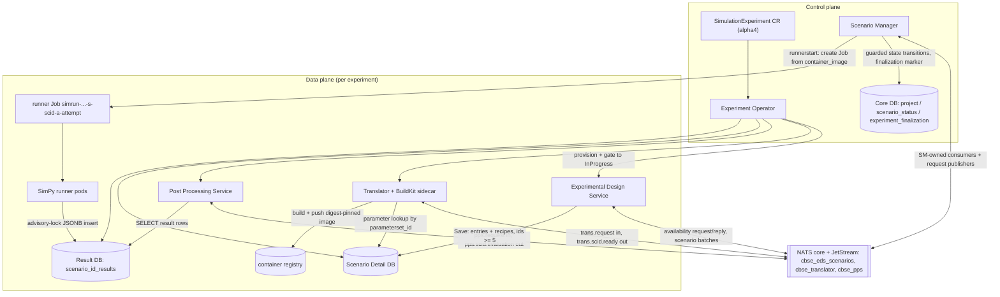

# CBSE Architecture

CBSE is a Kubernetes operator pattern for running simulation experiments. The user applies one `SimulationExperiment` custom resource (API group `experiment.cbse.terministic.de`, served version `alpha4`, storage version, namespaced, short name `simexp`); the [Experiment Operator](modules/experiment-operator.md) materializes it into per-experiment workloads — two PostgreSQL databases (Scenario Detail DB, Result DB), a two-container Translator Deployment (translator + rootless BuildKit sidecar), a Post Processing Service Deployment, an Experimental Design Service Deployment (`<exp>-eds`), and the runner ServiceAccount `simrunner-<uid12>` — then parks the experiment in `InProgress` once both database endpoints answer an availability probe and each component Deployment has a ready replica. All per-experiment component configuration is operator-injected (downward-API identity envs `SIMULATIONPROJECTNAMESPACE` / `SIMULATIONPROJECTNAME` / `SIMULATIONEXPERIMENTUID`, subject and consumer names derived from the experiment's namespace, name, and UID, and mounted connection Secrets); none of the components holds Kubernetes credentials.

The data plane runs per experiment through a shared NATS server and two databases. The [Scenario Manager](modules/scenario-manager.md) (a cluster-wide singleton on the shared stack) owns scenario state in the stack's Core PostgreSQL DB (the `scenarios` database; per-experiment state lives in `project` / `scenario_status` / `experiment_finalization` rows keyed by namespace+project) and coordinates everything over NATS: Core NATS request/reply for the [EDS](modules/experimental-design-service.md) availability handshake, and three JetStream streams — `cbse_eds_scenarios`, `cbse_translator`, `cbse_pps` — for scenario batches, translation requests/ready messages, and evaluation requests/verdicts. Subjects are fixed per experiment as `cbse.<namespace>.<project>.<domain>.<event>`; the namespace token makes the same experiment name routable in two namespaces without collision. The [Translator](modules/translator.md) consumes translation requests, looks up scenario parameters in the [Scenario Detail DB](modules/scenario-databases.md), builds and pushes a generated runner image with BuildKit, and reports a digest reference; the Scenario Manager then creates a deterministic runner Job (`simrun-<uid12>-s<scenario-id>-a<attempt>[-r<round>]`) whose SimPy pods insert JSONB result rows into the [Result DB](modules/scenario-databases.md) (per-scenario tables `scenario_<id>_results`, schema is the runner's concern); the [Post Processing Service](modules/post-processing-service.md) reads those rows and answers a precision verdict that the Scenario Manager applies as a guarded state transition. PostgreSQL is the authority for workflow ownership; NATS messages and Kubernetes Jobs are effects of that state, and every transition is a guarded `UPDATE ... WHERE state = <expected>` so redelivery and restarts cannot overwrite newer work.

The control plane converges on the CR status subresource with disjoint field ownership: the operator writes `status.phase`, `status.message`, and `status.metrics`; the Scenario Manager writes only `status.scenarioManagerVerdict` (absorbing, `Finished` or `Failed`) plus one diagnostic message (`awaiting EDS finalization`) while every scenario is terminal but the EDS finalization batch is outstanding. The operator derives the terminal phase from the verdict alone. The experiment's scenario lifecycle therefore closes explicitly: the EDS publishes a finalization batch (`scenarios: []`, `final: true`), the Scenario Manager durably marks the project finalized, and `Finished` requires all scenarios terminally verified *and* the finalization marker.

## Components

- [Experiment Operator](modules/experiment-operator.md) — reconciles the CR into per-experiment Deployments, Services, Secrets, and the runner ServiceAccount; owns `status.phase` / `status.message` / `status.metrics`.
- [Scenario Manager](modules/scenario-manager.md) — cluster-wide singleton; Core DB schema and guarded state machine, NATS streams/consumers, selection, runner-start, observation, evaluation-publication, verdict, and aggregate passes.
- [Experimental Design Service](modules/experimental-design-service.md) — per-experiment design UI/API; writes the Detail DB design-layer schema, publishes scenario batches and the finalization batch.
- [Translator](modules/translator.md) — per-experiment consumer of translation requests; generation, BuildKit build+push, ready publication; ships the generated runner's embedded Python modules (`runnermod/`).
- [Post Processing Service](modules/post-processing-service.md) — per-experiment consumer of evaluation requests; reads the Result DB and publishes `met` / `additional_runners` / `stop_unmet` verdicts.
- [Scenario Detail DB](modules/scenario-databases.md) — per-experiment PostgreSQL holding the six-object design-layer schema (the four entry tables `arrival_rate`, `service_rate`, `run_duration`, `seed_policy`, the `recipes` locator table, and the `simulation_parameters` view); the EDS is its only writer, the Translator its only generation-time reader.
- Result DB — per-experiment PostgreSQL whose only schema objects are the runner-created tables `scenario_<scenario-id>_results`; the generated runners are its only writers, the PPS its only reader (contract: [modules/communication-interfaces.md#result-database](modules/communication-interfaces.md#result-database)).
- [Generated simulation runner](modules/simulation-runner.md) — a per-scenario-image SimPy single-server queue built by the Translator from the embedded `runnermod/` modules; each pod inserts one JSONB result record into the Result DB.

Interface reference (every NATS subject, payload, and database contract): [modules/communication-interfaces.md](modules/communication-interfaces.md). End-to-end sequence diagrams: [diagrams/sequences.md](diagrams/sequences.md).

## System overview

Node notes: `NATS` is one server hosting Core NATS (request/reply) and the three JetStream streams. `CDB` is the shared stack's Core PostgreSQL (`scenarios` database; experiment state is per-project rows), reached by the SM through `SCENARIO_MANAGER_CORE_DB_DSN`; `DDB` and `RDB` are the operator-provisioned per-experiment databases. `uid12` in the Job name is the first 12 lowercase hex characters of the experiment UID with hyphens removed (shared with the per-experiment consumer names `translator-<uid12>` / `pps-<uid12>`); `scid`/`attempt` are the Core DB scenario id and translation attempt, `-r<round>` appears from runner round 2 on ([subject grammar](https://github.com/D4NS3U/cbse/blob/c993397/scenario-manager/internal/subject/subject.go), [runner Job name](https://github.com/D4NS3U/cbse/blob/c993397/scenario-manager/internal/jobadapter/jobadapter.go#L360)).

## Data-flow walkthrough

1. **Provisioning.** The operator validates the spec (digest-pinned images, `registryAuthSecretRef.name` must equal `cbse-registry-auth`), creates the database connection Secrets (`<exp>-detaildb-sct` / `<exp>-resultdb-sct`, five fields `host`/`port`/`dbname`/`user`/`password`), the database Deployments+Services (image form) or records the host form, the Translator Deployment with its ConfigMap, the PPS and EDS Deployments, and the runner ServiceAccount `simrunner-<uid12>`. Phase moves `Pending → Provisioning → InProgress` only when both DBs answer a probe and translator/PPS/EDS each have `ReadyReplicas >= 1`; a component that never becomes ready becomes a bounded, diagnosed `Error` through the readiness watchdog ([CRD spec](https://github.com/D4NS3U/cbse/blob/c993397/experiment-operator/api/alpha4/simulationexperiment_types.go), [provisioning contract](https://github.com/D4NS3U/cbse/blob/c993397/docs/COMPONENT_DESIGN_GOALS.md)).
2. **Design intake.** The experimenter (or e2e harness) drives the EDS JSON API: `POST /api/entries`, `POST /api/recipes`, `POST /api/scenarios` keep the design in memory; `POST /api/save` upserts entries and recipe locator rows into `DDB` in one transaction (EDS-assigned ids ≥ 5, baseline ids 1–4 read-only); `POST /api/start` runs the pre-flight (`parameterset_id` must resolve in the `simulation_parameters` view), the availability handshake on `cbse.<ns>.<proj>.eds.scenarios.available` (declaring `experiment_type: "standard"`), and publishes the batch to the SM-returned subject `cbse.<ns>.<proj>.eds.scenarios` ([EDS server](https://github.com/D4NS3U/cbse/blob/c993397/component-templates/experimental-design-service/internal/server/server.go), [wire](https://github.com/D4NS3U/cbse/blob/c993397/component-templates/experimental-design-service/internal/wire/wire.go)). The SM's `EDSBatchConsumer` validates subject/payload/identity, applies the lifecycle gate (`Admit` only for live, non-deleting, `InProgress`), and inserts one `scenario_status` row per scenario in `Created` via `persistence.InsertScenarioBatch` in one transaction, registering the `project` row as a side effect ([consumer](https://github.com/D4NS3U/cbse/blob/c993397/scenario-manager/internal/nats/edsbatch.go), [gate](https://github.com/D4NS3U/cbse/blob/c993397/scenario-manager/internal/lifecycle/gate.go)).
3. **Translation.** The SM's serial selection loop (5 s delay, recovery-first) picks the lowest `Created` id, claims it `Created → Scheduled` (incrementing `translation_attempts`), re-gates on the live CR, marks publish started, and publishes `{id, translation_attempt, recipe_info, confidence_metric}` on `cbse.<ns>.<proj>.trans.request` (stream `cbse_translator`), confirming the PubAck before marking the request published ([selection loop](https://github.com/D4NS3U/cbse/blob/c993397/scenario-manager/internal/selection/selection.go)). The Translator (durable `translator-<uid12>`, `MaxAckPending 1`) strictly decodes, resolves `parameterset_id` against the Detail DB's `simulation_parameters` view, writes a Docker build context (baked `scenario.json`, `resultdb.json`, embedded `runnermod`), builds+pushes via BuildKit, verifies the digest and identity annotations against `spec.translator.repository`, publishes `{translation_attempt, container_image}` on `cbse.<ns>.<proj>.trans.<id>.ready`, and only then ACKs the request ([orchestrator](https://github.com/D4NS3U/cbse/blob/c993397/component-templates/translator/internal/translator/translator.go), [lookup](https://github.com/D4NS3U/cbse/blob/c993397/component-templates/translator/internal/detaildb/detaildb.go), [generator](https://github.com/D4NS3U/cbse/blob/c993397/component-templates/translator/internal/generator/generator.go)).
4. **Ready handoff.** The SM's `TranslatorReadyConsumer` validates the strict two-field payload, then the ready workflow checks the digest and that its repository exactly matches the live `spec.translator.repository` (a foreign repository is permanent poison), and applies the guarded `Scheduled → StartingRunners` transition storing the digest in `container_image`; an empty image consumes the attempt (back to `Created` below the attempt limit, `Failed` at the limit) ([ready workflow](https://github.com/D4NS3U/cbse/blob/c993397/scenario-manager/internal/ready/ready.go)). The runnerstart scheduler then creates (or confirms) the deterministic runner Job from the accepted digest under `simrunner-<uid12>`, moving the row `StartingRunners → InProcessing` ([runnerstart](https://github.com/D4NS3U/cbse/blob/c993397/scenario-manager/internal/runnerstart/scheduler.go), [Job adapter](https://github.com/D4NS3U/cbse/blob/c993397/scenario-manager/internal/jobadapter/jobadapter.go)).
5. **Simulation.** Each runner pod reads its baked `scenario.json`/`resultdb.json`, derives a 63-bit seed from `sha256("<seed_policy>:<hostname>")`, runs the SimPy single-server queue for `run_duration`, and inserts one JSONB record (`parameterset_id`, rates, `seed_policy`, `effective_seed`, `completed_customers`, `mean_wait_time`) into `scenario_<id>_results` — creating the table under `pg_advisory_xact_lock(0, <scenario-id>)` in a single transaction with a 30 s statement timeout ([entrypoint](https://github.com/D4NS3U/cbse/blob/c993397/component-templates/translator/internal/generator/runnermod/main.py), [resultdb client](https://github.com/D4NS3U/cbse/blob/c993397/component-templates/translator/internal/generator/runnermod/resultdb.py), [model](https://github.com/D4NS3U/cbse/blob/c993397/component-templates/translator/internal/generator/runnermod/model.py)). When the Job completes, the SM's observation scheduler records the computed replication count and applies the guarded `InProcessing → PostProcessing`; on Job failure/collision it applies `InProcessing → Failed` ([observation](https://github.com/D4NS3U/cbse/blob/c993397/scenario-manager/internal/observation/worker.go)).
6. **Evaluation.** The SM's evaluation-publication loop claims the `PostProcessing` scenario, ensures the per-experiment PPS consumer `pps-<uid12>` exists, and publishes `{experiment_uid, namespace, project, scenario_id, runner_round, number_of_reps, confidence_metric}` on `cbse.<ns>.<proj>.pps.request` (stream `cbse_pps`) ([evaluationpub](https://github.com/D4NS3U/cbse/blob/c993397/scenario-manager/internal/evaluationpub/evaluationpub.go)). The PPS SELECTs the scenario's result rows, extracts the finite `mean_wait_time` observations, evaluates the 95 %-confidence-interval half-width `h = t(0.975, n-1)·s/√n` against `confidence_metric` (ε), and publishes the 13-field verdict on `cbse.<ns>.<proj>.pps.<id>.evaluation` ([processor](https://github.com/D4NS3U/cbse/blob/c993397/component-templates/post-processing-service/internal/messaging/processor.go), [evaluation math](https://github.com/D4NS3U/cbse/blob/c993397/component-templates/post-processing-service/internal/evaluation/evaluation.go), [Result DB read](https://github.com/D4NS3U/cbse/blob/c993397/component-templates/post-processing-service/internal/resultdb/resultdb.go)).
7. **Verdict.** The SM's `PPSEvaluationConsumer` applies the guarded transition for the current round: `met → Finished`, `additional_runners → StartingRunners` (new round, `round_reps = additional_runners`), `stop_unmet → Failed` ([verdict workflow](https://github.com/D4NS3U/cbse/blob/c993397/scenario-manager/internal/verdict/verdict.go)). The aggregate pass (5 s tick) then counts scenario states: any `Failed` fails the experiment fail-fast; `Finished` requires the durable finalization marker plus all scenarios terminal — including the explicit zero-scenario Finish. The verdict is written once (absorbing) to `status.scenarioManagerVerdict`, and the operator's terminal derivation moves `phase` to `Finished` ("All scenarios finished (scenarioManagerVerdict report)") or `Failed` ("A scenario failed (scenarioManagerVerdict report)") and parks it stickily ([aggregate](https://github.com/D4NS3U/cbse/blob/c993397/scenario-manager/internal/aggregate/scheduler.go), [terminal derivation](https://github.com/D4NS3U/cbse/blob/c993397/experiment-operator/internal/controller/simulationexperiment_alpha4_controller.go#L297)).
8. **Finalization.** The EDS's `POST /api/finish` re-enters the same handshake skeleton (`scenario_count: 0`) and publishes `{scenarios: [], final: true}` to the SM-provided batch subject; the SM inserts (nothing) and writes the `experiment_finalization` marker row, idempotently. Non-final batches arriving after finalization are rejected with ack `status: "error"` and the pinned reason `experiment finalized; no further batches accepted`; finalization is irrevocable ([finalization consumer path](https://github.com/D4NS3U/cbse/blob/c993397/scenario-manager/internal/nats/edsbatch.go), [marker](https://github.com/D4NS3U/cbse/blob/c993397/scenario-manager/internal/persistence/finalization.go), [ruled protocol](https://github.com/D4NS3U/cbse/blob/c993397/devlog/changes/experimental-design-service/FEATURE.md)).
9. **Deletion.** On CR deletion the SM's finalizer cleanup (fixed cadence) deletes ownership-verified runner Jobs, deletes the per-experiment `translator-<uid12>` and `pps-<uid12>` consumers after ownership verification (four metadata entries including the full UID), purges the experiment's `eds.scenarios`, `trans.request`, `trans.*.ready`, `pps.request`, and `pps.*.evaluation` subjects from the three streams, deletes the `project` row (cascading `scenario_status` and the finalization marker), and only then removes the finalizer ([cleanup order](https://github.com/D4NS3U/cbse/blob/c993397/scenario-manager/internal/lifecycle/cleanup.go), [ownership verification](https://github.com/D4NS3U/cbse/blob/c993397/scenario-manager/internal/nats/consumers.go)).

Full subject-by-subject reference with payloads, reply semantics, and database ownership: [modules/communication-interfaces.md](modules/communication-interfaces.md).
