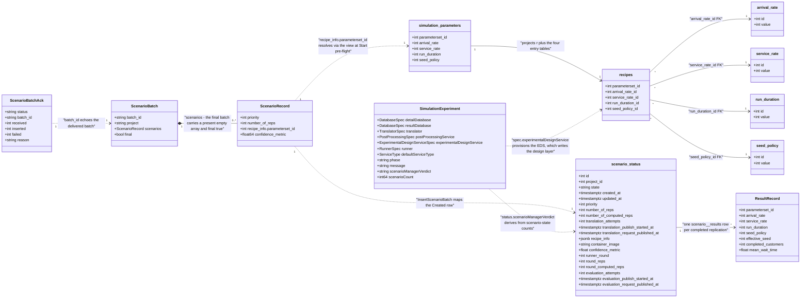

# Domain Class Diagram

One class diagram over the alpha4 domain types the EDS/PPS docs and the
Scenario Manager share: the Detail DB design-layer objects, the
[SimulationExperiment](https://github.com/D4NS3U/cbse/blob/c993397/experiment-operator/api/alpha4/simulationexperiment_types.go)
CR, the SBO wire types the EDS publishes
([`scenario-manager/internal/nats/edsbatch.go`](https://github.com/D4NS3U/cbse/blob/c993397/scenario-manager/internal/nats/edsbatch.go)
consumes `communication.ScenarioBatch` / `communication.ScenarioBatchAck`),
the Core DB `scenario_status` row, and the runner's JSONB result row.

Conventions: database classes use column names, the SBO wire classes use their
JSON field names (byte-pinned on the wire), and `SimulationExperiment` uses
Go field names — fields 1–7 are `spec.*` (`detailDatabase` through
`defaultServiceType`), fields 8–11 are `status.*`. `simulation_parameters` is
the Detail DB **view** (one of the canonical six self-provisioned objects); it
appears as a class because it is a persisted object with a fixed five-column
projection that both the EDS pre-flight and the Translator query.
[modules/experimental-design-service.md](../modules/experimental-design-service.md)
documents the EDS side;
[modules/post-processing-service.md](../modules/post-processing-service.md)
documents the PPS side.

## The classes

### Detail DB design layer

Pinned in
[`component-templates/scenario-detail-database/10-simulation-parameters.sql`](https://github.com/D4NS3U/cbse/blob/c993397/component-templates/scenario-detail-database/10-simulation-parameters.sql)
(the reference seeded image) and restated verbatim as `canonicalDDL` in
[`component-templates/experimental-design-service/internal/recipestore/recipestore.go`](https://github.com/D4NS3U/cbse/blob/c993397/component-templates/experimental-design-service/internal/recipestore/recipestore.go).

| Class | Definition |
|---|---|
| `arrival_rate` | `id INTEGER PRIMARY KEY CHECK (id > 0)`, `value INTEGER NOT NULL CHECK (value > 0)` |
| `service_rate` | same shape as `arrival_rate` |
| `run_duration` | same shape as `arrival_rate` |
| `seed_policy` | `id INTEGER PRIMARY KEY CHECK (id > 0)`, `value INTEGER NOT NULL CHECK (value >= 0)` (the only entry table allowing 0) |
| `recipes` | `parameterset_id INTEGER PRIMARY KEY CHECK (parameterset_id > 0)` plus `arrival_rate_id`/`service_rate_id`/`run_duration_id`/`seed_policy_id` `INTEGER NOT NULL REFERENCES public.<table>(id)` |
| `simulation_parameters` | view: `SELECT r.parameterset_id, a.value AS arrival_rate, s.value AS service_rate, d.value AS run_duration, p.value AS seed_policy FROM public.recipes r JOIN ... (all four entry tables)` |

Baseline ids 1–4 are read-only in all five tables (seeded with the values
listed in the EDS doc); the EDS id-space starts at 5.

### SimulationExperiment CR

From
[`experiment-operator/api/alpha4/simulationexperiment_types.go`](https://github.com/D4NS3U/cbse/blob/c993397/experiment-operator/api/alpha4/simulationexperiment_types.go):
`SimulationExperimentSpec` requires `detailDatabase` and `resultDatabase`
(`DatabaseSpec`, immutable after creation via CEL), `translator`
(`TranslatorSpec`), `postProcessingService` (`PostProcessingSpec`),
`experimentalDesignService` (`ExperimentalDesignServiceSpec` — `design`,
`image`, `command`, `args`, `serviceType`, `nodePort`, `port`), and optionally
`runner` (`RunnerSpec`, immutable `jobTemplate`) and
`defaultServiceType` (default `ClusterIP`). `SimulationExperimentStatus`
carries `phase` (`Pending|Provisioning|InProgress|Completed|Failed|Error|Finished`),
`message`, `metrics.scenarioCount`, and `scenarioManagerVerdict`
(`Finished|Failed`) — written by the Scenario Manager, consumed by the
operator as the sole input to terminal-phase derivation.

### SBO wire types

From [`scenario-manager/internal/communication/communication.go`](https://github.com/D4NS3U/cbse/blob/c993397/scenario-manager/internal/communication/communication.go)
(the EDS's own byte-identical copies live in
[`component-templates/experimental-design-service/internal/wire/wire.go`](https://github.com/D4NS3U/cbse/blob/c993397/component-templates/experimental-design-service/internal/wire/wire.go)):

| Class | JSON fields |
|---|---|
| `ScenarioBatch` | `batch_id`, `project`, `scenarios` (`[]ScenarioRecord`), `final` (omitempty; absent on non-final batches, `true` only on the finalization batch, which also carries the present empty `scenarios` array). The SM-side struct additionally carries non-JSON `ProjectNamespace`/`ProjectName` (`json:"-"`) populated from the batch subject |
| `ScenarioRecord` | `priority`, `number_of_reps` (1..100000), `recipe_info` (the `{"parameterset_id": N}` locator; `json.RawMessage` SM-side, a typed `RecipeInfo` EDS-side), `confidence_metric` |
| `ScenarioBatchAck` | `status` (`inserted`/`poison`/`error`), `batch_id`, `received`, `inserted`, `failed`, `reason` |

### scenario_status row

The per-scenario Core DB row, DDL in
[`scenario-manager/internal/persistence/schema.go`](https://github.com/D4NS3U/cbse/blob/c993397/scenario-manager/internal/persistence/schema.go).
All twenty columns appear above: the lifecycle `state` (constants
`Created|Scheduled|StartingRunners|InProcessing|PostProcessing|Finished|Failed`
in `internal/persistence/db.go`), the EDS-supplied
`priority`/`number_of_reps`/`recipe_info`/`confidence_metric`, the round
bookkeeping (`runner_round`, `round_reps`, `round_computed_reps`,
`number_of_computed_reps`), the translation attempt/publication-guard columns
(`translation_attempts`, `translation_publish_started_at`,
`translation_request_published_at`, `container_image`), and the evaluation
attempt/publication-guard columns (`evaluation_attempts`,
`evaluation_publish_started_at`, `evaluation_request_published_at`).

### Result row

The runner's JSONB record built by `build_result` in
[`component-templates/translator/internal/generator/runnermod/result.py`](https://github.com/D4NS3U/cbse/blob/c993397/component-templates/translator/internal/generator/runnermod/result.py)
(`RESULT_FIELDS`): the five baked scenario parameters
(`parameterset_id`, `arrival_rate`, `service_rate`, `run_duration`,
`seed_policy`), `effective_seed`, `completed_customers`, and
`mean_wait_time` — the reference KPI the PPS extracts from
`public.scenario_<id>_results`. `scenario_id` is excluded from the record (it
is the table key).

## The relationships, as used in the code

| Edge | Code basis |
|---|---|
| `recipes → <entry table>` (×4) | the four `REFERENCES public.<table>(id)` constraints in the DDL |
| `simulation_parameters → recipes` | the view's `FROM public.recipes r JOIN` over all four entry tables; one view row per `recipes` row |
| `ScenarioBatch ↔ ScenarioRecord` | `Scenarios []ScenarioRecord`; the finalization batch is the present empty array with `final: true` (golden-pinned in `wire_test.go`) |
| `ScenarioBatchAck → ScenarioBatch` | the ack's `batch_id` echoes the delivered batch; the EDS's `publisher.SetAck` refuses a mismatched `batch_id` as poison; the SM delivers the ack on the delivery's reply subject (`respondBatchAck` in `edsbatch.go`) |
| `ScenarioRecord → simulation_parameters` | the EDS Start pre-flight (`Store.Resolve`: `SELECT parameterset_id FROM public.simulation_parameters WHERE parameterset_id = ANY($1)`) and the SM's `RecipeError` path for unresolved ids |
| `ScenarioRecord → scenario_status` | `InsertScenarioBatch` (`internal/persistence/eds_intake.go`) maps each record to an INSERT of `(project_id, state=Created, priority, number_of_reps, round_reps=number_of_reps, recipe_info, confidence_metric)` in one multi-row statement |
| `scenario_status → ResultRecord` | one `public.scenario_<id>_results` table per scenario; one JSONB row per completed replication; the PPS reads it with `SELECT result FROM public.scenario_<id>_results` |
| `SimulationExperiment → scenario_status` | the SM aggregates `ScenarioStateCountsByProject` over `scenario_status` and writes the result to `status.scenarioManagerVerdict`, which the operator uses for terminal-phase derivation |
| `SimulationExperiment → recipes` | `spec.experimentalDesignService` provisions the EDS deployment; the EDS self-provisions (ruled R3) and writes the entry tables and `recipes` |
