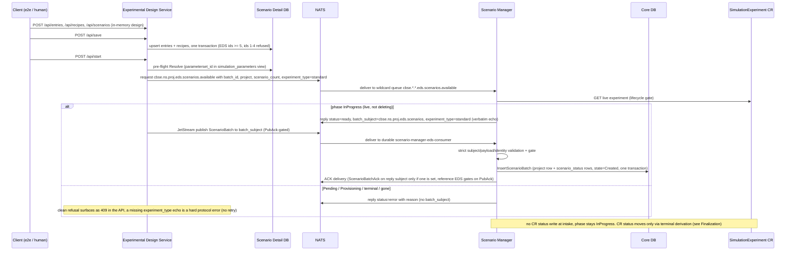
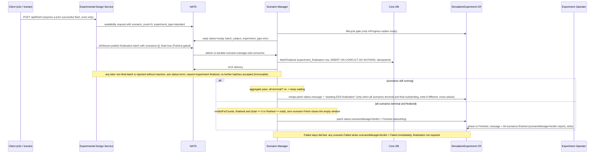

# End-to-End Sequence Diagrams

Sequence diagrams of the four end-to-end flows at `alpha4` — provisioning, design, execution rounds, and finalization — composing one experiment lifecycle. Participants are the real components from [architecture.md](../architecture.md); every subject and payload matches [modules/communication-interfaces.md](../modules/communication-interfaces.md). JetStream messages are durable (WorkQueue streams); Core NATS availability is plain request/reply.

## 1. Provisioning — the Experiment Operator builds the component set

```mermaid
sequenceDiagram
    participant Client as Client (kubectl / harness)
    participant OP as Experiment Operator
    participant DDB as Scenario Detail DB
    participant RDB as Result DB
    participant TR as Translator
    participant PPS as Post Processing Service
    participant EDS as Experimental Design Service
    participant CR as SimulationExperiment CR

    Client->>CR: apply SimulationExperiment (alpha4 spec)
    OP->>OP: validateExperiment (failure moves phase to Error before any component is created)
    OP->>CR: patch phase Pending to Provisioning ("Provisioning components")
    OP->>DDB: Secret name-detaildb-sct; image form adds Deployment name-detaildb + Service name-detaildb-svc
    OP->>RDB: Secret name-resultdb-sct; image form adds Deployment name-resultdb + Service name-resultdb-svc
    OP->>TR: ConfigMap name-translator-cfg; Deployment name-translator (runtime + rootless BuildKit sidecar); Service name-translator-svc
    OP->>PPS: Deployment name-pps + Service name-pps-svc
    OP->>EDS: Deployment name-eds + Service name-eds-svc
    Note over OP: runner ServiceAccount simrunner-uid12 (no permissions, no token automount) for the Scenario Manager's runner Jobs
    loop readiness gates (5 s requeue; the watchdog counts a retry every ~60 s, the third counted failure moves phase to Error)
        OP->>DDB: SELECT 1 availability probe
        OP->>RDB: SELECT 1 availability probe
        OP->>TR: ready replicas >= 1
        OP->>PPS: ready replicas >= 1
        EDS->>DDB: EnsureSchema at pod startup - the R3 self-provision (fail-fast restarts until the DB answers, then the six-object seed)
        OP->>EDS: ready replicas >= 1
    end
    OP->>CR: patch phase InProgress, message "All components provisioned and ready"
```

Source anchors: [startProvisioning and provisionComponents](https://github.com/D4NS3U/cbse/blob/c993397/experiment-operator/internal/controller/simulationexperiment_alpha4_controller.go), [checkReadiness gates](https://github.com/D4NS3U/cbse/blob/c993397/experiment-operator/internal/controller/simulationexperiment_alpha4_controller.go#L202), [bounded-retry watchdog](https://github.com/D4NS3U/cbse/blob/c993397/experiment-operator/internal/controller/readiness_watchdog.go), [DB probe contract](https://github.com/D4NS3U/cbse/blob/c993397/experiment-operator/internal/dbendpoint), [EDS startup self-provision](https://github.com/D4NS3U/cbse/blob/c993397/component-templates/experimental-design-service/cmd/experimental-design-service/main.go#L70).

## 2. Design flow — EDS API to Core DB rows



Source anchors: [EDS server flow](https://github.com/D4NS3U/cbse/blob/c993397/component-templates/experimental-design-service/internal/server/server.go), [availability responder](https://github.com/D4NS3U/cbse/blob/c993397/scenario-manager/internal/nats/availability.go), [batch consumer](https://github.com/D4NS3U/cbse/blob/c993397/scenario-manager/internal/nats/edsbatch.go), [intake](https://github.com/D4NS3U/cbse/blob/c993397/scenario-manager/internal/persistence/eds_intake.go).

## 3. Execution round — SM to Translator to runner to PPS verdict

```mermaid
sequenceDiagram
    participant SM as Scenario Manager
    participant NATS as NATS (JetStream)
    participant TR as Translator
    participant DDB as Scenario Detail DB
    participant REG as Container registry
    participant RUN as Runner pod (simrun-...-s-id-a-attempt)
    participant RDB as Result DB
    participant PPS as Post Processing Service
    participant CoreDB as Core DB
    participant CR as SimulationExperiment CR
    participant OP as Experiment Operator

    Note over SM: selection loop (5 s, recovery-first)
    SM->>CoreDB: ClaimScenarioForTranslation (Created to Scheduled, translation_attempts + 1)
    SM->>NATS: publish id, translation_attempt, recipe_info, confidence_metric on cbse.ns.proj.trans.request
    SM->>CoreDB: MarkScenarioTranslationRequestPublished (on PubAck)
    NATS->>TR: deliver to durable translator-uid12 (MaxAckPending 1)
    TR->>DDB: SELECT arrival_rate, service_rate, run_duration, seed_policy FROM public.simulation_parameters WHERE parameterset_id = $1
    TR->>TR: generate build context (baked scenario.json, resultdb.json, embedded runnermod)
    TR->>REG: BuildKit build + push, verify digest and identity annotations
    TR->>NATS: publish translation_attempt, container_image on cbse.ns.proj.trans.id.ready (PubAck)
    TR->>NATS: ACK request (only after ready is durably accepted)
    NATS->>SM: deliver to durable scenario-manager-translator-ready
    SM->>SM: validate digest + repository equals spec.translator.repository
    SM->>CoreDB: MarkScenarioStartingRunners (Scheduled to StartingRunners, store container_image)
    Note over SM: runnerstart scheduler
    SM->>RUN: create Job simrun-uid12-s-id-a-attempt (image = container_image, SA simrunner-uid12)
    SM->>CoreDB: StartingRunners to InProcessing
    RUN->>RDB: one transaction: pg_advisory_xact_lock(0, id), CREATE TABLE IF NOT EXISTS scenario_id_results, INSERT JSONB result
    Note over SM: observation scheduler (5 s): Job Complete records number_of_computed_reps
    SM->>CoreDB: InProcessing to PostProcessing
    Note over SM: evaluationpub loop
    SM->>NATS: publish experiment_uid, namespace, project, scenario_id, runner_round, number_of_reps, confidence_metric on cbse.ns.proj.pps.request (after ensuring pps-uid12)
    NATS->>PPS: deliver to durable pps-uid12 (MaxAckPending 1)
    PPS->>RDB: SELECT result FROM scenario_id_results (extract finite mean_wait_time)
    PPS->>PPS: 95% CI half-width h = t(0.975, n-1) * s / sqrt(n) vs confidence_metric epsilon
    PPS->>NATS: publish verdict on cbse.ns.proj.pps.id.evaluation (PubAck)
    PPS->>NATS: ACK request
    NATS->>SM: deliver to durable scenario-manager-pps-evaluation
    alt verdict = met
        SM->>CoreDB: MarkScenarioFinished (PostProcessing to Finished)
    else verdict = additional_runners
        SM->>CoreDB: ClaimScenarioForEvaluationRound (PostProcessing to StartingRunners, runner_round + 1, round_reps = additional_runners, loop resumes at runnerstart)
    else verdict = stop_unmet
        SM->>CoreDB: MarkScenarioFailedFrom (PostProcessing to Failed, max replications reached)
    end
    Note over SM: aggregate pass (5 s tick)
    SM->>CR: patch status.scenarioManagerVerdict = Finished or Failed (absorbing, write-if-absent)
    OP->>CR: terminal derivation: phase to Finished or Failed, sticky
```



Source anchors: [selection loop](https://github.com/D4NS3U/cbse/blob/c993397/scenario-manager/internal/selection/selection.go), [Translator orchestrator](https://github.com/D4NS3U/cbse/blob/c993397/component-templates/translator/internal/translator/translator.go), [Detail DB lookup](https://github.com/D4NS3U/cbse/blob/c993397/component-templates/translator/internal/detaildb/detaildb.go), [ready workflow](https://github.com/D4NS3U/cbse/blob/c993397/scenario-manager/internal/ready/ready.go), [runnerstart](https://github.com/D4NS3U/cbse/blob/c993397/scenario-manager/internal/runnerstart/scheduler.go), [runner entrypoint](https://github.com/D4NS3U/cbse/blob/c993397/component-templates/translator/internal/generator/runnermod/main.py), [evaluationpub](https://github.com/D4NS3U/cbse/blob/c993397/scenario-manager/internal/evaluationpub/evaluationpub.go), [PPS processor](https://github.com/D4NS3U/cbse/blob/c993397/component-templates/post-processing-service/internal/messaging/processor.go), [verdict workflow](https://github.com/D4NS3U/cbse/blob/c993397/scenario-manager/internal/verdict/verdict.go), [aggregate pass](https://github.com/D4NS3U/cbse/blob/c993397/scenario-manager/internal/aggregate/scheduler.go).

## 4. Finalization — EDS Finish to CR Finished



Source anchors: [EDS Finish action](https://github.com/D4NS3U/cbse/blob/c993397/component-templates/experimental-design-service/internal/server/server.go#L677), [finalization marker](https://github.com/D4NS3U/cbse/blob/c993397/scenario-manager/internal/persistence/finalization.go), [verdict rule](https://github.com/D4NS3U/cbse/blob/c993397/scenario-manager/internal/aggregate/scheduler.go#L265), [ruled protocol](https://github.com/D4NS3U/cbse/blob/c993397/devlog/changes/experimental-design-service/FEATURE.md), [operator terminal derivation](https://github.com/D4NS3U/cbse/blob/c993397/experiment-operator/internal/controller/simulationexperiment_alpha4_controller.go#L297).
