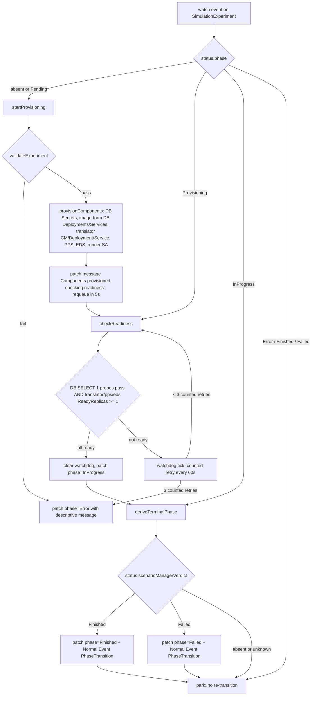

# Experiment Operator

Go module at `experiment-operator/` (module path `github.com/D4NS3U/cbse/experiment-operator`, see [PROJECT](https://github.com/D4NS3U/cbse/blob/c993397/experiment-operator/PROJECT)). A Kubernetes controller-runtime manager that reconciles `SimulationExperiment` custom resources of group `experiment.cbse.terministic.de`, version `alpha4`, into the per-experiment component set: database connection Secrets, image-form database Deployments/Services, the two-container Translator Deployment with its ConfigMap and Service, the single-container PPS and EDS Deployments with their Services, and the deterministic runner ServiceAccount. It owns the provisioning phases of the status subresource and derives the terminal phases `Finished`/`Failed` from the Scenario Manager's `scenarioManagerVerdict` field. It never creates runner Jobs, never writes `scenarioManagerVerdict`, and does not provision the shared stack components (scenario-manager, NATS, core DB) — those are deployed out of band (see [Shared stack components](#shared-stack-components)).

`alpha4` is the only served and stored API version. `alpha2` and `alpha3` are retired: they are not registered in the manager scheme, not served by the CRD, and have no conversion webhook ([cmd/main.go](https://github.com/D4NS3U/cbse/blob/c993397/experiment-operator/cmd/main.go), [api/alpha4/groupversion_info.go](https://github.com/D4NS3U/cbse/blob/c993397/experiment-operator/api/alpha4/groupversion_info.go)).

## Module layout

| Path | Contents |
|---|---|
| `api/alpha4/` | `SimulationExperiment` + `SimulationExperimentList` types, `GroupVersion` registration, generated deepcopy |
| `cmd/main.go` | controller-manager entry point: scheme, flags, metrics/webhook TLS, health probes, leader election |
| `internal/controller/` | `Alpha4SimulationExperimentReconciler` ([simulationexperiment_alpha4_controller.go](https://github.com/D4NS3U/cbse/blob/c993397/experiment-operator/internal/controller/simulationexperiment_alpha4_controller.go)), RBAC markers, NATS/env/label helpers ([workload.go](https://github.com/D4NS3U/cbse/blob/c993397/experiment-operator/internal/controller/workload.go)), readiness watchdog ([readiness_watchdog.go](https://github.com/D4NS3U/cbse/blob/c993397/experiment-operator/internal/controller/readiness_watchdog.go)), image/repository validation ([images.go](https://github.com/D4NS3U/cbse/blob/c993397/experiment-operator/internal/controller/images.go)), registry-auth Secret validation ([registryauth.go](https://github.com/D4NS3U/cbse/blob/c993397/experiment-operator/internal/controller/registryauth.go)), builder resource policy ([builderresources.go](https://github.com/D4NS3U/cbse/blob/c993397/experiment-operator/internal/controller/builderresources.go)), pgx probe connector ([dbprobe_pgx.go](https://github.com/D4NS3U/cbse/blob/c993397/experiment-operator/internal/controller/dbprobe_pgx.go)) |
| `internal/controller/alpha4/` | envtest suite: runs a local kube-apiserver/etcd (`TestMain` in [alpha4_controller_test.go](https://github.com/D4NS3U/cbse/blob/c993397/experiment-operator/internal/controller/alpha4/alpha4_controller_test.go)) against the checked-in CRDs, covering happy-path provisioning, probe failures, registry Secret validation, builder-resource policy, job-template rejection, CEL-immutable update rejection, and PPS idempotency |
| `internal/dbendpoint/` | shared database endpoint contract: host classification, DNS resolution, single-connection `SELECT 1` probe ([dbendpoint.go](https://github.com/D4NS3U/cbse/blob/c993397/experiment-operator/internal/dbendpoint/dbendpoint.go)) |
| `internal/jobtemplate/` | `spec.runner.jobTemplate` policy: allow-list validation and normalization without touching a cluster ([validator.go](https://github.com/D4NS3U/cbse/blob/c993397/experiment-operator/internal/jobtemplate/validator.go), [containers.go](https://github.com/D4NS3U/cbse/blob/c993397/experiment-operator/internal/jobtemplate/containers.go), [volumes.go](https://github.com/D4NS3U/cbse/blob/c993397/experiment-operator/internal/jobtemplate/volumes.go), [runtime.go](https://github.com/D4NS3U/cbse/blob/c993397/experiment-operator/internal/jobtemplate/runtime.go), [scheduling.go](https://github.com/D4NS3U/cbse/blob/c993397/experiment-operator/internal/jobtemplate/scheduling.go)) |
| `config/` | kubebuilder cluster config: `crd/` (generated CRD under `crd/bases/`), `rbac/`, `manager/`, `default/`, plus `network-policy`, `prometheus`, and `certmanager` overlays |
| `test/` | `utils` helpers and the kubebuilder e2e harness package (build tag `e2e`) that deploys the manager into `experiment-operator-system` and checks the metrics endpoint |
| `Dockerfile` | two-stage build: `golang:1.24` builder (`CGO_ENABLED=0`, binary `/manager`) on `gcr.io/distroless/static:nonroot`, `USER 65532:65532`, `ENTRYPOINT ["/manager"]`, OCI labels `org.opencontainers.image.version`/`.revision` from `IMAGE_VERSION`/`VCS_REF` build args |

## SimulationExperiment CRD reference (alpha4)

Generated CRD: [config/crd/bases/experiment.cbse.terministic.de_simulationexperiments.yaml](https://github.com/D4NS3U/cbse/blob/c993397/experiment-operator/config/crd/bases/experiment.cbse.terministic.de_simulationexperiments.yaml). Source of truth: [api/alpha4/simulationexperiment_types.go](https://github.com/D4NS3U/cbse/blob/c993397/experiment-operator/api/alpha4/simulationexperiment_types.go).

Identity and behavior:

- Group `experiment.cbse.terministic.de`, version `alpha4`, kind `SimulationExperiment`, short name `simexp`, namespaced scope, `alpha4` is both served and storage version, and the `status` subresource is enabled.
- Print columns: `Phase` (string, `.status.phase`), `Scenarios` (integer, priority 1, `.status.metrics.scenarioCount`), `Age` (date, `.metadata.creationTimestamp`).
- Object name CEL rule: `self.metadata.name.size() <= 63 && self.metadata.name.matches('^[a-z0-9]([-a-z0-9]*[a-z0-9])?$')` — a lowercase DNS label of at most 63 characters, so the name is safe as a label value on owned resources. The reconciler repeats this rule (`alpha4ExperimentNameRe`) for descriptive operator-side errors.
- The CRD carries **no finalizer**; deletion of the experiment relies on owner-reference garbage collection of the children (see [Ownership, labels, finalizers](#ownership-labels-finalizers)).
- The status subresource has **no `observedGeneration` and no `conditions`** — verified against both the Go types and the generated CRD schema; the only status fields are `phase`, `message`, `metrics`, and `scenarioManagerVerdict`.

### spec fields

| Field | Type | Required | Semantics |
|---|---|---|---|
| `detailDatabase` | `DatabaseSpec` | yes | Detail DB (scenario inputs). Immutable after creation (CEL: `self.detailDatabase == oldSelf.detailDatabase`). |
| `resultDatabase` | `DatabaseSpec` | yes | Result DB (scenario outputs). Immutable after creation (CEL: `self.resultDatabase == oldSelf.resultDatabase`). |
| `translator` | `TranslatorSpec` | yes | Translator runtime image, generated-runner repository, base/builder images, registry-auth Secret reference. |
| `postProcessingService` | `PostProcessingSpec` | yes | PPS scenario service image and Service settings. |
| `experimentalDesignService` | `ExperimentalDesignServiceSpec` | yes | EDS scenario service: design name, image, Service settings. |
| `runner` | `RunnerSpec` | no (`default {}`) | Optional Simulation Runner Job customization; the Job itself is created by the Scenario Manager, not the operator. |
| `defaultServiceType` | `ServiceType` | no (`default ClusterIP`) | Declared in the API, but no non-test operator code reads it; each component's own `serviceType` is what the reconciler renders. |

`ServiceType` is a constrained subset of `corev1.ServiceType`: `ClusterIP`, `NodePort`, `LoadBalancer`.

#### DatabaseSpec (`detailDatabase`, `resultDatabase`)

| Field | Type | Semantics |
|---|---|---|
| `image` | string | Container image the controller deploys and exposes. Exactly one of `image`/`host` must be set; the controller (not the CRD schema) enforces the either/or. |
| `host` | string | Existing reachable database; classified by `dbendpoint.ClassifyHost` (lowercase DNS subdomain, or IPv4/IPv6 literal; brackets, scheme, path, query, zone ID, and embedded ports are rejected). |
| `dbname` | string | Required; becomes the connection Secret key `dbname` and, in image form, the `POSTGRES_DB` env var. |
| `user` | string | Required; Secret key `user`, `POSTGRES_USER`. |
| `password` | string | Required; Secret key `password`, `POSTGRES_PASSWORD`. |
| `serviceType` | `ServiceType` | `default ClusterIP`; only relevant in image form (host form must be empty or `ClusterIP`). |
| `nodePort` | int32 pointer | 30000–32767; applied only when `serviceType` is `NodePort`. Not allowed in host form. |
| `port` | int32 | 1–65535, required. Container port in image form; port of the external endpoint in host form. |
| `command` | string array | Container command override (image form only; rejected in host form). |
| `args` | string array | Container args override (image form only; rejected in host form). |

#### TranslatorSpec (`translator`)

| Field | Type | Semantics |
|---|---|---|
| `image` | string | Translator runtime image. Must be an OCI digest reference `name@sha256:<64 lowercase hex>` (`ValidateDigestImage`); tags are rejected. |
| `repository` | string | Push path for generated-runner images; must not carry a tag or digest (`ValidateRepository`). |
| `baseimage` | string | Digest-pinned runner base image; must be an OCI digest reference. |
| `builderImage` | string | Rootless BuildKit builder sidecar image; must be an OCI digest reference. |
| `registryAuthSecretRef` | `corev1.LocalObjectReference` | Namespace-local Docker config Secret. CEL pins `name` to `cbse-registry-auth`; the controller additionally requires the Secret to exist, be of type `kubernetes.io/dockerconfigjson`, carry a `.dockerconfigjson` key, and resolve basic auth for the authorities of `baseimage` and `repository`. |
| `builderResources` | `*corev1.ResourceRequirements` | BuildKit sidecar resources. Only CPU and memory requests/limits are accepted (claims, huge pages, extended resources rejected); missing limits default independently to 1 CPU and 2Gi (`EffectiveBuilderResources`); requests must not exceed their limit. Immutable (CEL). |
| `serviceType` | `ServiceType` | `default ClusterIP`. Immutable (CEL). |
| `nodePort` | int32 pointer | 30000–32767. Immutable (CEL). |
| `port` | int32 | 1–65535, `default 8080`. Immutable (CEL). |
| `command` | string array | Translator container command override. Immutable (CEL). |
| `args` | string array | Translator container args override. Immutable (CEL). |

#### RunnerSpec (`runner`)

| Field | Type | Semantics |
|---|---|---|
| `jobTemplate` | `*batchv1.JobTemplateSpec` | Optional override of the default runner Job template. Validated by `internal/jobtemplate` at provisioning time (see [Runner Job template policy](#runner-job-template-policy)); immutable (CEL). When omitted, the Scenario Manager applies the default template. |

#### PostProcessingSpec (`postProcessingService`)

| Field | Type | Semantics |
|---|---|---|
| `image` | string | PPS image; must be an OCI digest reference (`ValidateDigestImage`). |
| `serviceType` | `ServiceType` | `default ClusterIP`. |
| `nodePort` | int32 pointer | 30000–32767. |
| `port` | int32 | 1–65535, `default 8080`. |
| `command` | string array | Container command override. |
| `args` | string array | Container args override. |

#### ExperimentalDesignServiceSpec (`experimentalDesignService`)

| Field | Type | Semantics |
|---|---|---|
| `design` | string | Design name; carries `minLength: 1` (it is not in the schema's `required` list, but the length rule makes it de facto required). |
| `image` | string | EDS image; must be an OCI digest reference (`minLength: 1` in the schema, digest form enforced by the operator). |
| `command` | string array | Container command override. |
| `args` | string array | Container args override. |
| `serviceType` | `ServiceType` | `default ClusterIP`. |
| `nodePort` | int32 pointer | 30000–32767. |
| `port` | int32 | 1–65535, `default 8080`. |

### status fields

| Field | Type | Writer | Semantics |
|---|---|---|---|
| `phase` | string enum `Pending;Provisioning;InProgress;Completed;Failed;Error;Finished` | operator | Lifecycle phase. The operator's writers (`patchPhase`) produce only `Provisioning`, `InProgress`, `Error`, `Finished`, `Failed`; `Pending` is the initial bucket (the reconciler treats absent and `Pending` identically and never writes it); `Completed` is in the enum but written by neither the operator nor the Scenario Manager (the SM never writes `phase`). |
| `message` | string | operator (plus one SM diagnostic) | Human-readable detail for the current phase. The operator's terminal derivation overwrites the SM's one owned message, `awaiting EDS finalization`. |
| `metrics.scenarioCount` | int64, minimum 0 | — (declared) | Declared for count-based progress and surfaced in the `Scenarios` print column, but no non-test code in either module writes it as of `c993397`; the operator's status patches carry only `phase` and `message`, and the SM's status patches carry only `scenarioManagerVerdict` or `message`. |
| `scenarioManagerVerdict` | string enum `Finished;Failed` | Scenario Manager | Scenario-aggregate verdict over the experiment's scenarios as held in the SM's core database. Absent until the SM writes its first verdict (absence means "not yet reported"); once written it is absorbing and never changes. The operator reads it as the sole input to terminal-phase derivation and never writes it. |

Field ownership is merge-patch-disjoint by construction: the operator writes `phase`/`message` through `Status().Patch` and the SM writes `scenarioManagerVerdict` (and the single diagnostic `message`) through its own `Status().Patch` (see `PatchVerdict`/`PatchAwaitingFinalization` in [scenario-manager/internal/aggregate/store.go](https://github.com/D4NS3U/cbse/blob/c993397/scenario-manager/internal/aggregate/store.go)).

## Reconcile flow

The only registered reconciler is `Alpha4SimulationExperimentReconciler`, wired by `SetupWithManager` as controller `alpha4-simulationexperiment`: `For(&SimulationExperiment{})` plus `Owns` of `Deployment`, `Service`, `Secret`, `ConfigMap`, and `ServiceAccount`, so any owned-resource change re-enqueues the experiment. `Reconcile` dispatches purely on `status.phase`:

| Current phase | Handler | Behavior |
|---|---|---|
| absent or `Pending` | `startProvisioning` | validate, provision, then re-enter the readiness gate |
| `Provisioning` | `checkReadiness` | evaluate readiness gates, advance the watchdog, or transition to `InProgress` |
| `InProgress` | `deriveTerminalPhase` | map `scenarioManagerVerdict` to `Finished`/`Failed`, else park |
| `Error`, `Finished`, `Failed` | — | park: terminal/error phases are not operator-owned beyond provisioning and never re-transition |
| object under deletion | — | clear any watchdog state and return; the CRD has no finalizer, so this is best-effort hygiene for the last watch delivery |

### startProvisioning

1. Patch `phase=Provisioning`, `message="Provisioning components"` (skipped if already `Provisioning`).
2. Run `validateExperiment` (below). Any failure patches `phase=Error` with the descriptive error **before any component is created** and stops.
3. Run `provisionComponents`, which in order reconciles: `reconcileDatabase` for `detaildb`, `reconcileDatabase` for `resultdb`, `reconcileTranslator`, `reconcilePPS`, `reconcileEDS`, `reconcileRunnerServiceAccount`. Any failure patches `phase=Error`.
4. Patch `phase=Provisioning`, `message="Components provisioned; checking readiness"` and requeue after the fixed 5 s cadence (`alpha4RequeueAfter`, not a backoff).

`validateExperiment` checks, in order: the name rule; each `DatabaseSpec` (exactly one of `image`/`host`; `dbname`/`user`/`password` non-empty; `port` in 1..65535; host form must classify, must not set `command`/`args`/`nodePort`, and must have empty or `ClusterIP` `serviceType`; image form must pass `ValidateDatabaseImage`, i.e. non-empty with no whitespace — unlike the translator images, database images may be tagged); `translator.image`, `translator.baseimage`, `translator.builderImage` as digest references; `translator.repository` as a tag-less, digest-less path; `registryAuthSecretRef.name == cbse-registry-auth`; `postProcessingService.image` and `experimentalDesignService.image` as digest references; `EffectiveBuilderResources`; `jobtemplate.ValidateAndNormalizeJobTemplate` when `runner.jobTemplate` is present; then it fetches the `cbse-registry-auth` Secret (absence is an explicit error), validates its type/key/JSON, and resolves non-empty basic auth for the registry authorities of `translator.baseimage` and `translator.repository` (authority parsing defaults to `docker.io` for unqualified names; the resolver supports the `https://host`, `https://host/v1/`, and docker.io `index.docker.io`/`registry-1.docker.io` alias forms and rejects identity-token and credential-helper-only entries).

### Children created per experiment

All children are created/updated idempotently via `controllerutil.CreateOrUpdate` with `SetControllerReference(instance, child, scheme)`. `N` below is the experiment's `metadata.name`.

| Kind | Exact name | Created when | Contents |
|---|---|---|---|
| Secret | `N-detaildb-sct` | always | Opaque, `StringData` keys `host`, `port`, `dbname`, `user`, `password`. Image form: `host` is `<N>-detaildb-svc.<namespace>.svc.cluster.local`. Host form: `host` is the classified normalized address. |
| Secret | `N-resultdb-sct` | always | Same shape as the detaildb Secret. |
| Deployment | `N-detaildb` | image form only | Single container named `detaildb` (or `resultdb`), image `spec.detailDatabase.image`, one port `spec.port`, env `POSTGRES_DB`/`POSTGRES_USER`/`POSTGRES_PASSWORD` plus the downward-API `SIMULATIONPROJECTNAME`, optional `command`/`args`, `imagePullSecrets` set to exactly `cbse-registry-auth` (never mounted or exposed otherwise). |
| Service | `N-detaildb-svc` | image form only | Single port from `spec.port` (targetPort equal), `nodePort` only when `NodePort`, selector `app=N-detaildb`, type from `serviceType` (empty falls back to `ClusterIP`). |
| Deployment | `N-resultdb` | image form only | Mirror of `N-detaildb` with container name `resultdb`. |
| Service | `N-resultdb-svc` | image form only | Mirror of `N-detaildb-svc`. |
| ConfigMap | `N-translator-cfg` | always | `data.REPOSITORY = spec.translator.repository`, `data.BASEIMAGE = spec.translator.baseimage`. |
| Deployment | `N-translator` | always | Two containers: `translator` + `buildkit` (details below). |
| Service | `N-translator-svc` | always | Selector `app=N-translator`, port from `spec.translator.port` (default 8080). |
| Deployment | `N-pps` | always | Single container `pps`, port `spec.postProcessingService.port` (default 8080), the PPS env contract, the resultdb connection Secret mounted read-only at `/resultdb-connection`. |
| Service | `N-pps-svc` | always | Selector `app=N-pps`. |
| Deployment | `N-eds` | always | Single container `eds`, port `spec.experimentalDesignService.port` (default 8080), the EDS env contract, the detaildb connection Secret mounted read-only at `/detaildb-connection`; no registry-auth volume (the EDS pulls nothing). |
| Service | `N-eds-svc` | always | Selector `app=N-eds`. |
| ServiceAccount | `simrunner-<12-char UID prefix>` | always | `automountServiceAccountToken: false`, no roles. The name is `RunnerServiceAccountName`: the experiment UID lowercased, hyphens stripped, truncated to 12 characters, prefixed `simrunner-` — a deliberate duplication of the Scenario Manager's `UIDPrefix` rule so both modules compute the same name without a cross-module import. The SM references this exact name in runner Job pod templates. |

Deployment objects and pod templates (only) carry the `workloadLabels` set: `app=<name>-<suffix>`, `experiment.cbse.terministic.de/project=N`, `experiment.cbse.terministic.de/experiment-uid=<full UID>`; the selector matches those labels. Secrets, Services, the ConfigMap, and the ServiceAccount receive the owner reference but no labels.

#### Translator Deployment

- Pod: `securityContext.fsGroup=1000`; `hostUsers=false` (per-Pod user namespace, K8s 1.30+, so the rootless BuildKit sidecar runs as the mapped root UID 0 inside the user namespace while the Translator runs as its image's UID 1000; the smoke namespace enforces PodSecurity `privileged` to admit user namespaces).
- Volumes: `workspace` and `run-buildkit` (emptyDirs shared by both containers), `registry-auth` (Secret `cbse-registry-auth`, item key `.dockerconfigjson` projected to `config.json`), `detaildb-connection` (Secret `N-detaildb-sct`), `resultdb-connection` (Secret `N-resultdb-sct`).
- Container `translator`: env `HOME=/workspace`, `REPOSITORY`/`BASEIMAGE` from the ConfigMap, the fixed NATS/JetStream vars and downward-API identity vars (see [Injected environment contracts](#injected-environment-contracts)); mounts all five volumes (`registry-auth`, both DB Secrets read-only); restricted security context (UID/GID 1000, `runAsNonRoot`, `allowPrivilegeEscalation=false`, drop `ALL`, seccomp `RuntimeDefault`); optional `command`/`args` from the spec.
- Container `buildkit`: image `spec.translator.builderImage`, command `buildkitd --rootless --oci-worker-snapshotter overlayfs --addr unix:///run/buildkit/buildkitd.sock --root /run/buildkit/data --group 1000 --oci-worker-no-process-sandbox`; env `XDG_RUNTIME_DIR=/run/buildkit`, `HOME=/run/buildkit`, `BUILDKITD_ROOTLESS=1`, `TMPDIR=/run/buildkit`; resources from `EffectiveBuilderResources`; mounts `workspace`, `run-buildkit`, `registry-auth` (read-only); exception security context (mapped-root UID 0 with group 1000 so buildkitd's sockets are group-reachable by the Translator, adds `CHOWN`, `DAC_OVERRIDE`, `FOWNER`, `SETGID`, `SETUID`, `SYS_ADMIN`, drops `ALL`, seccomp/AppArmor `Unconfined`, no privilege escalation, no privileged mode); startup probe `buildctl --addr unix:///run/buildkit/buildkitd.sock debug workers` with `periodSeconds: 1`, `failureThreshold: 60`. The `overlayfs` snapshotter is chosen because the native snapshotter stores extracted layers with foreign mapped UIDs that rootless buildkitd cannot open under the user namespace.

### checkReadiness (Provisioning)

Gates evaluated each pass:

- For each database (`detaildb`, `resultdb`): fetch the connection Secret, build a `dbendpoint.Endpoint` from its five keys (`host`, `port`, `user`, `password`, `dbname` — a missing/empty key is a transient early check that requeues in 5 s without consuming watchdog budget), then run the availability probe (`SELECT 1`). A probe failure is a not-ready observation recorded as `<suffix>: availability probe failed (<err>)`.
- For each of the Deployments `N-translator`, `N-pps`, `N-eds`: a non-NotFound fetch failure requeues in 5 s (client error, not an observation); NotFound is recorded as `<suffix>: Deployment absent`; `ReadyReplicas < 1` is recorded as `<suffix>: r/o ready` plus the first `False` Deployment condition's `Type`/`Reason` where available.

Outcomes:

- All gates pass: clear the watchdog entry and patch `phase=InProgress`, `message="All components provisioned and ready"`.
- Any gate fails: `readinessWatchdogTick` advances the bounded-retry watchdog (below) and requeues in 5 s.

**Bounded-retry watchdog** (in-memory, keyed by experiment UID, guarded by a mutex): the first not-ready evaluation starts the entry (no inventory) and requeues at the 5 s cadence; a retry is *counted* only when at least `ReadinessRetryInterval` has passed since the previous counted one — production default 60 s, so the 5 s polls between counts do not consume the budget; each counted retry appends the not-ready inventory. The third counted retry still not ready (`ReadinessMaxRetries` default 3) transitions the experiment to `Error` without further retry, with the aggregated message `readiness watchdog: 3 counted retries without all components ready; not-ready inventory per retry:` followed by one `retry i: <inventory>` line per counted retry. Entries are cleared on the `InProgress` transition, on the `Error` write, and on experiment deletion, and pruned opportunistically when the last counted evaluation is older than 1 h (`readinessWatchdogStaleHorizon`), so the map stays bounded by live provisioning experiments. An operator restart clears the map and every budget restarts from scratch — no persisted deadline.

### deriveTerminalPhase (InProgress)

Reads `status.scenarioManagerVerdict` and writes only `phase`/`message` (never the verdict field):

- `Finished` → patch `phase=Finished`, `message="All scenarios finished (scenarioManagerVerdict report)"`, then emit a Normal event with reason `PhaseTransition` ("experiment phase transitioned to Finished") via the `SimulationExperiment` event recorder.
- `Failed` → patch `phase=Failed`, `message="A scenario failed (scenarioManagerVerdict report)"`, same event.
- Absent (not yet reported) or any unknown value → park without a write.

Because the SM's verdict patch is a status-subresource write on the watched object, it re-enqueues the experiment and the terminal transition lands on the next reconcile. Once terminal, the phase parks in `Reconcile`'s default case.

### Ownership, labels, finalizers

- Every created child gets `controllerutil.SetControllerReference`, so the API server garbage-collects the whole component set when the experiment is deleted. The CRD defines no finalizer and the reconciler adds none; `Reconcile` only clears in-memory watchdog state on a deletion watch.
- The `Owns(...)` registrations make any change to a child (by any actor) re-enqueue the experiment.
- RBAC markers on the reconciler generate the manager ClusterRole and cover exactly: `simulationexperiments` (all verbs) plus `/status` (get/update/patch) and `/finalizers` (update); `apps/deployments` plus `deployments/finalizers`; core `services;secrets;configmaps;serviceaccounts` (all verbs) plus their `finalizers` subresources; `events` (create/patch). Notably there is **no `batch` verb** — the operator cannot create Jobs.

## Injected environment contracts

The operator bakes the fixed alpha4 NATS/JetStream configuration and the downward-API identity vars into each workload container. The reference components validate every value at startup, so a missing or inconsistent injection fails fast. Identity vars (present in all three workloads) are `SIMULATIONPROJECTNAMESPACE` (field path `metadata.namespace`), `SIMULATIONPROJECTNAME` (field path `metadata.labels['experiment.cbse.terministic.de/project']`), and `SIMULATIONEXPERIMENTUID` (field path `metadata.labels['experiment.cbse.terministic.de/experiment-uid']` — the label, not `metadata.uid`, so the value is the owning experiment's UID).

| Container | Env var | Value |
|---|---|---|
| translator | `HOME` | `/workspace` (writable home for the BuildKit session auth provider) |
| translator | `REPOSITORY`, `BASEIMAGE` | `ConfigMapKeyRef` into `N-translator-cfg` |
| translator | `NATS_URL` | `nats://sm-eds-nats:4222` (shared in-cluster NATS Service) |
| translator | `TRANSLATOR_STREAM` | `cbse_translator` |
| translator | `TRANSLATOR_REQUEST_SUBJECT` | `cbse.<namespace>.<name>.trans.request` |
| translator | `TRANSLATOR_READY_SUBJECT_TEMPLATE` | `cbse.{namespace}.{project}.trans.{scenario_id}.ready` (canonical literal) |
| translator | `TRANSLATOR_CONSUMER` | `translator-<12-char UID prefix>` (durable consumer) |
| pps | `NATS_URL` | `nats://sm-eds-nats:4222` |
| pps | `PPS_STREAM` | `cbse_pps` |
| pps | `PPS_REQUEST_SUBJECT` | `cbse.<namespace>.<name>.pps.request` |
| pps | `PPS_EVALUATION_SUBJECT_TEMPLATE` | `cbse.<namespace>.<name>.pps.%s.evaluation` (`%s` = scenario id, substituted by the PPS at publish time) |
| pps | `PPS_CONSUMER` | `pps-<12-char UID prefix>` |
| eds | `NATS_URL` | `nats://sm-eds-nats:4222` |
| eds | `EDS_AVAILABILITY_SUBJECT` | `cbse.<namespace>.<name>.eds.scenarios.available` (the SM's per-project availability subject; the batch subject is never baked — it arrives from the SM's availability reply at runtime) |

The EDS receives its detail-DB connection only via the mounted `detaildb-connection` Secret, not through env.

## Runner Job template policy

`internal/jobtemplate` validates the persisted `spec.runner.jobTemplate` without defaulting it or consulting a cluster; `ValidateAndNormalizeJobTemplate` deep-copies the template before inspection and returns the copy on both success and failure (validation never aliases or mutates the CR). Highlights:

- Pod spec allow-list (everything else is a `Forbidden` field error with a redacted `BadValue`): `volumes`, `initContainers`, `containers`, `imagePullSecrets`, `securityContext`, `nodeSelector`, `affinity`, `tolerations`, `topologySpreadConstraints`, `priorityClassName`, `preemptionPolicy`, `runtimeClassName`, `terminationGracePeriodSeconds`, `dnsPolicy`, `dnsConfig`, `hostAliases`, `enableServiceLinks`.
- Exactly one regular container named `runner` is required; for it, `image`, `command`, `args`, `workingDir`, and `lifecycle` are forbidden ("CBSE supplies ...") and `restartPolicy` is forbidden on regular containers. Native sidecar init containers (`restartPolicy: Always`, K8s 1.30+) are the only allowed restart policy.
- Job-controller-injected metadata (`controller-uid`, `job-name`, `batch.kubernetes.io/controller-uid`, `batch.kubernetes.io/job-name`) and any key under the reserved prefix `experiment.cbse.terministic.de/` are rejected in labels and annotations; protected Pod annotations (`kubernetes.io/config.mirror`, `scheduler.alpha.kubernetes.io/tolerations`, `seccomp.security.alpha.kubernetes.io/pod`, and the per-container seccomp/AppArmor prefixes) are rejected on pod templates.
- Volume sources limited to `EmptyDir`, `ConfigMap`, `Secret`, `PersistentVolumeClaim`, `DownwardAPI`, `Projected`; names must be unique DNS-1123 labels.
- DNS config caps mirror K8s 1.30 admission: ≤3 nameservers, ≤32 search paths, ≤2048 joined search characters.
- Normalization nils empty collections throughout and sorts `imagePullSecrets` by name so equal templates compare equal; the default pod termination grace of 30 s is applied in container validation when the template omits `terminationGracePeriodSeconds`.

## Availability probe (dbendpoint)

`dbendpoint.Probe` implements the shared alpha4 endpoint contract used by the operator's readiness gate (the Translator detail-DB client and generated-runner result-DB client are in their own modules): classify the host (`ClassifyHost`), resolve a DNS host via `LookupIPAddr` (A+AAAA) into an ordered, de-duplicated address list, then try addresses in order against one `Connector` — production is `pgxConnector`, which opens a single `pgx` connection with `sslmode=disable` (in-cluster trusted network), runs `SELECT 1` exactly once, and closes the connection. The whole resolve-plus-connect phase runs under one shared 10 s deadline; the first successful connection owns the probe, remaining addresses are not contacted, and no pool is retained.

## Shared stack components

The operator's `config/` tree contains only the operator's own cluster config (`crd`, `rbac`, `manager`, `default`, `network-policy`, `prometheus`, `certmanager`) — **no scenario-manager, NATS, or core-DB manifests**. The stack-level shared components live in the test stack manifest [test/e2e/manifests/base/stack.yaml](https://github.com/D4NS3U/cbse/blob/c993397/test/e2e/manifests/base/stack.yaml) (kustomization base with `app.kubernetes.io/part-of: cbse-smoke` and `cbse.terministic.de/test-run: CBSE_RUN_ID` labels), applied into the per-run namespace by [test/harness/smoke.sh](https://github.com/D4NS3U/cbse/blob/c993397/test/harness/smoke.sh) after placeholder substitution (`CBSE_NAMESPACE`, `CBSE_RUN_ID`, `CBSE_OPERATOR_IMAGE`, `CBSE_SM_IMAGE`, `CBSE_PROJECT`). That stack contains:

- `core-db`: Deployment + Service — `postgres:16-alpine`, `POSTGRES_DB=scenarios`, credentials from the `core-db-credentials` Secret (keys `SCENARIO_MANAGER_CORE_DB_USER`/`SCENARIO_MANAGER_CORE_DB_PASSWORD`, created by the harness), port 5432; this is the Scenario Manager's core database that holds the scenario aggregate behind `scenarioManagerVerdict`.
- `sm-eds-nats`: Deployment + Service + `nats-config` ConfigMap — `nats:2.11-alpine` with JetStream (`store_dir /data/jetstream`, `max_mem_store 128MB`, `max_file_store 512MB`), client port 4222, monitor 8222. The Service name `sm-eds-nats` is the in-cluster target of the operator-injected `NATS_URL` `nats://sm-eds-nats:4222`, so every experiment requires this Service in its own namespace.
- `scenario-manager`: Deployment + ServiceAccount + ClusterRole/ClusterRoleBinding + `scenario-manager-config` ConfigMap, with the `core-db-credentials` Secret mounted.
- `experiment-operator`: Deployment (container `manager`, env `EXPERIMENT_OPERATOR_WATCH_NAMESPACE` scoped to the run namespace) + ServiceAccount/Role/RoleBinding, pulling with `cbse-registry-auth`.

The harness also creates the `core-db-credentials` Secret, copies the registry pull Secret into the run namespace under the name `cbse-registry-auth` (default of `CBSE_PULL_SECRET_NAME`), patches the namespace `default` ServiceAccount with that pull Secret, and labels the namespace `pod-security.kubernetes.io/enforce=privileged` (required by the Translator's `hostUsers=false` user namespace). The operator's own [config/manager/manager.yaml](https://github.com/D4NS3U/cbse/blob/c993397/experiment-operator/config/manager/manager.yaml) is the kubebuilder scaffold for a standalone dev cluster (`system` namespace, `controller-manager` Deployment with `--leader-elect`, 500m/128Mi limits). The smoke harness applies the shared CRD from `config/crd/bases/` cluster-wide (field manager `cbse-smoke`, `app.kubernetes.io/part-of=cbse` label) and refuses to run if an existing CRD serves a version other than `alpha4`.

## Controller manager entry point

`cmd/main.go` registers only `clientgoscheme` and the alpha4 group into the shared scheme, then builds the manager. Flags: `--metrics-bind-address` (default `0` = disabled; `:8443` for HTTPS), `--health-probe-bind-address` (default `:8081`), `--leader-elect` (default off; leader election ID `c839179b.cbse.terministic.de`), `--metrics-secure` (default on, with `WithAuthenticationAndAuthorization` filters on the metrics endpoint), `--webhook-cert-path/-name/-key` and `--metrics-cert-path/-name/-key` (cert watchers; the webhook server is constructed but no webhooks are registered for alpha4), `--enable-http2` (default off; HTTP/2 is disabled on both TLS servers by default). The env var `EXPERIMENT_OPERATOR_WATCH_NAMESPACE`, when set, restricts the controller cache to that single namespace. The single reconciler is constructed with the manager client, scheme, and event recorder named `SimulationExperiment`; `healthz`/`readyz` are `Ping` checks.

## Diagrams

Reconcile loop:

CR creation to children up to `Finished` (`N` = experiment name):

```mermaid
sequenceDiagram
    autonumber
    actor User
    participant Op as Alpha4SimulationExperimentReconciler
    participant API as Kubernetes API server
    participant DB as detaildb / resultdb endpoints
    participant SM as Scenario Manager

    User->>API: create SimulationExperiment (alpha4)
    API->>Op: watch event, status.phase absent
    Op->>API: patch status.phase=Provisioning, message "Provisioning components"
    Op->>API: create Secrets N-detaildb-sct, N-resultdb-sct
    Op->>API: create N-detaildb/-resultdb Deployments + Services (image form, pull Secret cbse-registry-auth)
    Op->>API: create N-translator-cfg, N-translator (translator + buildkit containers), N-translator-svc
    Op->>API: create N-pps + N-pps-svc, N-eds + N-eds-svc
    Op->>API: create ServiceAccount simrunner-<uid12>
    Op->>API: patch message "Components provisioned &#59; checking readiness", requeue in 5s
    loop until every gate passes (5s cadence)
        Op->>DB: SELECT 1 availability probe per database (10s deadline, no pool)
        Op->>API: read ReadyReplicas of N-translator, N-pps, N-eds
        Note over Op: watchdog counts one not-ready retry per 60s &#59; 3 counts write phase=Error
    end
    Op->>API: patch status.phase=InProgress, message "All components provisioned and ready"
    Note over SM: scenarios run to terminal via runner Jobs (SM-owned, using simrunner-<uid12>)
    SM->>API: Status().Patch scenarioManagerVerdict=Finished or Failed (absorbing)
    API->>Op: watch event from the status change
    Op->>API: patch status.phase=Finished (or Failed)
    Op-->>User: Normal Event, reason PhaseTransition
```

## Source files

- [api/alpha4/simulationexperiment_types.go](https://github.com/D4NS3U/cbse/blob/c993397/experiment-operator/api/alpha4/simulationexperiment_types.go) — spec/status types, CEL immutability, print columns
- [api/alpha4/groupversion_info.go](https://github.com/D4NS3U/cbse/blob/c993397/experiment-operator/api/alpha4/groupversion_info.go) — group/version registration
- [cmd/main.go](https://github.com/D4NS3U/cbse/blob/c993397/experiment-operator/cmd/main.go) — manager wiring and flags
- [internal/controller/simulationexperiment_alpha4_controller.go](https://github.com/D4NS3U/cbse/blob/c993397/experiment-operator/internal/controller/simulationexperiment_alpha4_controller.go) — reconciler, RBAC markers, provisioning, validation
- [internal/controller/workload.go](https://github.com/D4NS3U/cbse/blob/c993397/experiment-operator/internal/controller/workload.go) — NATS subjects/streams, workload labels, downward-API env vars
- [internal/controller/readiness_watchdog.go](https://github.com/D4NS3U/cbse/blob/c993397/experiment-operator/internal/controller/readiness_watchdog.go) — bounded-retry readiness watchdog
- [internal/controller/images.go](https://github.com/D4NS3U/cbse/blob/c993397/experiment-operator/internal/controller/images.go) — digest/repository/image validation
- [internal/controller/registryauth.go](https://github.com/D4NS3U/cbse/blob/c993397/experiment-operator/internal/controller/registryauth.go) — `cbse-registry-auth` Docker config validation
- [internal/controller/builderresources.go](https://github.com/D4NS3U/cbse/blob/c993397/experiment-operator/internal/controller/builderresources.go) — BuildKit sidecar resource policy
- [internal/controller/dbprobe_pgx.go](https://github.com/D4NS3U/cbse/blob/c993397/experiment-operator/internal/controller/dbprobe_pgx.go) — pgx single-connection probe connector
- [internal/dbendpoint/dbendpoint.go](https://github.com/D4NS3U/cbse/blob/c993397/experiment-operator/internal/dbendpoint/dbendpoint.go) — host classification, resolution, `SELECT 1` probe contract
- [internal/jobtemplate/](https://github.com/D4NS3U/cbse/blob/c993397/experiment-operator/internal/jobtemplate/validator.go) — runner Job-template policy
- [internal/controller/alpha4/alpha4_controller_test.go](https://github.com/D4NS3U/cbse/blob/c993397/experiment-operator/internal/controller/alpha4/alpha4_controller_test.go) — envtest suite
- [config/crd/bases/experiment.cbse.terministic.de_simulationexperiments.yaml](https://github.com/D4NS3U/cbse/blob/c993397/experiment-operator/config/crd/bases/experiment.cbse.terministic.de_simulationexperiments.yaml) — generated CRD
- [test/e2e/manifests/base/stack.yaml](https://github.com/D4NS3U/cbse/blob/c993397/test/e2e/manifests/base/stack.yaml) — shared stack (operator, scenario-manager, core-db, NATS)
- [test/harness/smoke.sh](https://github.com/D4NS3U/cbse/blob/c993397/test/harness/smoke.sh) — smoke orchestrator that applies the stack
