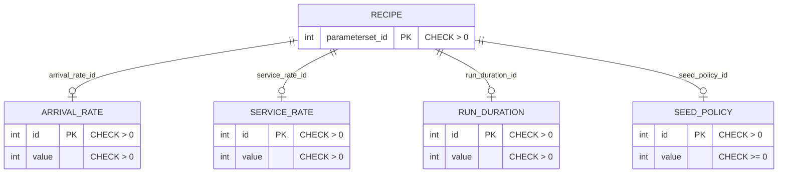

# Scenario Databases

Each `SimulationExperiment` runs two experiment-scoped PostgreSQL databases provisioned by the Experiment Operator from the CR spec: the **Scenario Detail DB** (`spec.detailDatabase`) — the design-layer parameter store written by the Experimental Design Service and read by the Translator — and the **Result DB** (`spec.resultDatabase`) — the per-scenario result sink written by generated runner Pods and read by the PostProcessingService. The third database, the Core DB that the Scenario Manager persists to (`scenarios` database, `scenario_status`/`project` tables), belongs to [scenario-manager.md](scenario-manager.md) and is not covered here.

## Provisioning (common to both)

The alpha4 reconciler (`experiment-operator/internal/controller/simulationexperiment_alpha4_controller.go`, `reconcileDatabase`) provisions each database from its `DatabaseSpec` (API type in `experiment-operator/api/alpha4/simulationexperiment_types.go`):

- **Image form** (`spec.image` set): a single-container `Deployment` named `<experiment>-detaildb` / `<experiment>-resultdb` (container named after the suffix, image from the spec, `containerPort = spec.port`, env `POSTGRES_DB`, `POSTGRES_USER`, `POSTGRES_PASSWORD`, plus the `SIMULATIONPROJECT*` identity vars; exactly one `imagePullSecrets` entry, `cbse-registry-auth`), a `Service` named `<experiment>-<suffix>-svc` (the spec's `serviceType`, `port`, and optional `nodePort`), and a connection `Secret` named `<experiment>-<suffix>-sct`.
- **Host form** (`spec.host` set, image empty): only the connection Secret is created; `host`, `command`, `args`, and `nodePort` constraints differ (a host form must be `ClusterIP` and cannot carry command/args/nodePort).
- The connection Secret (`Opaque`, `stringData`) always carries the five keys `host`, `port`, `dbname`, `user`, `password`; in the image form `host` is the cluster DNS name `<experiment>-<suffix>-svc.<namespace>.svc.cluster.local`, in the host form the normalized literal or DNS name. All three objects are owner-referenced to the experiment and are deleted with it.

`DatabaseSpec` fields: exactly one of `image` | `host`; required `dbname`, `user`, `password`; `port` 1–65535; `serviceType` `ClusterIP|NodePort|LoadBalancer` (default `ClusterIP`); `nodePort` 30000–32767; `command`/`args` (image form only). The experiment's `checkReadiness` gate probes **both** databases with the shared 10-second endpoint-contract availability probe (classify/resolve/dial, `sslmode=disable`) reading the connection Secrets, and requires the Translator, PPS, and EDS Deployments to have a ready replica before moving the experiment to `InProgress`; a probe failure is a not-ready observation bounded by the readiness watchdog.

## Scenario Detail DB

### Reference image

The repository-owned reference image is [`component-templates/scenario-detail-database/Dockerfile`](https://github.com/D4NS3U/cbse/blob/c993397/component-templates/scenario-detail-database/Dockerfile): `FROM ${POSTGRES_IMAGE}` where the `POSTGRES_IMAGE` build argument is required (a missing argument fails the build — the base is never inferred from a floating tag). In the test harness it is the locked official digest from `test/e2e/images.lock.env` (`docker.io/library/postgres@sha256:7341002d2b8c7c5bdd7542a671a95b36196c0b5b888daf454ae4fc33ba5346d7`, `POSTGRES_VERSION=18.6`). The Dockerfile's only content step copies [`10-simulation-parameters.sql`](https://github.com/D4NS3U/cbse/blob/c993397/component-templates/scenario-detail-database/10-simulation-parameters.sql) into `/docker-entrypoint-initdb.d/`, where the official PostgreSQL first-start initialization executes it **once**, as the configured `POSTGRES_USER`, before the server reports readiness. Neither the image nor the SQL contains credentials: the Operator supplies `POSTGRES_USER`, `POSTGRES_PASSWORD`, and `POSTGRES_DB` from `spec.detailDatabase` at runtime, and that account owns every schema object.

### The six-object schema

The seed creates, in schema `public`, the ruled R2 design-layer schema — four per-parameter entry tables, a locator table, and a view:

- **Entry tables** `arrival_rate`, `service_rate`, `run_duration`, `seed_policy`: each `(id INTEGER PRIMARY KEY CHECK (id > 0), value INTEGER NOT NULL CHECK (value > 0))`; `seed_policy` uses `CHECK (value >= 0)`.
- **Locator table** `recipes`: `parameterset_id INTEGER PRIMARY KEY CHECK (parameterset_id > 0)` plus four `NOT NULL` foreign keys, one per parameter (`arrival_rate_id`, `service_rate_id`, `run_duration_id`, `seed_policy_id`), pointing at the entry row the scenario resolves.
- **View** `simulation_parameters`: `CREATE OR REPLACE VIEW` (the only idempotent view form in PostgreSQL) over `recipes` joined with the four entry tables, projecting the exact legacy columns `parameterset_id`, `arrival_rate`, `service_rate`, `run_duration`, `seed_policy`. The view is read-only by construction.

Explicit grants to the owning account (`CURRENT_USER`): `GRANT USAGE ON SCHEMA public`; `GRANT SELECT` on the view; `GRANT SELECT, INSERT, UPDATE` on each of the five tables. The Translator therefore receives `SELECT` on the view only; the write surface is the entry tables and `recipes`.

### Baseline rows

The seed inserts one immutable row per id 1–4 in all five tables (`recipes` row *n* references entry row *n* in every table), so the view computes exactly:

| `parameterset_id` | `arrival_rate` | `service_rate` | `run_duration` | `seed_policy` |
| --- | --- | --- | --- | --- |
| 1 | 2 | 4 | 100 | 1001 |
| 2 | 3 | 5 | 120 | 1002 |
| 3 | 4 | 7 | 150 | 1003 |
| 4 | 5 | 8 | 180 | 1004 |

These rows are read-only in all five tables: no CBSE component updates or deletes them, and the EDS id-space starts at 5 in every table (its next-id query is `GREATEST(COALESCE(MAX(id), 0) + 1, 5)` per table, `...MAX(parameterset_id)...` for `recipes`; a write targeting an id 1–4 is refused). The reference image seeds no EDS rows (id ≥ 5); the values are fixed, reproducible image inputs, never regenerated during build, container startup, or a smoke run.

### Live-locator / view model

The Experimental Design Service's Detail DB write surface is exactly the entry tables and `recipes`. A design save runs in one transaction: new entry ids are `INSERT`ed and the values of ids the EDS assigned earlier are `UPDATE`d — **live locators**, so a saved design's resolved values track its entries until the next save — and new `parameterset_id`s are `INSERT`ed into `recipes` while the four FK columns of recipe ids the EDS assigned are `UPDATE`d. The EDS never writes the view or any other schema or table.

The Translator reads the schema through the single predefined parameterized lookup owned by its `detaildb` package (`SELECT arrival_rate, service_rate, run_duration, seed_policy FROM public.simulation_parameters WHERE parameterset_id = $1`, one positive integer key from `recipe_info`) and never executes SQL text received in a message. Because the view projects the exact legacy columns, the landed lookup contract (query text, `parameterset_id` key, four-value projection) is view-transparent: it is unchanged by the rework from the former single seeded table to this six-object schema. The smoke suite creates its parametersets through the EDS API (ids ≥ 5) and asserts the runner results against a live `SELECT ... FROM public.simulation_parameters WHERE parameterset_id = <id>` — no assertion may depend on the baseline rows 1–4.

### Lockstep

The sqldoc lockstep test (`component-templates/translator/internal/sqldoc/sqldoc_test.go`) asserts this seed against the repository-owned SQL verbatim — the six objects' exact DDL lines, the grants, and the four baseline rows per table (every row id 1–4, no EDS row) — and drift fails `make test-fast`. See [translator.md](translator.md#sqldoc-lockstep).

### Build and image contract

The reference image is built by `test/harness/build-images.sh` with the exact component token `scenario-detail-database` and the nested repository layout: canonical repository `${CBSE_REGISTRY}/scenario-detail-database`, canonical tag `${VERSION}` (a non-normalizing `YY.M.D` `TEST_IMAGE_VERSION`, e.g. `26.7.16`, validated against `^[0-9]{2}\.[0-9]{1,2}\.[0-9]{1,2}$`), immutable provenance tag `${VERSION}.sha-${commit}-${sourceHash}-${runId}`, and digest output `DETAIL_DB_IMAGE=${CBSE_REGISTRY}/scenario-detail-database@sha256:<64hex>` in `images.env` (the digest keeps the nested repository path). With `SKIP_BUILD=1` the harness requires `DETAIL_DB_IMAGE` supplied as an immutable digest reference; a floating tag is rejected by preflight. All references in CRs and manifests use the immutable digest form. Generated-runner cleanup targets only the `${CBSE_REGISTRY}/cbse-test-runner` repository and must never delete or prune the shared `scenario-detail-database` repository.

## Result DB

### No seed SQL: plain PostgreSQL

Unlike the Detail DB, the Result DB image carries no repository-owned initialization SQL. `spec.resultDatabase.image` receives the locked official `POSTGRES_IMAGE` digest **directly** (the smoke CR renders `resultDatabase.image: CBSE_POSTGRES_IMAGE` from `images.lock.env`); the derived Detail DB image is not reused for the Result DB. The Operator provisions it exactly as in the common section: Deployment `<experiment>-resultdb`, Service `<experiment>-resultdb-svc`, connection Secret `<experiment>-resultdb-sct` (in the smoke stack: `dbname: result_db`, user/password `smoke`, port 5432, `ClusterIP`). The configured database (named by `spec.resultDatabase.dbname`) starts with only PostgreSQL's own defaults; the `scenario_<id>_results` tables the runners create in `public` are the only schema objects added.

### Layout: one table per scenario id

The schema is created lazily by the runners themselves, not by any component:

- Table name: `scenario_<scenario_id>_results`, schema `public`.
- Definition (created by `runnermod/resultdb.py` under `pg_advisory_xact_lock(0, <scenario_id>)`): `scenario_<id>_results (id BIGSERIAL PRIMARY KEY, result JSONB NOT NULL)`.
- One table per scenario id, shared across all runner rounds of that scenario: every Pod of every round's Job inserts one row, so rows accumulate as rounds are added by `additional_runners` verdicts.
- The JSONB `result` record carries exactly eight fields: `parameterset_id`, `arrival_rate`, `service_rate`, `run_duration`, `seed_policy`, `effective_seed`, `completed_customers`, `mean_wait_time` (`scenario_id` is intentionally absent — the table is the key; no credentials appear in the record).

### Who creates, writes, and reads

| Role | Access | How |
| --- | --- | --- |
| Generated runner Pods | **create + write** (sole writer) | `CREATE TABLE IF NOT EXISTS` + `INSERT` in one transaction per Pod run, via Psycopg with `sslmode=disable`, 30-second statement timeout; the Result DB connection is baked into the image as `/runner/resultdb.json` (mode 0600) from the `<experiment>-resultdb-sct` Secret the Operator mounted at the Translator (`/resultdb-connection`) at generation time |
| PostProcessingService | **read** (sole in-cluster reader) | `SELECT result FROM public.scenario_<id>_results` with a 30-second statement timeout, extracting the finite-float `mean_wait_time` from each row and counting rows whose `mean_wait_time` is missing, non-numeric, or non-finite as malformed; it never writes the Result DB and never touches the Core DB. The connection comes from the same `<experiment>-resultdb-sct` Secret, mounted read-only at `/resultdb-connection` in the PPS Deployment; fetch failures leave the evaluation request unacknowledged (NAK) for redelivery with no built-in retry |
| Translator | **no access at run time** | holds the Result DB config only to bake it into the generated image; it never connects to the Result DB itself |
| Smoke harness | **read** (test tooling) | `test/e2e/smoke_test.go` queries `scenario_<id>_results` (row count == `number_of_reps`, the eight `result->>` fields, distinct `effective_seed` per repetition) to verify the no-failure path |

The `scenario_<id>_results` table is never dropped by any component while the experiment is live; it disappears with the database when the Operator deletes the experiment-owned Result DB Deployment, Service, and Secret via owner references.

## Related

- [translator.md](translator.md) — the Detail DB read (`detaildb.Lookup`) and the Result DB config baked into generated images.
- [simulation-runner.md](simulation-runner.md) — the runner-side write path (`resultdb.py`, the advisory lock, the single-transaction shape).
- [scenario-manager.md](scenario-manager.md) — the Core DB (scenario status state machine) and the PostProcessingService evaluation loop that consumes Result DB rows over NATS.
