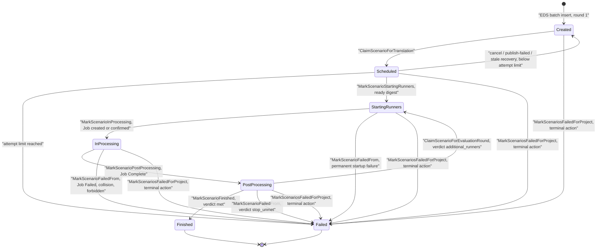
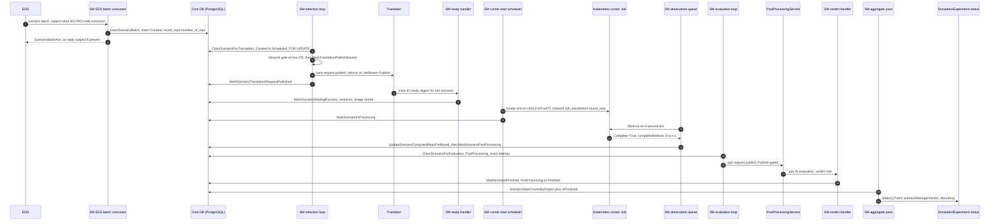
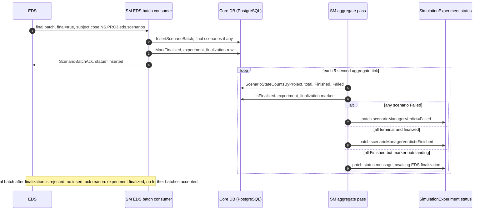

# Scenario Manager (`scenario-manager/`)

Source: [scenario-manager/](https://github.com/D4NS3U/cbse/tree/c993397/scenario-manager) · entrypoint [cmd/main.go](https://github.com/D4NS3U/cbse/blob/c993397/scenario-manager/cmd/main.go) · module `github.com/D4NS3U/cbse/scenario-manager` (Go 1.24, [go.mod](https://github.com/D4NS3U/cbse/blob/c993397/scenario-manager/go.mod) with `replace github.com/D4NS3U/cbse/experiment-operator => ../experiment-operator`)

The Scenario Manager (SM) is CBSE's experiment lifecycle owner. It keeps the authoritative scenario state in a per-experiment Core PostgreSQL database (the Operator creates each experiment's Core DB fresh, so the schema package never migrates), ingests EDS scenario batches, drives the translation handoff, orchestrates batch/v1 runner Jobs, observes their outcomes, publishes evaluation requests to the PostProcessingService (PPS), aggregates the per-experiment verdict onto the `SimulationExperiment` CR, and performs deletion-time cleanup behind its own finalizer. The [Experiment Operator](https://github.com/D4NS3U/cbse/blob/c993397/experiment-operator/README.md) provisions the experiment's workloads; all scenario-lifecycle work happens here.

Structural invariants visible across the packages:

- **Durable ownership by guarded single-row UPDATEs.** No component holds a row lock, queue, leader flag, or cross-replica coordination state; every scenario transition is a state-guarded SQL update where a zero-row result means "another replica won or the lifecycle gate closed" and is a stale no-op, not an error.
- **The lifecycle gate.** Every NATS handler and every scheduler iteration re-fetches the live CR and applies `lifecycle.AdmitExperiment`: only a non-deleting `InProgress` experiment is admitted; `Error`/`Failed`/`Finished`/deleting is terminal (deliveries are ACKed and discarded); `Pending`/`Provisioning`/empty is unavailable (deliveries are NAKed for redelivery).
- **The publication boundary.** Translation and evaluation requests are published to JetStream only after a database marker flip (`MarkTranslationPublishStarted` / `MarkEvaluationPublishStarted`), and the durable-acceptance marker (`...RequestPublished`) is written only after a JetStream PubAck, so a lost confirmation is detectable and recoverable.

## Responsibilities

- **EDS intake** — answers the availability handshake on `cbse.<namespace>.<project>.eds.scenarios.available` (Core NATS request/reply) and consumes scenario batches from the JetStream stream `cbse_eds_scenarios`, inserting each batch into `scenario_status` in one multi-row statement.
- **Translation-request selection** — one serial worker discovers the lowest positive `Created` scenario, claims it (`Created → Scheduled`), and publishes the translation request on `cbse.<namespace>.<project>.trans.request` (stream `cbse_translator`) only after a durable PubAck; each iteration first recovers stale unpublished claims.
- **Translator-ready handling** — consumes `cbse.<namespace>.<project>.trans.<scenario-id>.ready`, validates the digest against the live CR's `spec.translator.repository`, applies `Scheduled → StartingRunners`; an empty image consumes the attempt through the recovery path.
- **Runner-Job orchestration** — a bounded, ordered scheduler creates or confirms the deterministic Job `simrun-<UID-prefix>-s<scenario-id>-a<attempt>` from the Operator-validated runner template and the accepted digest.
- **Observation** — a per-scenario deduplicated queue polls each `InProcessing` Job on a fixed five-second tick, records the monotonic completed-repetition count, and applies `InProcessing → PostProcessing` on `Complete` or `InProcessing → Failed` on `Failed`/collision/forbidden.
- **Evaluation handoff and verdicts** — a serial loop publishes `pps.request` evaluation requests for `PostProcessing` scenarios; the verdict consumer applies `met` → `Finished`, `additional_runners` → a new runner round (`PostProcessing → StartingRunners`), and `stop_unmet` → `Failed`.
- **Phase aggregation** — a fixed-cadence pass aggregates the per-project scenario-state counts plus the durable finalization marker and writes the absorbing `status.scenarioManagerVerdict` (`Finished` or `Failed`) through the status subresource, plus one SM-owned `status.message` diagnostic ("awaiting EDS finalization").
- **Lifecycle dispatch and cleanup** — a cluster-wide CR informer closes the per-experiment lifecycle gate, runs the terminal action (bulk-fail unfinished scenarios, delete verified Jobs) for `Error`/`Failed` experiments, and runs the 11-step deletion cleanup behind the SM finalizer.

Startup is fail-fast: configuration, messaging templates and stream names, Core DB schema, Kubernetes authorization, and the authentication-free NATS connection are all validated before any consumer or scheduler starts; any startup configuration failure exits the process.

## Module layout

| Path | Role |
| --- | --- |
| [cmd/main.go](https://github.com/D4NS3U/cbse/blob/c993397/scenario-manager/cmd/main.go) | Binary bootstrap: `signal.NotifyContext(SIGINT, SIGTERM)` then `core.RunScenarioManager(ctx)` |
| [internal/core/app.go](https://github.com/D4NS3U/cbse/blob/c993397/scenario-manager/internal/core/app.go) | Composition entry point: startup validation order, construction and start order, 30-second shutdown join |
| [internal/persistence/](https://github.com/D4NS3U/cbse/tree/c993397/scenario-manager/internal/persistence) | Core DB contract: schema, tables, guarded transitions, claims, finalization marker, terminal bulk update |
| [internal/nats/](https://github.com/D4NS3U/cbse/tree/c993397/scenario-manager/internal/nats) | Canonical alpha4 NATS contract: templates, streams, SM consumers, per-experiment consumers, adapters, reconciliation |
| [internal/subject/](https://github.com/D4NS3U/cbse/tree/c993397/scenario-manager/internal/subject) | Namespace-aware subject grammar and strict parser |
| [internal/communication/](https://github.com/D4NS3U/cbse/tree/c993397/scenario-manager/internal/communication) | Transport-neutral wire types, validation, publisher/handler interfaces |
| [internal/selection/](https://github.com/D4NS3U/cbse/tree/c993397/scenario-manager/internal/selection) | Serial translation-request selection loop |
| [internal/ready/](https://github.com/D4NS3U/cbse/tree/c993397/scenario-manager/internal/ready) | Translator-ready workflow (digest validation, `Scheduled → StartingRunners`) |
| [internal/evaluationpub/](https://github.com/D4NS3U/cbse/tree/c993397/scenario-manager/internal/evaluationpub) | Serial evaluation-request publication loop |
| [internal/verdict/](https://github.com/D4NS3U/cbse/tree/c993397/scenario-manager/internal/verdict) | PPS-verdict workflow (guarded verdict transitions) |
| [internal/aggregate/](https://github.com/D4NS3U/cbse/tree/c993397/scenario-manager/internal/aggregate) | Scheduler-cadence scenario-aggregate verdict pass |
| [internal/scheduler/](https://github.com/D4NS3U/cbse/tree/c993397/scenario-manager/internal/scheduler) | Resource-neutral adapter boundary (start/observe outcome taxonomy) |
| [internal/runnerstart/](https://github.com/D4NS3U/cbse/tree/c993397/scenario-manager/internal/runnerstart) | Bounded ordered runner-start scheduler |
| [internal/observation/](https://github.com/D4NS3U/cbse/tree/c993397/scenario-manager/internal/observation) | Per-scenario five-second observation queue |
| [internal/jobadapter/](https://github.com/D4NS3U/cbse/tree/c993397/scenario-manager/internal/jobadapter) | batch/v1 Job adapter: create/confirm/observe/delete, `completedIndexes` parsing |
| [internal/effectivejob/](https://github.com/D4NS3U/cbse/tree/c993397/scenario-manager/internal/effectivejob) | Effective Job builder (template merge + SM executable contract) |
| [internal/registry/](https://github.com/D4NS3U/cbse/tree/c993397/scenario-manager/internal/registry) | Cross-module copy of the Operator's image-reference/Docker-config resolver |
| [internal/lifecycle/](https://github.com/D4NS3U/cbse/tree/c993397/scenario-manager/internal/lifecycle) | Gate, finalizer, terminal action, deletion cleanup, deterministic identity |
| [internal/informer/](https://github.com/D4NS3U/cbse/tree/c993397/scenario-manager/internal/informer) | Cluster-wide CR informer and lifecycle dispatch with fixed-cadence retry |
| [internal/rbac/](https://github.com/D4NS3U/cbse/tree/c993397/scenario-manager/internal/rbac) | Startup `SelfSubjectAccessReview` authorization checks |
| [internal/kube/](https://github.com/D4NS3U/cbse/tree/c993397/scenario-manager/internal/kube) | Legacy client helpers; production wiring builds clients directly |
| [internal/config/](https://github.com/D4NS3U/cbse/tree/c993397/scenario-manager/internal/config) | Runner-start worker count parsing |
| [internal/translatorconfig/](https://github.com/D4NS3U/cbse/tree/c993397/scenario-manager/internal/translatorconfig) | Shared translation-attempt policy and recovery timeout |
| [internal/eventlog/](https://github.com/D4NS3U/cbse/tree/c993397/scenario-manager/internal/eventlog) | Scenario-observability logger (credential-free records) |
| [Dockerfile](https://github.com/D4NS3U/cbse/blob/c993397/scenario-manager/Dockerfile) | Production image: `golang:1.24` builder with `GOWORK=off`, `alpine:3.21`, non-root `USER app` |
| [test_sm.Dockerfile](https://github.com/D4NS3U/cbse/blob/c993397/scenario-manager/test_sm.Dockerfile) | Hermetic test image: entrypoint `go test -tags=integration -v -count=1 ./...`; fetches `experiment-operator` for the replace directive when absent from the build context |

## Startup and configuration

[core.RunScenarioManager](https://github.com/D4NS3U/cbse/blob/c993397/scenario-manager/internal/core/app.go) performs startup validation in the SM failure-class order, and only after every check passes does it start components, again in dependency order:

1. **Pure config** — `config.ParseRunnerStartWorkers` (env `SCENARIO_MANAGER_RUNNER_START_WORKERS`; a pure base-10 decimal in `[1, 64]`, default 4, so `+4`, ` 4 `, `0x10`, and `1.5` are all malformed), then `nats.ValidateTemplates` and `nats.ValidateStreamNames`: the six subject-template env vars and three stream-name env vars, if explicitly set, must equal the canonical values or startup fails with `ErrNoncanonicalConfig`.
2. **Core DB** — `SCENARIO_MANAGER_CORE_DB_DSN` + `SCENARIO_MANAGER_CORE_DB_USER` + `SCENARIO_MANAGER_CORE_DB_PASSWORD` are merged into a pgx DSN; a 10-second `PingContext`; then `persistence.EnsureSchema` (see [Core DB contract](#core-db-contract)).
3. **Kubernetes** — in-cluster REST config (or `SCENARIO_MANAGER_KUBECONFIG` for local dev), a scheme containing the alpha4 `SimulationExperiment` plus `clientgoscheme`, a controller-runtime client and a client-go clientset, then `rbac.Verify` — a denied `SelfSubjectAccessReview` check is a fatal installation error before any component starts.
4. **NATS** — `SCENARIO_MANAGER_NATS_URL` must carry no user information, and the legacy `SCENARIO_MANAGER_NATS_USER`/`SCENARIO_MANAGER_NATS_PASSWORD` must be empty (alpha4 NATS is authentication-free); connect, then `nats.ReconcileStreamsAndConsumers` brings the three shared streams and three SM-owned durables to the canonical configuration.
5. **Construction** — `informer.NewProductionDispatcher` (DB store, `nats.NATSDeletionClient`), `ready.NewHandler` (max attempts from `translatorconfig.LoadMaxAttempts`), the four NATS adapter surfaces and the two JetStream publishers, `selection.NewProductionDependencies`, `evaluationpub.NewProductionDependencies`, and the three schedulers over the shared `jobadapter.NewControllerRuntimeAdapter` (runner-start workers from config; observation fixed at `Workers: 4`; aggregate with default config).
6. **Start order** — informer → EDS availability responder → EDS batch consumer → translator-ready consumer → PPS-evaluation consumer → selection loop → evaluation-publication loop → runner-start scheduler → observation scheduler → aggregate scheduler, then the single `Scenario Manager is ready` log. On `ctx.Done()` the informer and the three schedulers are joined under a 30-second timeout and the two serial loops on their done channels.

Additional env knobs loaded once at startup (invalid values log and fall back to defaults rather than failing): `SCENARIO_MANAGER_TRANS_MAX_ATTEMPTS` (default 3) and `SCENARIO_MANAGER_TRANS_PUBLISH_RECOVERY_TIMEOUT` (Go duration, default 1m), both parsed in [translatorconfig](https://github.com/D4NS3U/cbse/blob/c993397/scenario-manager/internal/translatorconfig/translatorconfig.go).

## Core DB contract

[persistence](https://github.com/D4NS3U/cbse/blob/c993397/scenario-manager/internal/persistence/db.go) is the only Core DB persistence wiring (the earlier alpha3 `coredb` package is retired). Table names default to `project` and `scenario_status` and may be overridden by the legacy env vars `SCENARIO_MANAGER_CORE_DB_PROJECT_TABLE` / `SCENARIO_MANAGER_CORE_DB_SCENARIO_STATUS_TABLE`; the finalization table name `experiment_finalization` is fixed with no env override. All functions take an injected `DB`/`Store` interface so the package is pool- and test-neutral.

### `project` table

Exactly three columns, enforced by `validateProjectTable` in [schema.go](https://github.com/D4NS3U/cbse/blob/c993397/scenario-manager/internal/persistence/schema.go) — any extra column (a legacy `status`, `number_of_components`, or `experiment_uid`) is `ErrSchemaIncompatible`:

| Column | Type | Notes |
| --- | --- | --- |
| `id` | `int4` | `SERIAL` primary key, sole PK, generated by a serial/identity sequence |
| `project_namespace` | `text` | `NOT NULL`; copied verbatim from `metadata.namespace` |
| `project_name` | `text` | `NOT NULL`; copied verbatim from `metadata.name` |

Constraint `UNIQUE (project_namespace, project_name)` (exact two-column constraint, validated against the catalog). There is no mutable status column: the experiment's phase lives on the CR, not the row. [project.go](https://github.com/D4NS3U/cbse/blob/c993397/scenario-manager/internal/persistence/project.go) exposes:

- `ProjectIDByNamespaceAndName(ctx, db, namespace, project) (int, error)` — returns `ErrProjectNotFound` for a missing pair.
- `RegisterProject(ctx, db, namespace, project) (int, error)` — idempotent `INSERT ... ON CONFLICT (project_namespace, project_name) DO NOTHING` with a SELECT fallback; does not manage the finalizer (the informer adds it first).
- `DeleteProjectByNamespaceAndName(ctx, db, namespace, project) error` — cascade removes the project's scenario rows and finalization marker; a missing row is success.

### `scenario_status` table

Twenty columns, all type- and nullability-checked against the PostgreSQL catalog by `validateScenarioStatusTable`, plus a required single-column FK `project_id → project.id` with `ON DELETE CASCADE` (`confdeltype = 'c'`):

| Column | Type | Default | Meaning |
| --- | --- | --- | --- |
| `id` | `int4` | `SERIAL` | scenario identity; every discovery query orders by ascending positive `id` |
| `project_id` | `int4` | — | FK to `project.id`, `ON DELETE CASCADE` |
| `state` | `text` | — | one of the seven [scenario states](#scenario-state-machine) |
| `created_at` | `timestamptz` | `NOW()` | row creation |
| `updated_at` | `timestamptz` | `NOW()` | every guarded transition rewrites it; doubles as the staleness clock |
| `priority` | `int4` | `0` | EDS-supplied scenario priority |
| `number_of_reps` | `int4` | `0` | round-1 requested repetition count (EDS-supplied; intake enforces 1..100000) |
| `number_of_computed_reps` | `int4` | `0` | monotone cross-round completed total |
| `translation_attempts` | `int4` | `0` | consumed translation claims; the attempt-limit counter |
| `translation_publish_started_at` | `timestamptz` | — (NULL, **no default** — enforced) | publication boundary: about to call NATS |
| `translation_request_published_at` | `timestamptz` | NULL | durable PubAck received; gates `MarkScenarioStartingRunners` |
| `recipe_info` | `jsonb` | NULL | EDS-supplied recipe payload |
| `container_image` | `text` | NULL | accepted Translator runner digest |
| `confidence_metric` | `float8` | NULL | per-scenario precision threshold (epsilon) |
| `runner_round` | `int4` | `1` | current runner round (round 1 = original fleet) |
| `round_reps` | `int4` | — | current round's requested count; the Job's completion count; equals `number_of_reps` for round 1 |
| `round_computed_reps` | `int4` | `0` | current round's completed count, clamped to `round_reps` |
| `evaluation_attempts` | `int4` | `0` | consumed evaluation-request claims |
| `evaluation_publish_started_at` | `timestamptz` | NULL | evaluation publication boundary |
| `evaluation_request_published_at` | `timestamptz` | NULL | evaluation durable PubAck received |

`EnsureSchema` creates missing tables with `CREATE TABLE IF NOT EXISTS` (concurrent SM startups stay safe) and then **validates only** — it never issues `ALTER TABLE` repair; an incompatible pre-existing table fails startup with `ErrSchemaIncompatible` so the Operator can supply a fresh database.

`InsertScenarioBatch` ([eds_intake.go](https://github.com/D4NS3U/cbse/blob/c993397/scenario-manager/internal/persistence/eds_intake.go)) registers the project pair and inserts every record as a `Created` row in a single multi-row statement, supplying exactly `project_id, state, priority, number_of_reps, round_reps, recipe_info, confidence_metric` — `round_reps` is set to `number_of_reps` for round 1, and every other column takes its schema default (`state=Created`, `runner_round=1`, both `*_computed_reps=0`, both attempt counters 0, `container_image=NULL`, all publication timestamps NULL).

## Scenario state machine

The seven canonical states are the constants in [db.go](https://github.com/D4NS3U/cbse/blob/c993397/scenario-manager/internal/persistence/db.go): `Created`, `Scheduled`, `StartingRunners`, `InProcessing`, `PostProcessing`, `Finished`, `Failed`. `Finished` and `Failed` are terminal: `Finished` never re-enters any guarded transition and is absent from the failure allow-lists; `Failed` is the sink for every failure path.

Every edge, its SQL guard, and its applier:

| From → To | Function ([persistence](https://github.com/D4NS3U/cbse/blob/c993397/scenario-manager/internal/persistence/scenario_status.go)) | SQL guard | Owner / trigger |
| --- | --- | --- | --- |
| — → Created | `InsertScenarioBatch` | intake validation (`number_of_reps` in 1..100000, subject/payload identity match) | EDS batch consumer |
| Created → Scheduled | `ClaimScenarioForTranslation` | `FOR UPDATE` row lock; `state = Created`; increments `translation_attempts`, clears both `translation_*_at` markers | selection loop |
| Scheduled → Created | `CancelUnpublishedTranslationClaim` | `state = Scheduled`, exact attempt, both publication timestamps NULL; decrements `translation_attempts` (refund) | selection loop, pre-publish gate rejection |
| Scheduled → Created | `MarkScenarioTranslationPublishFailed` | `state = Scheduled`, exact attempt, both timestamps NULL; no refund; `Failed` instead when `attempt >= maxAttempts` | selection loop, NATS publish failure before the publish-start marker held |
| Scheduled → Created/Failed | `RecoverUnpublishedTranslationClaim` | `state = Scheduled`, exact attempt, `translation_request_published_at IS NULL`, `updated_at < claimedBefore`; both-NULL branches refund the attempt, started-set/published-NULL consumes it; `Failed` when `expectedAttempt >= maxAttempts` | selection loop, stale-claim recovery (first pass of every iteration) |
| Scheduled → Created/Failed | `MarkScenarioTranslationAttemptFailed` | `state = Scheduled`, exact attempt (publish timestamps may be set); never refunds; `Failed` at the limit | ready workflow, empty (failure) ready image |
| Scheduled → StartingRunners | `MarkScenarioStartingRunners` | `state = Scheduled` **and** `translation_request_published_at IS NOT NULL`; writes `container_image` | ready workflow, validated digest matching `spec.translator.repository` |
| StartingRunners → InProcessing | `MarkScenarioInProcessing` | `state = StartingRunners` | runner-start scheduler, after Created/Confirmed outcome |
| StartingRunners → Failed | `MarkScenarioFailedFrom` | `state = StartingRunners` (allow-listed source states: the five non-terminal states) | runner-start scheduler, Collision/Forbidden/ProjectionInvalid |
| InProcessing → PostProcessing | `MarkScenarioPostProcessing` | `state = InProcessing` | observation queue, after the full round count is recorded |
| InProcessing → Failed | `MarkScenarioFailedFrom` | `state = InProcessing` | observation queue, Failed/Collision/Forbidden |
| PostProcessing → Finished | `MarkScenarioFinished` | `state = PostProcessing` | verdict workflow, `met` |
| PostProcessing → StartingRunners | `ClaimScenarioForEvaluationRound` | `state = PostProcessing`; `runner_round += 1`, `round_reps = additionalRunners` (validated ≥ 1 via `ErrInvalidAdditionalRunners`), `round_computed_reps = 0`; returns the new round | verdict workflow, `additional_runners` |
| PostProcessing → Failed | `MarkScenarioFailedFrom` | `state = PostProcessing` | verdict workflow, `stop_unmet` |
| {Created, Scheduled, StartingRunners, InProcessing, PostProcessing} → Failed | `MarkScenariosFailedForProject` | one transaction per project; `state IN (non-terminal set)`; preserves reps, attempts, timestamps, `container_image`, diagnostics | terminal action on `Error`/`Failed` experiments (non-deleting) |

Two bookkeeping updates are not state transitions but are part of the same guarded surface:

- `UpdateScenarioComputedRepsForRound(ctx, db, scenarioID, round, roundCount) (int, bool, error)` — guarded by `state = InProcessing AND runner_round = round`; sets `round_computed_reps = LEAST(round_reps, GREATEST(round_computed_reps, count))` (monotone, clamped to the round) and accumulates `number_of_computed_reps` as `GREATEST(total, total + LEAST(round_reps, GREATEST(round_computed_reps, count)) - round_computed_reps)` (monotone cross-round total, redelivery-safe); returns the resulting total.
- `ClaimScenarioForEvaluation(ctx, store, scenarioID) (int, bool, error)` — `FOR UPDATE` claim of a `PostProcessing` row that increments `evaluation_attempts` and clears both `evaluation_*_at` markers, mirroring the translation claim.

## NATS messaging contract

### Subject grammar ([subject](https://github.com/D4NS3U/cbse/blob/c993397/scenario-manager/internal/subject/subject.go))

Every subject has the form `cbse.<namespace>.<project>.<domain>.<event>` (four or five tokens):

| Domain | Subject | Direction |
| --- | --- | --- |
| `eds` | `cbse.<ns>.<proj>.eds.scenarios.available` | EDS → SM availability request/reply (Core NATS) |
| `eds` | `cbse.<ns>.<proj>.eds.scenarios` | EDS → SM scenario batches (JetStream) |
| `trans` | `cbse.<ns>.<proj>.trans.request` | SM → Translator translation requests (JetStream) |
| `trans` | `cbse.<ns>.<proj>.trans.<scenario-id>.ready` | Translator → SM readiness (JetStream) |
| `pps` | `cbse.<ns>.<proj>.pps.request` | SM → PPS evaluation requests (JetStream) |
| `pps` | `cbse.<ns>.<proj>.pps.<scenario-id>.evaluation` | PPS → SM evaluation verdicts (JetStream) |

`subject.ValidateIdent` requires each of `<namespace>` and `<project>` to be a single lowercase DNS label of 1–63 characters (the CRD admission rule) and performs **no normalization** — identifiers are opaque tokens. `subject.Parse` tokenizes strictly (rejects empty/double tokens, wrong arity, unknown domains); the `<scenario-id>` token in a ready subject must be non-empty, while the PPS-evaluation scenario-id token must be a canonical positive decimal (no sign, no leading zeros). Cluster-wide wildcards (`cbse.*.*.eds.scenarios.available`, `cbse.*.*.trans.*.ready`, `cbse.*.*.pps.*.evaluation`, and the three stream subjects) are fixed constants in the package; per-project wildcards (`cbse.<ns>.<proj>.trans.*.ready`, `cbse.<ns>.<proj>.pps.*.evaluation`) exist only for deletion-time purges.

### Streams and consumers ([nats/config.go](https://github.com/D4NS3U/cbse/blob/c993397/scenario-manager/internal/nats/config.go))

Three shared JetStream streams, all `WorkQueuePolicy` / `FileStorage` / `DiscardOld`:

| Stream | Subjects |
| --- | --- |
| `cbse_eds_scenarios` | `cbse.*.*.eds.scenarios` |
| `cbse_translator` | `cbse.*.*.trans.request`, `cbse.*.*.trans.*.ready` |
| `cbse_pps` | `cbse.*.*.pps.request`, `cbse.*.*.pps.*.evaluation` |

Three SM-owned durable queue consumers (the queue group distributes deliveries among SM replicas):

| Durable | Queue group | Filter | Deliver subject |
| --- | --- | --- | --- |
| `scenario-manager-eds-consumer` | `scenario-manager-eds` | `cbse.*.*.eds.scenarios` | `cbse.sm.eds-batch.deliver` |
| `scenario-manager-translator-ready` | `scenario-manager-translator-ready` | `cbse.*.*.trans.*.ready` | `cbse.sm.translator-ready.deliver` |
| `scenario-manager-pps-evaluation` | `scenario-manager-pps-evaluation` | `cbse.*.*.pps.*.evaluation` | `cbse.sm.pps-evaluation.deliver` |

All SM consumers run explicit ACK, `DeliverAll`, `AckWait` 2m, `MaxAckPending` 1024, `MaxDeliver` -1 (unlimited redelivery); the 4-token deliver subjects match no stream filter, so push deliveries never re-enter a stream. Per-experiment durable consumers are created on the shared streams: `translator-<uid-prefix>` (filter `cbse.<ns>.<proj>.trans.request`, `MaxAckPending` 1 — a single in-flight request per Translator) and `pps-<uid-prefix>` (filter `cbse.<ns>.<proj>.pps.request`, `MaxAckPending` 1). The 12-char UID prefix is `nats.UIDPrefix` — lowercase, hyphens stripped, first 12 characters — shared with the runner Job and ServiceAccount names. Each per-experiment consumer carries four ownership metadata entries under `experiment.cbse.terministic.de/` (`managed-by` = `translator` or `pps`, `experiment-uid`, `namespace`, `project`) so deletion can verify ownership without relying on the truncated durable name.

### Reconciliation and ownership ([nats/consumers.go](https://github.com/D4NS3U/cbse/blob/c993397/scenario-manager/internal/nats/consumers.go))

- `ReconcileStreamsAndConsumers(js)` — startup entry point: `ReconcileStream` for each of the three streams (missing → create; existing → union required subjects in without removing unrelated ones), then `ReconcileSMConsumer` for the three SM durables (missing → create; matching → no-op; mutable drift → in-place update; immutable/filter drift → delete-and-recreate of the SM-owned durable only).
- `VerifySMConsumerOwnership(info, want)` / `VerifyTranslatorConsumerOwnership` / `VerifyPPSConsumerOwnership` — field-for-field comparison (durable, filter, queue group, ack/deliver policy, `AckWait`, `MaxAckPending`, `MaxDeliver`, and the four metadata entries); any mismatch is `ErrOwnershipCollision`, and the caller must not delete, update, or adopt the consumer.
- `DeleteTranslatorConsumer(js, stream, uid, namespace, project)` / `DeletePPSConsumer` — delete only after ownership verification; a missing consumer is success; a collision is an error so the caller retains the finalizer.
- `EnsurePPSConsumer(js, stream, uid, namespace, project)` — create-if-missing for the PPS durable at evaluation admission; a non-matching existing consumer is a collision, never adopted.
- `PurgeSubject(js, stream, subject)` — subject-filtered stream purge; a missing stream is success.

### Adapters ([nats](https://github.com/D4NS3U/cbse/blob/c993397/scenario-manager/internal/nats/natsadapter.go))

`nats.Adapters` binds the four concrete adapters to one shared set of dependencies (NATS `Conn`, JetStream context, controller-runtime client, batch-insert function, finalization marker functions, and the ready handler). Every adapter is transport-level only: exact subject construction, subject parsing, strict JSON decode, the lifecycle gate (`lifecycle.AdmitExperiment` on the fetched CR), and ACK/NAK mapping — ACK covers success, permanent poison, and terminal experiments; NAK covers transient failures and unavailable (pre-`InProgress`) experiments.

- `EDSAvailabilityResponder` ([availability.go](https://github.com/D4NS3U/cbse/blob/c993397/scenario-manager/internal/nats/availability.go)) — queue-subscribes the `cbse.*.*.eds.scenarios.available` wildcard on Core NATS; replies `status=ready` with the exact `cbse.<ns>.<proj>.eds.scenarios` batch subject for an admitted experiment, `status=error` (no batch subject) otherwise; echoes the request's `experiment_type` verbatim and status-independently (the finalization capability handshake — absent means the EDS does not participate in finalization).
- `EDSBatchConsumer` ([edsbatch.go](https://github.com/D4NS3U/cbse/blob/c993397/scenario-manager/internal/nats/edsbatch.go)) — attaches to the `scenario-manager-eds-consumer` durable; validates subject shape, identity, payload (subject/payload `project` match, reps range), then the gate; inserts via `InsertScenarioBatch`; rides the [finalization protocol](#finalization-protocol); replies a `ScenarioBatchAck` (`status` = `inserted`/`poison`/`error`) on the delivery's reply subject when one is present (publishers without a reply subject — the protocol-faithful mock and the reference EDS — see only the JetStream ACK/NAK).
- `TranslationRequestPublisher` / `EvaluationRequestPublisher` ([publisher.go](https://github.com/D4NS3U/cbse/blob/c993397/scenario-manager/internal/nats/publisher.go)) — JetStream publishes on the exact `trans.request` / `pps.request` subject, returning nil only after a PubAck; both validate the DNS-label identity before building the subject, and the evaluation publisher additionally refuses non-finite or non-positive `confidence_metric`, non-positive scenario id/round/reps, or an empty UID (no message is sent).
- `TranslatorReadyConsumer` ([readyconsumer.go](https://github.com/D4NS3U/cbse/blob/c993397/scenario-manager/internal/nats/readyconsumer.go)) — attaches to the `scenario-manager-translator-ready` durable; strict-decodes the two-field payload (`translation_attempt`, `container_image`) rejecting unknown fields and trailing tokens, requires a positive scenario-id token and attempt, gates, then delegates to the ready handler (`Handled` → ACK, `Retry` → NAK; an unknown status is conservatively ACKed as poison).
- `PPSEvaluationConsumer` ([ppsevaluationconsumer.go](https://github.com/D4NS3U/cbse/blob/c993397/scenario-manager/internal/nats/ppsevaluationconsumer.go)) — attaches to the `scenario-manager-pps-evaluation` durable; strict-decodes the 13-field verdict wire type, requires the payload's `namespace`/`project` to equal the subject identity (mismatch is poison), gates, and delegates to the verdict handler with the same `Handled`/`Retry` → ACK/NAK mapping.
- `NATSDeletionClient` ([nats_adapter.go](https://github.com/D4NS3U/cbse/blob/c993397/scenario-manager/internal/nats/nats_adapter.go)) — adapts the JetStream context to the `lifecycle.MessagingCleaner` + `lifecycle.PPSCleaner` surfaces used by deletion cleanup (`DeleteTranslatorConsumer`, `DeletePPSConsumer`, `PurgeSubject`).

## Message flow: batch intake to evaluation verdict

The happy path for one scenario, from EDS intake to the absorbing CR verdict:

Notes on the edges:

- The selection loop publishes **only after** `MarkTranslationPublishStarted` flipped the row; the published marker is written **only after** the PubAck, so a crash between the two leaves an ambiguous claim that the loop's stale-claim recovery (`RecoverUnpublishedTranslationClaim`) resolves on the next iteration (refund when no publish started, consume the attempt when publication began).
- The runner Job is an indexed batch/v1 Job with `completions = parallelism = round_reps` and a global `backoffLimit` of 4 shared across all completion indexes; a `Failed` Pod anywhere consumes the one budget.
- The observation queue records the partial `completedIndexes` count monotonically on non-terminal polls when the count is positive, and records the full round count (`CompletedReps = round_reps`) before the guarded `InProcessing → PostProcessing` transition on `Complete`.
- The evaluation loop's `ClaimScenarioForEvaluation` increments `evaluation_attempts` and clears both evaluation publication markers, mirroring the translation claim; a publish failure leaves the row claimable again (there is no attempt-consuming evaluation failure path).
- The aggregate pass writes the verdict only through the status subresource merge patch whose payload carries `scenarioManagerVerdict` alone; the field is absorbing (write-if-absent), so the pass is idempotent and the verdict never changes once written.

## Phase aggregation ([aggregate](https://github.com/D4NS3U/cbse/blob/c993397/scenario-manager/internal/aggregate/scheduler.go))

The aggregate verdict pass is a single serial goroutine on a fixed cadence: an immediate first tick, then one tick every `Interval` (default 5s), each bounded by `TickTimeout` (default 30s). A slow tick delays the next one; ticks never overlap and there is no queue, row lock, leader flag, or coordination state — the absorbing verdict field plus the fixed cadence are the durability mechanism.

Each tick:

1. **Enumerate** every cluster-wide `SimulationExperiment` (`Kube.ListExperiments`, the same namespace scope as the informer's watch). A list failure is a transient dependency failure: logged, next tick retries.
2. **Gate** each experiment with `lifecycle.AdmitExperiment`; `Pending`/`Provisioning`, terminal phases, unknown phases, and deleting experiments are skipped.
3. **Absorbing check**: `status.scenarioManagerVerdict != ""` → skipped forever (write-if-absent); the pass also never re-touches the diagnostic after a verdict.
4. **Project lookup** (`Store.ProjectIDByNamespaceAndName`); `ErrProjectNotFound` (not yet registered, or row deleted) is a no-op for this tick.
5. **Aggregate** `Store.ScenarioStateCounts` → `ScenarioStateCounts{Total, Finished, Failed}` via `persistence.ScenarioStateCountsByProject` (read-only `COUNT(*) FILTER` aggregation; applies no transition).
6. **Finalization marker read** `Store.IsFinalized` → presence of the `experiment_finalization` row.
7. **Verdict derivation** (`verdictForCounts`, the finalization-aware rule):
   - `Failed > 0` → `Failed` — fail-fast: the experiment's failure is decided by the first failing scenario, regardless of finalization.
   - else `finalized && (Total == 0 || Finished == Total)` → `Finished` — all terminal **plus final implies Finished**; the marker is required, so all-terminal alone is not enough. `Total == 0` with the marker is the explicit zero-scenario Finish (the interactive window's explicit close), distinct from the absent-EDS idle (`Total == 0` without the marker → no verdict).
   - else no verdict (the pass writes nothing).
8. **Verdict patch**: `Kube.PatchVerdict` → `client.Status().Patch` with a merge patch whose `status` payload carries **only** `scenarioManagerVerdict` — never `phase`, never `message`. A patch failure leaves the verdict unreported; the next tick re-derives and retries (self-healing).

Field ownership is the contract (the additive amendment of the SBO finalization protocol): the SM never writes `phase`; the SM writes status fields in exactly two cases — the absorbing `scenarioManagerVerdict` report and the awaiting-EDS-finalization diagnostic. The Operator retains full ownership of `phase` and all other messages and overwrites the diagnostic at the phase transition (its terminal derivation lands later in the sequence because the Finished verdict requires the finalization).

**Awaiting finalization** (`opAwaitingFinalization`): when `!finalized && status.phase == InProgress && Total > 0 && Finished == Total`, the experiment idles `InProgress` by design; the pass writes the diagnostic `status.message = "awaiting EDS finalization"` via `Kube.PatchAwaitingFinalization` (merge patch carrying only `message`), guarded write-if-different against the enumerated CR.

The pass's `operation=` log lines (the `alpha4_` operations of the aggregate):

| Operation | Logged when |
| --- | --- |
| `alpha4_scenario_aggregate_pass` | tick's cluster-wide list fails (dependency class) |
| `alpha4_aggregate_project_lookup` | project lookup fails — `not-found` (skip) or `dependency` (skip, retry next tick) |
| `alpha4_aggregate_scenario_counts` | `ScenarioStateCounts` read fails (dependency) |
| `alpha4_aggregate_awaiting_finalization` | `IsFinalized` read fails, or the diagnostic patch fails (retry next tick) / succeeds (`scenarios_total`, `scenarios_finished`) |
| `alpha4_aggregate_verdict_patch` | verdict merge patch fails (dependency; verdict unreported) / succeeds (`verdict`, `scenarios_total`) |

For reference, the other `alpha4_` operation names in the module (selection and evaluation-publication loops; idle iterations are deliberately silent):

| Operation | Package / meaning |
| --- | --- |
| `alpha4_selection_iteration` / `alpha4_selection_wait` | [selection](https://github.com/D4NS3U/cbse/blob/c993397/scenario-manager/internal/selection/selection.go) — iteration or inter-iteration wait errored (workflow class) |
| `alpha4_recover_unconfirmed_publish` | selection — stale-claim recovery consumed the iteration (stale no-op, or resulting state logged) |
| `alpha4_claim_translation` | selection — `Created → Scheduled` claim won (attempt) / stale |
| `alpha4_gate_rejection_cancel` | selection — pre-publish gate rejection cancelled the unpublished claim (gate / stale) |
| `alpha4_mark_publish_started` | selection — publish-start marker flip lost (stale no-op, no publish) |
| `alpha4_publish_translation` | selection — NATS publish attempted (publish class + error) |
| `alpha4_publish_failed` | selection — pre-publish-confirmation failure persisted (resulting state, attempt) / stale |
| `alpha4_publish_confirmed` | selection — durable PubAck marker written (attempt) |
| `alpha4_evaluation_publication_iteration` / `alpha4_evaluation_publication_wait` | [evaluationpub](https://github.com/D4NS3U/cbse/blob/c993397/scenario-manager/internal/evaluationpub/evaluationpub.go) — iteration or wait errored (workflow class) |
| `alpha4_claim_evaluation` | evaluationpub — `PostProcessing` evaluation claim won (attempt) / stale |
| `alpha4_load_evaluation_projection` | evaluationpub — round-scoped projection gone (stale) |
| `alpha4_evaluate_projection` | evaluationpub — projection failed wire validation (e.g. NULL `confidence_metric`) |
| `alpha4_gate_rejection` | evaluationpub — pre-publish gate rejection (no NATS call; row stays claimable) |
| `alpha4_mark_evaluation_publish_started` | evaluationpub — publish-start marker flip lost (stale no-op) |
| `alpha4_publish_evaluation` | evaluationpub — NATS publish failed (row stays claimable; no attempt-consuming path) |
| `alpha4_evaluation_publish_confirmed` / `alpha4_mark_evaluation_publish_confirmed` | evaluationpub — PubAck marker written (attempt) / flip lost (stale no-op) |

(The `alpha4_it_` string in [persistence_integration_test.go](https://github.com/D4NS3U/cbse/blob/c993397/scenario-manager/internal/persistence/persistence_integration_test.go) is a per-run test schema-name prefix, not an operation.)

## Finalization protocol

The SBO finalization protocol rides the EDS batch delivery and the aggregate pass:

- **Capability handshake**: the availability request's `experiment_type` is echoed verbatim and status-independently on every reply; a missing declaration leaves the field absent so the legacy reply is byte-identical, and an optimization EDS detects an SM without the finalization protocol from the missing echo.
- **Final batch** ([communication.ScenarioBatch.Final](https://github.com/D4NS3U/cbse/blob/c993397/scenario-manager/internal/communication/communication.go)): `final: true` means "no further scenarios will be generated." The consumer inserts its scenarios (if any — the finalization-only shape carries none and is byte-identical to a normal empty batch), then durably marks the project finalized. `MarkFinalized` registers a not-yet-registered project first and is idempotent (`INSERT ... ON CONFLICT (project_id) DO NOTHING`), so a redelivered final batch is a no-op. A transient database failure at either step is a NAK for redelivery.
- **Durable marker** ([persistence/finalization.go](https://github.com/D4NS3U/cbse/blob/c993397/scenario-manager/internal/persistence/finalization.go)): the `experiment_finalization` table has exactly `project_id` (PK, FK to `project.id` `ON DELETE CASCADE`) and `finalized_at TIMESTAMP NOT NULL DEFAULT NOW()`. `IsFinalized` returns `(false, nil)` for a missing project — the marker's lifecycle follows the project's, and `DeleteProjectByNamespaceAndName` removes the marker with the project.
- **Post-finalization rejection**: a non-final batch arriving after finalization is not inserted; the delivery is ACKed with `ScenarioBatchAck{status: "error", reason: "experiment finalized; no further batches accepted"}` — the reason is byte-exact per the SBO wire pin, and the outcome is permanent (finalization is irrevocable).
- **Verdict interaction**: the aggregate `Finished` verdict requires the marker, and the Operator derives the `Finished` phase from `scenarioManagerVerdict`; therefore the operator's terminal derivation lands after the verdict and overwrites the awaiting-finalization diagnostic at the phase transition. Until the final batch lands, an all-Finished project reports the diagnostic instead of a verdict.

## Experiment CR cleanup finalizer and teardown order

SM owns the finalizer `scenario-manager.cbse.terministic.de/cleanup` ([lifecycle/finalizer.go](https://github.com/D4NS3U/cbse/blob/c993397/scenario-manager/internal/lifecycle/finalizer.go)). The informer's add handler calls `EnsureFinalizer` (strategic-merge patch of the `finalizers` slice only, then a re-get) **before** registering the project in Core DB; if deletion began between the patch and the re-get, it runs deletion cleanup instead of registering. While the finalizer is present the API server cannot admit a replacement CR with the same namespace/name, so the previous incarnation's durable state is gone before a fresh row is registered. `RemoveFinalizer` is called only after verified cleanup succeeds.

[informer.Dispatcher](https://github.com/D4NS3U/cbse/blob/c993397/scenario-manager/internal/informer/dispatch.go) routes accepted events (update handler re-gets the live object and requires namespace, name, and full UID to match — a stale event for an old UID neither closes nor cleans a replacement):

| Live object state | `DispatchAction` | Action |
| --- | --- | --- |
| `DeletionTimestamp` set (takes precedence over phase) | `ActionDeletionCleanup` | `lifecycle.RunDeletionCleanup` in a per-experiment goroutine, retrying on the fixed 5-second `lifecycle.RetryCadence` with no backoff or limit until success or gate close |
| `Error` or `Failed`, non-deleting | `ActionTerminal` | `lifecycle.RunTerminalAction`, same retry policy |
| `Finished`, non-deleting | `ActionCompleted` | `lifecycle.RunCompletedAction` — a documented no-op that closes only the lifecycle gate (done synchronously by the dispatcher) |
| anything else | `ActionNone` | gate closed, no slower work queued |

The per-`(namespace/name)` gate (each gate carries the UID of its in-flight incarnation) is closed synchronously before any slower action is queued, so one experiment's failure cannot mask a newer event for the same key. `HandleDelete` is a no-op: deletion is driven by the `DeletionTimestamp` update event while the finalizer keeps the object readable.

**Terminal action** (`RunTerminalAction`, [terminal.go](https://github.com/D4NS3U/cbse/blob/c993397/scenario-manager/internal/lifecycle/terminal.go)) — idempotent, for non-deleting `Error`/`Failed` experiments:

1. Pass 1: `DeleteVerifiedRunnerJobs` (list by the two reserved project/UID labels, verify each candidate's full ownership identity, delete with **foreground propagation**) + `ConfirmRunnerJobsAbsent` for the deleted names.
2. One Core DB transaction: `MarkScenariosFailedForProject` moves every `Created`/`Scheduled`/`StartingRunners`/`InProcessing`/`PostProcessing` row of the project to `Failed`.
3. Pass 2: list and delete verified Jobs again, to catch a Job create that crossed the gate-close event.

An ownership collision or a Job still present after deletion fails the attempt (retry on the fixed cadence). The terminal action does **not** delete the project row, scenario rows, the Translator consumer, or retained messages — those remain for diagnosis until CR deletion.

**Deletion cleanup** (`RunDeletionCleanup`, [cleanup.go](https://github.com/D4NS3U/cbse/blob/c993397/scenario-manager/internal/lifecycle/cleanup.go)) — idempotent, in this code order (steps 8–11 are the PPS extension appended to the translator-flow steps):

1. Delete and confirm absence of all ownership-verified runner Jobs (`DeleteVerifiedRunnerJobs` + `ConfirmRunnerJobsAbsent`).
2. Retrieve and ownership-verify the per-experiment Translator consumer, then delete it (`DeleteTranslatorConsumer`; missing = success, collision = error → finalizer retained).
3. Purge `cbse.<ns>.<proj>.eds.scenarios` from `cbse_eds_scenarios`.
4. Purge `cbse.<ns>.<proj>.trans.request` from `cbse_translator`.
5. Purge `cbse.<ns>.<proj>.trans.*.ready` from `cbse_translator`.
6. Delete the `(project_namespace, project_name)` row; `ON DELETE CASCADE` removes its scenarios and the finalization marker (missing row = success).
7. Final verified Job absence check (`ConfirmAllRunnerJobsAbsent` — catches any candidate, verified or not).
8. Purge `cbse.<ns>.<proj>.pps.request` from `cbse_pps`.
9. Purge `cbse.<ns>.<proj>.pps.*.evaluation` from `cbse_pps`.
10. Retrieve and ownership-verify the per-experiment PPS consumer, then delete it (`DeletePPSConsumer`).
11. Remove the SM finalizer — the completion signal and the **last** step.

(The function's doc comment still carries the older numbering with finalizer removal as step 8; the in-code comments and the implementation place it last.) The implied teardown order: Jobs are gone before the Core DB row is deleted, the Translator consumer is deleted before its stream is purged, the PPS consumer is deleted after its stream is purged, and the finalizer is removed only when every resource is verified gone — while it is present a failed attempt retries the idempotent sequence on the still-existing object, and once it is removed the API server deletes the object immediately, so no cleanup step may follow it (a step after the finalizer would leak its resources permanently whenever the object vanished mid-cleanup).

## Runner Job lifecycle ([runnerstart](https://github.com/D4NS3U/cbse/blob/c993397/scenario-manager/internal/runnerstart/scheduler.go))

### Deterministic identity

- UID prefix: lowercase, hyphens stripped, first 12 characters (`nats.UIDPrefix` / `lifecycle.uidPrefix`).
- Job name: `lifecycle.RunnerJobName(uid, scenarioID, attempt, round)` — round 1 keeps the historical exact form `simrun-<prefix>-s<scenario>-a<attempt>` (byte-identical to the pre-round single-round name); rounds ≥ 2 append `-r<round>` so every round's Job name never collides with an earlier round's completed Job. `jobadapter.ParseRunnerJobName` inverts both forms (12-char lowercase-alphanumeric prefix; canonical positive decimals; unparseable = identity collision).
- ServiceAccount: `simrunner-<prefix>` (created by the Operator from the same live UID; SM resolves it with a get-only RBAC grant and references it by exact name).
- Reserved identity labels on Job and Pod template: `experiment.cbse.terministic.de/project`, `/experiment-uid`, `/scenario-id`, `/translation-attempt`, `/runner-round` (always set, `"1"` for round 1) — scenario-id/attempt/round must be canonical positive decimals that reproduce the deterministic Job name.
- Owner reference: the exact alpha4 controller owner reference (`experiment.cbse.terministic.de/alpha4`, kind `SimulationExperiment`, live name and full UID, `controller: true`, `blockOwnerDeletion: false`). `lifecycle.VerifyRunnerJob` requires namespace, all five labels, name reproduction, and the owner reference before any status field is read or any delete is issued.

### Scheduling

`runnerstart.Scheduler` is a bounded ordered scheduler with process-local `ready` / `delayed` / `inflight` sets keyed by scenario id; all set mutation happens in the single coordinator goroutine, workers only reconcile one id at a time and report the outcome. `Config`: `Workers` in `[1, 64]` (from `SCENARIO_MANAGER_RUNNER_START_WORKERS`, default 4), `DiscoveryInterval` default 5s, `TransientDelay` default 5s. The first discovery runs immediately; it lists `StartingRunners` ids in ascending order, prunes ready/delayed ids no longer `StartingRunners` (gate closure or another replica's move) except cleanup-mode entries, and dispatches the **lowest** currently eligible id to a free reconciler. A transient failure moves the id to `delayed` with `nextEligibleAt = now + TransientDelay` without occupying a worker; on expiry it rejoins `ready` and regains its ascending-id position. The state is process-local: a restart loses it and the immediate discovery reconstructs it from the authoritative database rows.

### Reconciliation (one dispatch)

The worker loads the fresh `RunnerStartProjection` (nil = stale, remove without a transition), then calls `adapter.Start`:

| Adapter outcome | Worker action |
| --- | --- |
| `RunnerStartCreated` | `MarkScenarioInProcessing`; if this replica won, log the `create` event; if the transition lost (gate race), delete the created Job via `DeleteCreated` using the server-assigned UID as the sole precondition (no ownership GET) — a failed delete becomes a cleanup-mode delay that re-runs only the delete on the terminal-cleanup retry cadence |
| `RunnerStartConfirmed` | `MarkScenarioInProcessing`; if won, log the `adopt` event; a zero-row transition is stale success **without** cleanup (this attempt did not create the Job) and without a record |
| `RunnerStartCollision` / `RunnerStartForbidden` / `RunnerStartProjectionInvalid` | `MarkScenarioFailedFrom(StartingRunners)`; if won, log the `fail` event with the credential-free `terminalReason` |
| `RunnerStartExperimentTerminal` | remove, no transition and no Job create — the experiment phase action owns cancellation and bulk updates |
| `RunnerStartTransient` | delay 5s, no state change — retry targets the same deterministic Job |

Scenario-observability records are emitted only when this replica wins the guarded transition: exactly one creation or adoption record per scenario that advances to `InProcessing`, exactly one terminal fail record per scenario moved to `Failed`; a stale zero-row transition emits nothing, so a scenario is logged exactly once per kind even under concurrent replicas.

### Rounds and completion

- Round 1 starts with `runner_round = 1`, `round_reps = number_of_reps` (set at intake), `round_computed_reps = 0`. The Job's `completions` and `parallelism` both equal `round_reps` (indexed completion), and the global `backoffLimit` of 4 is shared across all completion indexes.
- A PPS `additional_runners` verdict claims a new round: `runner_round += 1`, `round_reps = additionalRunners`, `round_computed_reps = 0`, state `PostProcessing → StartingRunners`; the new round's Job name carries the `-r<round>` suffix and flows through the existing `StartingRunners → InProcessing → PostProcessing` path.
- The observation queue (fixed four workers, five-second discovery, FIFO with per-key eligibility at the first strictly subsequent tick) parses `job.status.completedIndexes` against `0..round_reps-1` (`jobadapter.parseCompletedIndexes` validates ordered, non-overlapping intervals and counts in O(intervals), so a 100000-rep Job's `0-99999` is cheap). A malformed or out-of-range index string is invalid Job status and fails only that scenario.
- On `Complete`: record `CompletedReps = round_reps` via `UpdateScenarioComputedRepsForRound` (monotone, clamped per round; cross-round total accumulated), then the guarded `InProcessing → PostProcessing` transition, then the `complete` event. On `Failed`: record the partial successful-index count first, then `InProcessing → Failed`. `Collision`/`Forbidden` fail without changing the count. Non-terminal retries record the partial count monotonically when positive and emit no record — SM does not log every unchanged poll.

### Job GC

Three deletion paths retire runner Jobs, all guarded by ownership verification except the gate-race case:

- **Gate-race cleanup** (runnerstart): a create that crossed lifecycle-gate closure is deleted at the deterministic namespace/name with the created UID as the delete precondition (`client.Preconditions{UID}`; NotFound/Conflict = successful no-op); a Forbidden or transport failure retries the delete only, on the fixed cadence, with the UID held process-locally (lost on SM restart by design).
- **Terminal action**: passes 1 and 2 above — foreground-propagation delete (Pods removed before the Job) plus named absence confirmation, with a second pass catching a crossing create.
- **Deletion cleanup**: step 1 (delete + confirm) and step 7 (any candidate present fails the attempt until it is gone).

Each Kubernetes get/create/delete inside the job adapter runs under a fixed 10-second operation deadline (`opDeadline`); a successful create is authoritative and the adapter retains **only** the returned UID, ignoring every other server-assigned field per the successful-create trust boundary.

## Package reference

### `core` — [app.go](https://github.com/D4NS3U/cbse/blob/c993397/scenario-manager/internal/core/app.go)
Composition entry point; owns no domain logic. `func RunScenarioManager(ctx context.Context)` — the full startup-validation-then-start sequence documented in [Startup and configuration](#startup-and-configuration). Unexported seams: `validatePureConfig`, `validateNATSConfig`, `openCoreDB` (pgx driver, 10s ping), `buildCoreDBConnString`, `loadRESTConfig`, `buildK8sScheme`, `connectNATS`.

### `config` — [config.go](https://github.com/D4NS3U/cbse/blob/c993397/scenario-manager/internal/config/config.go)
Startup configuration for the single tunable: the runner-start worker count. `func RunnerStartWorkers() (int, error)`, `func ParseRunnerStartWorkers(value string) (int, error)`; constants `RunnerStartWorkersEnv = "SCENARIO_MANAGER_RUNNER_START_WORKERS"`, `MinRunnerStartWorkers = 1`, `MaxRunnerStartWorkers = 64`, `DefaultRunnerStartWorkers = 4`. The observation scheduler's fixed four workers are not configurable.

### `translatorconfig` — [translatorconfig.go](https://github.com/D4NS3U/cbse/blob/c993397/scenario-manager/internal/translatorconfig/translatorconfig.go)
Translator-workflow policy shared without import cycles. `func LoadMaxAttempts() int` (env `SCENARIO_MANAGER_TRANS_MAX_ATTEMPTS`, default 3), `func LoadPublishRecoveryTimeout() time.Duration` (env `SCENARIO_MANAGER_TRANS_PUBLISH_RECOVERY_TIMEOUT`, default 1m); invalid values log and fall back so core and transport layers keep one deterministic default.

### `subject` — [subject.go](https://github.com/D4NS3U/cbse/blob/c993397/scenario-manager/internal/subject/subject.go)
Canonical namespace-aware subject grammar and strict parser. `func ValidateIdent(s string) (Ident, error)`, `func Parse(s string) (Subject, error)`, `func ParseIdentity(s string) (Identity, error)`, constructors `EDSAvailabilitySubject`, `EDSBatchSubject`, `TranslatorRequestSubject`, `TranslatorReadySubject`, `TranslatorReadyWildcardSubject`, `PPSRequestSubject`, `PPSEvaluationSubject`, `PPSEvaluationWildcardSubject`; wildcard constants `EDSAvailabilityWildcard`, `EDSBatchStreamSubject`, `TranslatorRequestStreamSubject`, `TranslatorReadyStreamSubject`, `PPSRequestStreamSubject`, `PPSEvaluationStreamSubject`. `Subject` carries `ReadyScenarioID` (ready subjects) and `EvaluationScenarioID` (canonical positive integer, evaluation subjects).

### `nats` — [config.go](https://github.com/D4NS3U/cbse/blob/c993397/scenario-manager/internal/nats/config.go), [consumers.go](https://github.com/D4NS3U/cbse/blob/c993397/scenario-manager/internal/nats/consumers.go), [natsadapter.go](https://github.com/D4NS3U/cbse/blob/c993397/scenario-manager/internal/nats/natsadapter.go), [availability.go](https://github.com/D4NS3U/cbse/blob/c993397/scenario-manager/internal/nats/availability.go), [edsbatch.go](https://github.com/D4NS3U/cbse/blob/c993397/scenario-manager/internal/nats/edsbatch.go), [readyconsumer.go](https://github.com/D4NS3U/cbse/blob/c993397/scenario-manager/internal/nats/readyconsumer.go), [ppsevaluationconsumer.go](https://github.com/D4NS3U/cbse/blob/c993397/scenario-manager/internal/nats/ppsevaluationconsumer.go), [publisher.go](https://github.com/D4NS3U/cbse/blob/c993397/scenario-manager/internal/nats/publisher.go), [nats_adapter.go](https://github.com/D4NS3U/cbse/blob/c993397/scenario-manager/internal/nats/nats_adapter.go)
Canonical alpha4 messaging contract and the four concrete adapters (documented in [NATS messaging contract](#nats-messaging-contract)). Public API: `ValidateTemplates` / `ValidateTemplatesFromEnv`, `ValidateStreamNames` / `ValidateStreamNamesFromEnv`, stream configs `EDSStreamConfig` / `TranslatorStreamConfig` / `PPSStreamConfig`, consumer configs `EDSConsumerConfig` / `TranslatorReadyConsumerConfig` / `PPSEvaluationConsumerConfig` / `TranslatorConsumerConfig` / `PPSConsumerConfig`, `SMConsumers()`, `UIDPrefix`, `TranslatorConsumerName`, `PPSConsumerName`, `ReconcileStream`, `ReconcileSMConsumer`, `ReconcileStreamsAndConsumers`, `VerifySMConsumerOwnership`, `VerifyTranslatorConsumerOwnership`, `VerifyPPSConsumerOwnership`, `DeleteTranslatorConsumer`, `DeletePPSConsumer`, `EnsurePPSConsumer`, `PurgeSubject`; constructors `NewAdapters`, `NewEDSAvailabilityResponder`, `NewEDSBatchConsumer`, `NewTranslatorReadyConsumer`, `NewPPSEvaluationConsumer`, `NewTranslationRequestPublisher`, `NewEvaluationRequestPublisher`, `NewNATSDeletionClient`. Fixed constants: `AckWaitCanonical = 2m`, `MaxAckPendingSM = 1024`, `MaxAckPendingTranslator = 1`, `MaxDeliverCanonical = -1`.

### `communication` — [communication.go](https://github.com/D4NS3U/cbse/blob/c993397/scenario-manager/internal/communication/communication.go)
Transport-neutral `alpha4` wire types and the publisher/handler surfaces. Types: `EDSAvailabilityRequest` / `EDSAvailabilityReply` (status `ready`/`error`, verbatim `experiment_type` echo), `ScenarioBatch` (with the `Final` finalization flag), `ScenarioRecord` (`priority`, `number_of_reps`, `recipe_info`, `confidence_metric`), `ScenarioBatchAck` (status `inserted`/`poison`/`error`, `ReasonExperimentFinalized` pin), `ScenarioForTranslation`, `TranslatorReadyMessage`, `ScenarioForEvaluation`, `PPSEvaluationMessage`, and the strict wire types `ScenarioEvaluationRequest` (7 required fields) and `PPSEvaluationVerdict` (13 required fields) whose `UnmarshalJSON` applies field-for-field validation (unknown or missing fields → `ErrEvaluationWire`; verdict domain `met`/`additional_runners`/`stop_unmet`; `additional_runners >= 1` exactly when the verdict is `additional_runners`, zero otherwise). Interfaces: `TranslationRequestPublisher`, `EvaluationRequestPublisher`, `TranslatorReadyConsumer`, `PPSEvaluationConsumer`, `EDSAvailabilityResponder`; handler func types `TranslatorReadyHandler` / `PPSEvaluationHandler` with `Handled`/`Retry` result statuses. Functions: `ValidateBatchIdentity`, `ValidateBatchReps` (range `MinReps = 1` .. `MaxReps = 100000`, out-of-range batch is permanent poison). Every transport-neutral projection carries the explicit `(ProjectNamespace, ProjectName)` identity — the legacy single `Project` field survives only on the wire for fixture compatibility.

### `persistence` — [db.go](https://github.com/D4NS3U/cbse/blob/c993397/scenario-manager/internal/persistence/db.go), [schema.go](https://github.com/D4NS3U/cbse/blob/c993397/scenario-manager/internal/persistence/schema.go), [project.go](https://github.com/D4NS3U/cbse/blob/c993397/scenario-manager/internal/persistence/project.go), [eds_intake.go](https://github.com/D4NS3U/cbse/blob/c993397/scenario-manager/internal/persistence/eds_intake.go), [scenario_status.go](https://github.com/D4NS3U/cbse/blob/c993397/scenario-manager/internal/persistence/scenario_status.go), [selection_discovery.go](https://github.com/D4NS3U/cbse/blob/c993397/scenario-manager/internal/persistence/selection_discovery.go), [runner_status.go](https://github.com/D4NS3U/cbse/blob/c993397/scenario-manager/internal/persistence/runner_status.go), [attempt_failed.go](https://github.com/D4NS3U/cbse/blob/c993397/scenario-manager/internal/persistence/attempt_failed.go), [finalization.go](https://github.com/D4NS3U/cbse/blob/c993397/scenario-manager/internal/persistence/finalization.go)
Core DB layer, documented in [Core DB contract](#core-db-contract) and [Scenario state machine](#scenario-state-machine). Public API: `DB` / `Tx` / `Store` interfaces, `NewStore(db *sql.DB) Store`, `EnsureSchema`, `ProjectTable` / `ScenarioStatusTable` / `FinalizationTable`, the seven `ScenarioState*` constants, `ErrSchemaIncompatible`, `ErrProjectNotFound`, `ProjectIDByNamespaceAndName`, `RegisterProject`, `DeleteProjectByNamespaceAndName`, `InsertScenarioBatch`, `MarkScenarioStartingRunners`, `ClaimScenarioForTranslation`, `MarkTranslationPublishStarted`, `MarkScenarioTranslationRequestPublished`, `CancelUnpublishedTranslationClaim`, `RecoverUnpublishedTranslationClaim`, `MarkScenarioTranslationPublishFailed`, `MarkScenarioTranslationAttemptFailed`, `NextCreatedScenarioForTranslation`, `NextStaleUnpublishedTranslationClaim`, `MarkScenarioInProcessing`, `MarkScenarioPostProcessing`, `MarkScenarioFailedFrom`, `UpdateScenarioComputedRepsForRound`, `LoadRunnerStartProjection`, `LoadObservationProjection`, `ListStartingRunnersScenarios`, `ListInProcessingScenarios`, `ClaimScenarioForEvaluationRound`, `ClaimScenarioForEvaluation`, `MarkEvaluationPublishStarted`, `MarkEvaluationRequestPublished`, `MarkScenarioFinished`, `MarkScenariosFailedForProject`, `ScenarioStateCountsByProject`, `MarkFinalized`, `IsFinalized`.

### `selection` — [selection.go](https://github.com/D4NS3U/cbse/blob/c993397/scenario-manager/internal/selection/selection.go), [wiring.go](https://github.com/D4NS3U/cbse/blob/c993397/scenario-manager/internal/selection/wiring.go)
One process-local serial worker owning `Created → Scheduled` and the translation publication boundary. `func NewSelector(publisher communication.TranslationRequestPublisher, publishRecoveryTimeout time.Duration, deps Dependencies) (*Selector, error)`, `func (s *Selector) Start(ctx context.Context) (<-chan struct{}, error)`, `func NewProductionDependencies(deps ProductionDeps) (Dependencies, error)`. Each iteration (30s timeout, 5s delay) is recovery-first: one clock reading produces the `claimedBefore` cutoff passed to both discovery and recovery; a stale result or error always consumes the iteration (the selector never silently moves to a different scenario). It holds no row lock, queue, leader flag, or cross-replica state.

### `ready` — [ready.go](https://github.com/D4NS3U/cbse/blob/c993397/scenario-manager/internal/ready/ready.go)
Translator-ready workflow as a `communication.TranslatorReadyHandler`. `func NewHandler(k8s client.Client, db persistence.DB, maxAttempts int) *Handler`, `func (h *Handler) Handle(ctx, ready communication.TranslatorReadyMessage) communication.TranslatorReadyHandlingResult`. Non-empty image: `registry.ValidateDigestImage`, `registry.RepositoryFromDigest`, exact match against the live CR's `spec.translator.repository` (a digest from another repository is permanent poison — ACK, no persistence, no Job), then `MarkScenarioStartingRunners`. Empty image: `MarkScenarioTranslationAttemptFailed` (Created below the limit, Failed at the limit, never refunded). Stale attempt or identity mismatch → `Handled` (ACK, no mutation); transient DB/Kubernetes failure → `Retry` (NAK).

### `evaluationpub` — [evaluationpub.go](https://github.com/D4NS3U/cbse/blob/c993397/scenario-manager/internal/evaluationpub/evaluationpub.go), [wiring.go](https://github.com/D4NS3U/cbse/blob/c993397/scenario-manager/internal/evaluationpub/wiring.go)
Serial evaluation-request publication loop owning the `PostProcessing` publication boundary. `func NewPublisher(publisher communication.EvaluationRequestPublisher, deps Dependencies) (*Publisher, error)`, `func (p *Publisher) Start(ctx context.Context) (<-chan struct{}, error)`, `func NewProductionDependencies(deps ProductionDeps) (Dependencies, error)`. Iteration (30s timeout, 5s delay): discover the lowest positive `PostProcessing` scenario → `ClaimScenarioForEvaluation` → load the round-scoped projection (`runner_round`, cross-round `number_of_computed_reps` as replications, nullable `confidence_metric` — a NULL metric is a permanent validation failure) → gate → `nats.EnsurePPSConsumer` (admission-time creation of the experiment's PPS durable) → `MarkEvaluationPublishStarted` → publish → `MarkEvaluationRequestPublished` on PubAck. A gate rejection or publish failure does no further mutation and leaves the row claimable again (the exact-attempt guards make retries safe; a stale attempt number can never mark publication for a newer claim).

### `verdict` — [verdict.go](https://github.com/D4NS3U/cbse/blob/c993397/scenario-manager/internal/verdict/verdict.go)
PPS-evaluation workflow as a `communication.PPSEvaluationHandler`. `func NewHandler(k8s client.Client, db persistence.DB) *Handler`, `func (h *Handler) Handle(ctx, m communication.PPSEvaluationMessage) communication.PPSEvaluationHandlingResult`. Requires the payload's `experiment_uid` to equal the live CR's UID (mismatch = poison), reads the scenario's current `state`/`runner_round` (missing row or a verdict for a different round = stale no-op), then applies the guarded transition: `met` → `MarkScenarioFinished`, `additional_runners` → `ClaimScenarioForEvaluationRound`, `stop_unmet` → `MarkScenarioFailedFrom(PostProcessing)`. Every transition is guarded on the row's current `PostProcessing` state.

### `aggregate` — [scheduler.go](https://github.com/D4NS3U/cbse/blob/c993397/scenario-manager/internal/aggregate/scheduler.go), [store.go](https://github.com/D4NS3U/cbse/blob/c993397/scenario-manager/internal/aggregate/store.go)
Scheduler-cadence scenario-aggregate verdict pass, documented in [Phase aggregation](#phase-aggregation). `func NewScheduler(store Store, kube Kube, cfg Config) (*Scheduler, error)`, `func (s *Scheduler) Start()`, `func (s *Scheduler) Shutdown(ctx context.Context) error`, `func NewKube(k8s client.Client) Kube`, `type Config struct { Interval, TickTimeout time.Duration }` (defaults 5s / 30s). `Store` interface: `ProjectIDByNamespaceAndName`, `ScenarioStateCounts`, `IsFinalized` (over `PersistenceStore`). `Kube` interface: `ListExperiments`, `PatchVerdict`, `PatchAwaitingFinalization` — both patches through `client.Status().Patch` with field-disjoint merge payloads.

### `scheduler` — [scheduler.go](https://github.com/D4NS3U/cbse/blob/c993397/scenario-manager/internal/scheduler/scheduler.go)
Resource-neutral boundary between core orchestration and the workload adapter; imports neither batch/v1 nor the alpha4 API so the state-machine contract does not depend on a workload type. Types: `RunnerStartRequest`, `RunnerStartOutcome` (seven values: `RunnerStartCreated`, `RunnerStartConfirmed`, `RunnerStartCollision`, `RunnerStartForbidden`, `RunnerStartProjectionInvalid`, `RunnerStartExperimentTerminal`, `RunnerStartTransient`; `String()`, `IsPermanent()`), `RunnerStartResult` (`Outcome`, `JobName`, `CreatedJobUID`, `Err`), `ObservationRequest`, `ObservationOutcome` (five values: `ObservationCompleted`, `ObservationFailed`, `ObservationCollision`, `ObservationForbidden`, `ObservationRetry`; `String()`, `IsPermanent()`, `IsTerminalSuccess()`), `ObservationResult` (`Outcome`, `CompletedReps`, `JobName`, `Err`). Interfaces: `RunnerStartAdapter` (`Start`, `DeleteCreated`), `ObservationAdapter` (`Observe`) — each Kubernetes call additionally receives a fixed 10-second operation deadline.

### `runnerstart` — [scheduler.go](https://github.com/D4NS3U/cbse/blob/c993397/scenario-manager/internal/runnerstart/scheduler.go), [worker.go](https://github.com/D4NS3U/cbse/blob/c993397/scenario-manager/internal/runnerstart/worker.go), [store.go](https://github.com/D4NS3U/cbse/blob/c993397/scenario-manager/internal/runnerstart/store.go)
Bounded ordered runner-start scheduler, documented in [Runner Job lifecycle](#runner-job-lifecycle). `func NewScheduler(store Store, adapter scheduler.RunnerStartAdapter, cfg Config) (*Scheduler, error)`, `func (s *Scheduler) Start()`, `func (s *Scheduler) Shutdown(ctx context.Context) error`, `func (s *Scheduler) SetLogger(l eventlog.Logger)`, `func (s *Scheduler) Snapshot() SchedulerSnapshot`; `type Config struct { Workers int; DiscoveryInterval, TransientDelay time.Duration }` (defaults 5s / 5s); `Store` interface (`ListStartingRunners`, `LoadProjection`, `MarkInProcessing`, `MarkFailed`) with `PersistenceStore` production adapter.

### `observation` — [scheduler.go](https://github.com/D4NS3U/cbse/blob/c993397/scenario-manager/internal/observation/scheduler.go), [worker.go](https://github.com/D4NS3U/cbse/blob/c993397/scenario-manager/internal/observation/worker.go), [store.go](https://github.com/D4NS3U/cbse/blob/c993397/scenario-manager/internal/observation/store.go)
Per-scenario deduplicated five-second observation queue. `func NewScheduler(store Store, adapter scheduler.ObservationAdapter, cfg Config) (*Scheduler, error)`, `Start()`, `Shutdown(ctx)`, `SetLogger(l)`, `Snapshot()`; `Config{Workers int; DiscoveryInterval time.Duration}` (production: `Workers: 4` fixed, 5s tick). Tick-based dedup: after an observation completes the key is eligible only at the first **strictly subsequent** tick (`eligibleAt[id] = currentTick + 1`). `Store` interface: `ListInProcessing`, `LoadProjection`, `UpdateComputedRepsForRound`, `MarkPostProcessing`, `MarkFailedFrom` with `PersistenceStore`.

### `jobadapter` — [jobadapter.go](https://github.com/D4NS3U/cbse/blob/c993397/scenario-manager/internal/jobadapter/jobadapter.go), [cradapter.go](https://github.com/D4NS3U/cbse/blob/c993397/scenario-manager/internal/jobadapter/cradapter.go), [indexes.go](https://github.com/D4NS3U/cbse/blob/c993397/scenario-manager/internal/jobadapter/indexes.go)
The batch/v1 Kubernetes Job adapter behind the `scheduler` boundary; the only implementation in this branch. `func NewAdapter(k8s k8sClient) *Adapter`, `func NewControllerRuntimeAdapter(c client.Client) *Adapter`, `func (a *Adapter) Start(ctx, req scheduler.RunnerStartRequest) scheduler.RunnerStartResult`, `func (a *Adapter) Observe(ctx, req scheduler.ObservationRequest) scheduler.ObservationResult`, `func (a *Adapter) DeleteCreated(ctx, namespace, name, createdUID string) error`, `func ParseRunnerJobName(name string) (scenarioID, attempt, round int, err error)`. `Start` revalidates the persisted digest and its repository against `spec.translator.repository`, resolves basic auth from the `cbse-registry-auth` Secret for the digest's authority (identity tokens and credential helpers unsupported; no unauthenticated fallback), GETs the deterministic ServiceAccount, builds the effective Job, and creates it — `AlreadyExists` triggers ownership-verified confirmation, a missing experiment outside the supported finalizer lifecycle is `ProjectionInvalid`. the `opDeadline` constant is the fixed 10s per-call bound.

### `effectivejob` — [effectivejob.go](https://github.com/D4NS3U/cbse/blob/c993397/scenario-manager/internal/effectivejob/effectivejob.go)
Builds the effective batch/v1 runner Job by merging the Operator-validated runner template (or a default single-`runner`-container template) with SM-controlled fields; the SM treats an `InProgress` experiment's template as already validated and runs no second template-policy pass. `func Build(req BuildRequest) (*batchv1.Job, error)`. SM contract: deterministic name, `CompletionMode = Indexed` with `completions = parallelism = round_reps` (1..100000), global `backoffLimit = 4`, exact controller owner reference, five reserved labels, `ServiceAccountName = simrunner-<prefix>`, `AutomountServiceAccountToken = false`, `RestartPolicy = Never`, `RuntimeDefault` seccomp, `RunAsNonRoot` / `AllowPrivilegeEscalation = false` / `Capabilities.Drop = [ALL]` on every container, `cbse-registry-auth` merged into `imagePullSecrets`, runner container image replaced with the accepted digest.

### `registry` — [registry.go](https://github.com/D4NS3U/cbse/blob/c993397/scenario-manager/internal/registry/registry.go)
Faithful cross-module copy of the Operator's `internal/controller/images.go` + `registryauth.go` (a separate Go module whose `internal/` tree is not importable); drift between the copies is a contract change applied to both together. Constants: `RegistryAuthSecretName = "cbse-registry-auth"`, `DockerConfigSecretKey = ".dockerconfigjson"`, `RegistryAuthSecretType = kubernetes.io/dockerconfigjson`. `func ValidateDigestImage(ref string) error` (exact `name@sha256:<64 lowercase hex>` — a tag or bare name is invalid), `func ValidateRepository(repo string) error` (no tag, no digest), `func RepositoryFromDigest(ref string) (string, error)`, `func RegistryAuthority(ref string) (string, error)` (no explicit host → `docker.io`), `func ResolveDockerAuth(dockerconfigjson []byte, authority string) (username, password string, err error)` (standard config-file lookup keys incl. docker.io aliases; basic auth only), `func ValidateRegistrySecret(secret *corev1.Secret) ([]byte, error)`.

### `lifecycle` — [lifecycle.go](https://github.com/D4NS3U/cbse/blob/c993397/scenario-manager/internal/lifecycle/lifecycle.go), [gate.go](https://github.com/D4NS3U/cbse/blob/c993397/scenario-manager/internal/lifecycle/gate.go), [finalizer.go](https://github.com/D4NS3U/cbse/blob/c993397/scenario-manager/internal/lifecycle/finalizer.go), [terminal.go](https://github.com/D4NS3U/cbse/blob/c993397/scenario-manager/internal/lifecycle/terminal.go), [cleanup.go](https://github.com/D4NS3U/cbse/blob/c993397/scenario-manager/internal/lifecycle/cleanup.go), [jobownership.go](https://github.com/D4NS3U/cbse/blob/c993397/scenario-manager/internal/lifecycle/jobownership.go), [projectstore.go](https://github.com/D4NS3U/cbse/blob/c993397/scenario-manager/internal/lifecycle/projectstore.go)
Experiment lifecycle gate, finalizer sequencing, terminal action, deletion cleanup, and deterministic runner-identity derivation, documented in [Experiment CR cleanup finalizer](#experiment-cr-cleanup-finalizer-and-teardown-order). Public API: `AdmitExperiment(exp) AdmitDecision` (+ `IsAdmitted` / `IsTerminal`), `FinalizerName`, label constants (`LabelProject`, `LabelExperimentUID`, `LabelScenarioID`, `LabelTranslationAttempt`, `LabelRunnerRound`), phase constants (`PhasePending` .. `PhaseError`), `RetryCadence = 5`, `EnsureFinalizer`, `RemoveFinalizer`, `RunnerJobName`, `RunnerServiceAccountName`, `ControllerOwnerReference`, `DispatchAction`, `ActionKind` (`ActionNone`, `ActionTerminal`, `ActionCompleted`, `ActionDeletionCleanup`), `RunTerminalAction`, `RunCompletedAction`, `RunDeletionCleanup`, `ListRunnerJobs`, `VerifyRunnerJob`, `DeleteVerifiedRunnerJobs`, `ConfirmRunnerJobsAbsent`, `ConfirmAllRunnerJobsAbsent`, `ProjectStore` / `DBProjectStore`, `MessagingCleaner` / `PPSCleaner` interfaces, `ExperimentIdentity` (+ `Matches`), `GateClosedForDeletion`.

### `informer` — [informer.go](https://github.com/D4NS3U/cbse/blob/c993397/scenario-manager/internal/informer/informer.go), [dispatch.go](https://github.com/D4NS3U/cbse/blob/c993397/scenario-manager/internal/informer/dispatch.go)
Cluster-wide alpha4 `SimulationExperiment` informer and lifecycle dispatch (add/update handlers re-get the live object; failed terminal or deletion-cleanup actions retry on the fixed five-second cadence with no backoff or limit; the informer does not write `SimulationExperiment.status`). `func NewInformer(cfg Config, dispatch *Dispatcher) (*Informer, error)`, `func (i *Informer) Start(ctx context.Context) error` (waits for cache sync), `func (i *Informer) Shutdown()`; `func NewDispatcher(k8s, store, msg, registerProject) *Dispatcher`, `func NewProductionDispatcher(k8s client.Client, store persistence.Store, msg productionMessenger) *Dispatcher` (injects the three canonical stream names and the PPS cleaner), `HandleAdd` / `HandleUpdate` / `HandleDelete`, `SetRootContext`, `SetRetryCadence`, `Snapshot() map[string]string`.

### `rbac` — [rbac.go](https://github.com/D4NS3U/cbse/blob/c993397/scenario-manager/internal/rbac/rbac.go)
Startup authorization checks via `SelfSubjectAccessReview` (probes the effective RBAC decision, not Role objects). `func RequiredChecks() []Check` — exactly twelve cluster-wide checks: `get`/`list`/`watch`/`patch` on `experiment.cbse.terministic.de/simulationexperiments` plus `patch` on the `status` subresource (the SM-owned `scenarioManagerVerdict` report — the single deliberate status exception); `create`/`delete`/`get`/`list`/`watch` on `batch/jobs`; `get` on `secrets` with `resourceNames = ["cbse-registry-auth"]`; `get` on `serviceaccounts`. SM deliberately receives no deletecollection, Pod, ConfigMap, Job update/patch, experiment status/update/delete, PriorityClass, RuntimeClass, or RBAC-management permission. `func Verify(ctx, k8s kubernetes.Interface) ([]Decision, error)` — a denied or failed check is a fatal installation error (`StartupAuthorizationError` aggregates every gap).

### `kube` — [kubeconnect.go](https://github.com/D4NS3U/cbse/blob/c993397/scenario-manager/internal/kube/kubeconnect.go), [simulationexperiments.go](https://github.com/D4NS3U/cbse/blob/c993397/scenario-manager/internal/kube/simulationexperiments.go)
Legacy Kubernetes API client helpers, exercised only by this package's own tests — the active composition builds its client directly. `func KubeConnect() error`, `func Client() client.Client`, `func RunningInCluster() bool`, and `func ListSimulationExperiments(ctx, k8s client.Client, namespace string) ([]experimentalpha4.SimulationExperiment, error)` (the list helper the aggregate pass uses, cluster-wide with `namespace = ""`).

### `eventlog` — [eventlog.go](https://github.com/D4NS3U/cbse/blob/c993397/scenario-manager/internal/eventlog/eventlog.go)
Scenario-observability logger: exactly two record kinds per scenario — one Job creation or adoption record and one terminal outcome record; no per-poll records, no credentials or recipe payloads. `type Event` (`EventCreate = "create"`, `EventAdopt = "adopt"`, `EventComplete = "complete"`, `EventFail = "fail"`), `type Record` (`Event`, `Namespace`, `Experiment`, `ScenarioID`, `Attempt`, `JobName`, `RequestedReps`, `ComputedReps`, `Outcome`, `Reason`), `type Logger interface { Log(Record) }`, `NopLogger`, and `Recorder` (in-memory test fake).

## Test surface and images

- **Hermetic tier**: the repository-root `make test-fast` runs the Scenario Manager's race-enabled unit suite (`go test -race ./...`) plus the compile-only integration-tagged check together with the operator and translator modules and the harness self-tests.
- **Integration image**: [test_sm.Dockerfile](https://github.com/D4NS3U/cbse/blob/c993397/scenario-manager/test_sm.Dockerfile) is a `golang:1.24` image whose entrypoint is `go test -tags=integration -v -count=1 ./...`; it reorganizes the build context so `/workspace/scenario-manager` and `/workspace/experiment-operator` always exist (fetching the operator from the repository when absent, so the `replace` directive resolves) and lets callers override env vars (DB DSN, NATS URL, kube config).
- **Production image**: [Dockerfile](https://github.com/D4NS3U/cbse/blob/c993397/scenario-manager/Dockerfile) builds from the monorepo root with `GOWORK=off` (the workspace `go` directive is raised for the translator module's local tests and must not constrain this image), outputs a static linux/amd64 binary, and ships it in `alpine:3.21` running as the non-root `app` user.
- Cluster-level behavior (real PostgreSQL, NATS/JetStream, and the reference components) is covered by the repository smoke suite; the runtime cluster prerequisites are stated in the repository's cluster-requirements documentation.

## Further reading

- [scenario-manager/README.md](https://github.com/D4NS3U/cbse/blob/c993397/scenario-manager/README.md) — module README with the responsibility summary and package map.
- [Experiment Operator](https://github.com/D4NS3U/cbse/blob/c993397/experiment-operator/README.md) — provisions the experiment's workloads and owns `status.phase`; the two modules' status writers are field-disjoint by construction.
- [alpha4 API types](https://github.com/D4NS3U/cbse/blob/c993397/experiment-operator/api/alpha4/simulationexperiment_types.go) — `SimulationExperiment` including `Status.ScenarioManagerVerdict` (`+kubebuilder:validation:Enum=Finished;Failed`, absorbing, Operator-derived terminal input).
