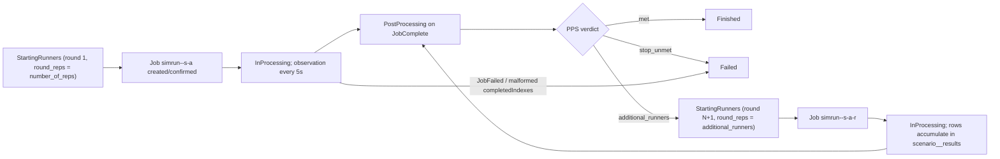

# Simulation Runner (generated)

The Simulation Runner is not a checked-in component: it is a container image the [Translator](translator.md) generates once per (scenario, translation attempt) and the Scenario Manager (SM) runs as one Kubernetes Job per (scenario, attempt, runner round). Each Pod of the Job is one independent simulation repetition: it starts the baked scenario, runs the SimPy model to the horizon, and inserts exactly one JSONB result row into the experiment's Result DB. The runner receives no command, arguments, or environment variables from SM — everything it needs is baked into the image at generation time.

## Image composition

The generated Dockerfile (written by `internal/generator/generator.go` in the Translator) is: `FROM <digest-pinned runner base image>`, `WORKDIR /runner`, `COPY --chown=1000:1000 runner/ /runner/`, `USER 1000:1000`, `ENTRYPOINT ["python3", "/runner/main.py"]`.

The base is the repository-built `runner-base` image ([`component-templates/translator/runner-base/Dockerfile`](https://github.com/D4NS3U/cbse/blob/c993397/component-templates/translator/runner-base/Dockerfile)): locked `PYTHON_BASE_IMAGE` (Python 3.14.6-slim, linux/amd64) with exactly `simpy==4.1.2`, `psycopg==3.3.4`, and the precompiled `psycopg-binary==3.3.4` cp314 manylinux x86_64 wheel, installed through `pip --require-hashes` from the hash-locked [`requirements.lock`](https://github.com/D4NS3U/cbse/blob/c993397/component-templates/translator/runner-base/requirements.lock) (these three entries are the complete dependency closure on CPython 3.14 / linux). The base contains no model, no scenario parameters, no database configuration, and no credentials; Psycopg is the client used to reach the Result DB — there is no PostgreSQL server in the runner image.

The generated `/runner/` directory therefore contains:

| File | Origin |
| --- | --- |
| `main.py`, `model.py`, `seed.py`, `result.py`, `resultdb.py`, `database_endpoint/` (`__init__.py`, `dispatcher.py`, `dns.py`, `ipv4.py`, `ipv6.py`) | copied verbatim from the Translator's embedded `runnermod/` tree (`//go:embed all:runnermod`); `test_*` files and `__pycache__` are excluded from generated images |
| `scenario.json` | written by the generator: `scenario_id`, `parameterset_id`, `arrival_rate`, `service_rate`, `run_duration`, `seed_policy` |
| `resultdb.json` | written by the generator (mode 0600): Result DB `host`, `port`, `dbname`, `user`, `password` |

## File by file

### `main.py` — entrypoint

[`runnermod/main.py`](https://github.com/D4NS3U/cbse/blob/c993397/component-templates/translator/internal/generator/runnermod/main.py):

1. Loads the baked `/runner/scenario.json` and `/runner/resultdb.json`.
2. Gets the Pod hostname with `socket.gethostname()` (from the container runtime — SM provides nothing).
3. Derives the effective seed: `derive_seed(scenario["seed_policy"], hostname)`, then builds a local `random.Random(effective_seed)`.
4. Runs the model: `completed, mean_wait = model.run(arrival_rate, service_rate, run_duration, rng)`.
5. Builds the result record: `result.build_result(scenario, completed, mean_wait, effective_seed)`.
6. Inserts it: `resultdb.insert(scenario["scenario_id"], result_record, db_config)`. Any exception (any database failure) writes to stderr and exits with status 1, failing the Pod — the comment states the intent: "any DB failure must fail the Pod."

### `model.py` — the simulation

[`runnermod/model.py`](https://github.com/D4NS3U/cbse/blob/c993397/component-templates/translator/internal/generator/runnermod/model.py) is a single-server queue built on SimPy:

- A `source` process accumulates interarrival times sampled with `rng.expovariate(arrival_rate)` and spawns a `customer` process at each arrival time `t` while `t < run_duration` (when `t >= run_duration` it stops).
- Each `customer` waits for the single `simpy.Resource(env, capacity=1)`, records `wait = env.now - arrival_time`, samples its service time with `rng.expovariate(service_rate)`, and increments the completed count only if `finish = env.now + service_time <= run_duration`. Customers whose service would finish after the horizon are neither completed nor included in the mean.
- The environment runs until `run_duration`. A non-positive horizon returns `(0, 0.0)` directly because SimPy requires `env.run(until)` to be greater than the current time (0).
- `mean_wait_time` is the arithmetic mean of the wait times of completed customers, and `0.0` when no customer completes.

### `seed.py` — effective seed derivation

[`runnermod/seed.py`](https://github.com/D4NS3U/cbse/blob/c993397/component-templates/translator/internal/generator/runnermod/seed.py) (pure stdlib, no third-party dependencies): `digest = hashlib.sha256("{seed_policy}:{hostname}".encode("utf-8")).digest()`, then `seed = int.from_bytes(digest[:8], "big") & 0x7FFF_FFFF_FFFF_FFFF`.

The effective seed is the first eight bytes of `sha256("<seed_policy>:<hostname>")` interpreted big-endian, masked to a non-negative 63-bit integer suitable for `random.Random`. An empty hostname raises `SystemExit`. The properties are: the same hostname produces a stable seed, and different hostnames produce different seeds — since every Pod of an indexed Job gets its own hostname, the repetitions of one round are mutually independent draws. The smoke suite asserts `effective_seed` is distinct across all repetitions of a round.

### `result.py` — result record construction

[`runnermod/result.py`](https://github.com/D4NS3U/cbse/blob/c993397/component-templates/translator/internal/generator/runnermod/result.py) builds the JSONB record with exactly eight fields, pinned by the `RESULT_FIELDS` tuple: `parameterset_id`, `arrival_rate`, `service_rate`, `run_duration`, `seed_policy`, `effective_seed`, `completed_customers`, `mean_wait_time`. The record deliberately excludes `scenario_id` (the table is the scenario's key) and carries no credentials.

### `resultdb.py` — the result write

[`runnermod/resultdb.py`](https://github.com/D4NS3U/cbse/blob/c993397/component-templates/translator/internal/generator/runnermod/resultdb.py):

- `_connect` supplies a `psycopg.connect(host=..., port=..., user=..., password=..., dbname=..., sslmode="disable", connect_timeout=<remaining seconds>)` callable to the `database_endpoint.dispatcher.dial` shared endpoint contract (10-second shared deadline, candidate addresses in resolver order).
- `insert(scenario_id, result_obj, db_config)` sets the table name `scenario_<scenario_id>_results` and executes, in a **single** psycopg transaction, in order: `SET statement_timeout = 30000`; `SELECT pg_advisory_xact_lock(0, <scenario_id>)`; `CREATE TABLE IF NOT EXISTS scenario_<id>_results (id BIGSERIAL PRIMARY KEY, result JSONB NOT NULL)`; `INSERT INTO scenario_<id>_results (result) VALUES (%s)` with `json.dumps(result_obj)` as the parameter.

- The statement timeout, advisory lock, schema check, and insert share one transaction because psycopg 3 closes the connection when a second `with conn:` transaction block opens after the first commits against PostgreSQL 18.6 — the original two-transaction shape (lock+CREATE, then a separate INSERT) fails with `OperationalError("the connection is closed")`. The `pg_advisory_xact_lock(0, <scenario_id>)` still releases at the single transaction's commit, so concurrent first-use table creation for the same scenario is serialized.
- The runner performs **no inner retry**: a timeout or permission failure exits non-zero via `main.py` and consumes the Pod attempt (the retry budget is the Job's `backoffLimit`, owned by SM).

### `database_endpoint/` — the shared endpoint contract

The Python port of the same contract the Operator probe and the Translator's `internal/databaseendpoint` implement, so all three clients classify, order, de-duplicate, time-bound, and fall back identically:

- `__init__.py` declares `RESOLUTION_DEADLINE_SECONDS = 10.0`.
- `dispatcher.classify_host`: trims and classifies a host as `HOST_DNS`, `HOST_IPV4`, or `HOST_IPV6`; rejects empty, bracketed, zone-scoped (`%`), URL-scheme/path/query/fragment, and embedded-port hosts; rejects IPv4-mapped IPv6 addresses.
- `dispatcher.resolve_addresses`: a literal yields one canonical address (via `ipv4.addresses` / `ipv6.addresses`); a DNS host is resolved anew through `dns.resolve` (process `getaddrinfo` for A and AAAA, resolver order retained, duplicate normalized addresses dropped by first occurrence, empty result is a failure).
- `dispatcher.dial`: dials the candidate addresses in resolver order under a shared 10-second monotonic deadline, passing the remaining time as each connection's `connect_timeout`; the first successful connection owns the dial (`{"conn", "host", "kind"}`) and the connection is not closed by `dial`.

## How it runs as a Kubernetes Job

SM schedules the runner; this section covers only the runner-visible side of that contract (scheduling internals live in [scenario-manager.md](scenario-manager.md)).

### Job creation

SM's runner-start scheduler discovers `scenario_status` rows in `StartingRunners` state (Core DB), and for each scenario validates the live experiment, the persisted runner digest (its normalized repository must equal the live `spec.translator.repository`), the `cbse-registry-auth` Secret (it must resolve credentials for the digest's authority), and the deterministic runner ServiceAccount `simrunner-<12-char-UID-prefix>`. It then builds the effective Job (`scenario-manager/internal/effectivejob/effectivejob.go`) and creates it:

- **Name** (`lifecycle.RunnerJobName`): `simrun-<uid12>-s<scenario-id>-a<attempt>` for round 1 (byte-identical to the pre-round form) and `simrun-<uid12>-s<scenario-id>-a<attempt>-r<round>` for rounds ≥ 2, so every round's Job name never collides with an earlier round's completed Job. The name is stable across SM replicas and restarts.
- **Spec**: `completionMode: Indexed` with `completions = parallelism = round_reps` (the round's requested repetition count, validated 1–100000), a single shared `backoffLimit: 4` across all completion indexes, and the optional `activeDeadlineSeconds` from a custom `spec.runner.jobTemplate`.
- **Ownership and identity**: owner reference to the `SimulationExperiment` (controller: true), and five reserved labels on the Job and Pod under `experiment.cbse.terministic.de/`: `project`, `experiment-uid`, `scenario-id`, `translation-attempt`, `runner-round` (always set, "1" for round 1).
- **Pod contract** (applied to the default template — one container named `runner` with the digest-pinned image — or merged over an Operator-validated custom `spec.runner.jobTemplate`, which must contain exactly one container named `runner`): ServiceAccount `simrunner-<uid12>`, `automountServiceAccountToken: false`, `restartPolicy: Never`, `RuntimeDefault` seccomp, and per container `runAsNonRoot`, `allowPrivilegeEscalation: false`, `capabilities.drop: [ALL]`; `cbse-registry-auth` is always present in `imagePullSecrets`.

A successful `AlreadyExists` at the deterministic name is confirmed by exact ownership verification (a mismatch is a collision and a permanent scenario failure). On success SM applies the guarded `StartingRunners → InProcessing` transition; a lost guard (lifecycle gate closed between create and transition) deletes the just-created Job using the returned UID as the sole precondition.

### Per-Pod execution

Each completion index runs one Pod of the generated image, executing `main.py` in order: load `/runner/scenario.json` + `/runner/resultdb.json`; `hostname = socket.gethostname()` (unique per Pod); `effective_seed = derive_seed(seed_policy, hostname)`; `model.run(...)` to the `run_duration` horizon; `resultdb.insert(scenario_id, record)` (one JSONB row, single transaction); exit 0.

Consequences of the contract:

- One row per Pod: an indexed Job with `completions = N` produces exactly N rows in `scenario_<id>_results` on the no-failure path (the smoke suite asserts `COUNT(*) == number_of_reps`).
- Distinct seeds: each Pod's hostname differs, so the derived `effective_seed` differs across repetitions.
- Any database failure makes the Pod exit 1; Kubernetes replaces failed Pods while the global `backoffLimit: 4` remains, and marks the Job `Failed` when the budget is exhausted — there is no in-runner retry.
- All rounds of a scenario insert into the *same* `scenario_<id>_results` table; rows accumulate across rounds.

### Observation and the per-round lifecycle

SM's observation queue (fixed 5-second discovery interval) GETs the deterministic Job, verifies its ownership identity, and parses `status.completedIndexes` against the valid index range `0..round_reps-1` (a malformed or out-of-range server-owned string fails the scenario):

- `JobFailed` condition → guarded `InProcessing → Failed` transition.
- `JobComplete` condition → the full repetition count is recorded and the guarded `InProcessing → PostProcessing` transition is applied.
- Active/pending → the monotonic partial count is stored (`round_computed_reps` clamped to the round's requested count; `number_of_computed_reps` accumulates only the round's newly completed reps) and the scenario stays `InProcessing` until the next tick.

The round loop around the runner:

- Round 1's `round_reps` is the scenario's intake `number_of_reps`.
- A PPS `additional_runners` verdict claims the next round (`runner_round + 1`, `round_reps` set to the requested additional-runner count, `round_computed_reps` reset to zero) via the guarded `PostProcessing → StartingRunners` transition; the new round's Job carries the `-r<round>` name suffix and a `runner-round` label while writing into the same result table.
- `met` finishes the scenario; `stop_unmet` (the maximum-replications stop criterion) fails it.

Failure semantics end at the Job: a failed Job (budget exhausted) or a permanent startup failure (ownership collision, forbidden, invalid projection) moves the scenario to `Failed`; the runner itself has no recovery path.

## Effective seed derivation (summary)

`effective_seed = int.from_bytes(sha256(f"{seed_policy}:{hostname}")[:8], "big") & 0x7FFF_FFFF_FFFF_FFFF` — a non-negative 63-bit integer, deterministic per (seed policy, hostname), with no third-party dependencies. The `seed_policy` value itself comes from the Translator's Detail DB lookup at generation time; the hostname comes from the Pod at run time. The result record persists the effective seed per row so every repetition is reproducible from its stored seed.

## Related

- [translator.md](translator.md) — how this image is generated, pushed, and verified.
- [scenario-databases.md](scenario-databases.md) — the Result DB layout this runner creates and writes into.
- [scenario-manager.md](scenario-manager.md) — the runner-start and observation schedulers, the Core DB state machine, and Job cleanup.
