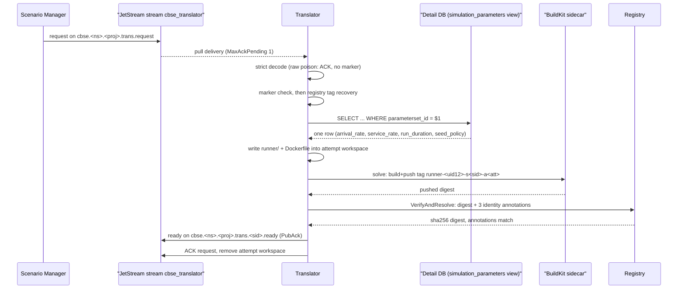

# Translator

The Translator is the reference component that turns one scenario translation request from the Scenario Manager into a pushed, digest-verified simulation runner image. It is a standalone Go module (`github.com/D4NS3U/cbse/component-templates/translator`, source root [`component-templates/translator/`](https://github.com/D4NS3U/cbse/blob/c993397/component-templates/translator/)) built with `GOWORK=off` against its own `go.mod`, because its `moby/buildkit` and Docker dependencies require newer `k8s.io/*` modules than the Experiment Operator's controller-runtime workspace.

The module is split into a **framework** and a **replaceable generator**:

- The framework (`internal/translator`, `internal/messaging`, `internal/workspace`, `internal/buildkit`, `internal/registry`, `internal/config`) owns request consumption, the BuildKit build+push seam, registry verification, ready publication, and acknowledgement.
- The generator (`internal/generator`) owns only model-specific decisions: validating `recipe_info`, performing the predefined Scenario Detail Database parameter lookup, and writing a complete Docker build context into the attempt workspace. A replacement generator may swap `internal/generator` without touching the handoff protocol, provided it preserves the `generator.Generator` interface and the dependency direction (a generator never consumes NATS messages, calls BuildKit, pushes images, publishes ready messages, or acknowledges deliveries).

The reference generator is `ExampleGenerator`, a small parameterizable SimPy single-server queue whose parameters are looked up from the Scenario Detail Database by a positive integer `parameterset_id` carried in `recipe_info`. See [simulation-runner.md](simulation-runner.md) for what the generated image runs and [scenario-databases.md](scenario-databases.md) for the Detail DB schema the lookup reads.

## Translation pipeline

The sequence in `Translator.handle` (`internal/translator/translator.go`) for one delivery of a request with usable identity:

1. **Retained marker**: if `ready-outcome.json` exists in the attempt workspace and validates against the current (UID, scenario, attempt, ready subject), the exact ready message is republished from the marker without regeneration. An invalid retained marker is discarded and the build input removed.
2. **Registry tag recovery**: if no marker exists, the deterministic tag `<repository>:runner-<uid12>-s<scenario-id>-a<attempt>` is resolved through `registry.VerifyAndResolve`. A resolved, annotation-verified tag becomes a success marker (the "success-marker-loss" path). A clean `ErrNotFound` proceeds to generation; any other resolution failure is a confirmed empty-image outcome with failure class `digest_resolution`.
3. **Generate**: the stale `runner/` directory and `Dockerfile` are removed, then `Generator.Generate` runs under the in-progress-ack loop.
4. **Build and push**: the attempt directory is submitted as both Dockerfile and build context to BuildKit, pushed to the deterministic tag with the framework-owned OCI manifest annotations.
5. **Verify**: the tag is resolved over the registry HTTP API and the normalized repository plus all three identity annotations must exactly match the current request.
6. **Finish**: the success marker is written, the ready message (digest reference `<repository>@sha256:...`) is published with JetStream confirmation *before* the request is acknowledged, and the attempt workspace is removed.

## NATS request/publish surface

The framework connects to NATS with **no credentials** (no username, password, token, NKey, JWT, or credentials file; `NATS_URL` must not contain user information) under the client name `cbse-translator-<experiment-UID>`. In the Operator deployment the injected values are `NATS_URL=nats://sm-eds-nats:4222` and stream `cbse_translator` (constants in the Operator's `internal/controller/workload.go`).

**Request subject**: `cbse.<namespace>.<project>.trans.request`. The `internal/subject` package ports the alpha4 subject grammar: `cbse.` prefix plus exactly four tokens, the third fixed to `trans`, the fourth to `request`; `<namespace>` and `<project>` are each a single lowercase DNS label (1–63 chars, `^[a-z0-9]([-a-z0-9]*[a-z0-9])?$`, no normalization).

**Consumer**: a UID-specific durable pull consumer, configuration in `internal/messaging/messaging.go`:

- durable name `translator-<12-char-UID-prefix>` (UID prefix = first 12 lowercase hex chars of the experiment UID after hyphen removal, `imageref.UIDPrefix`), and `TRANSLATOR_CONSUMER` must equal it
- filter subject: the exact request subject
- `DeliverAll`, explicit ACK, `AckWait` 2 minutes, `MaxAckPending` 1 (one request in flight), `MaxDeliver` -1 (unlimited redelivery)
- four ownership metadata entries under `experiment.cbse.terministic.de/`: `managed-by=translator`, `experiment-uid`, `namespace`, `project`

An existing durable with the same name but mismatched settings or metadata is an **identity collision** (`messaging.ErrOwnershipCollision`): the framework rejects it without deleting, updating, or adopting it.

**Request payload** (`internal/wire/wire.go`), decoded strictly (unknown fields and trailing JSON tokens rejected): `"id"` (positive int), `"translation_attempt"` (positive int), `"recipe_info"` (object), `"confidence_metric"` (number or null) — e.g. `{"id": 12, "translation_attempt": 1, "recipe_info": {"parameterset_id": 7}, "confidence_metric": null}`.

A request that fails strict decoding or carries a non-positive `id` or `translation_attempt` has no usable attempt identity and is **raw poison**: the framework ACKs it without creating an outcome marker or publishing a ready message. A request with usable identity but a bad `recipe_info` is instead a generator-input failure handled through the empty-image workflow.

**Ready subject**: derived per scenario as `cbse.<namespace>.<project>.trans.<scenario-id>.ready`; the framework accepts only the canonical template `cbse.{namespace}.{project}.trans.{scenario_id}.ready` at startup so it can never publish outside the injected namespace or project.

**Ready payload** (two fields, always published with PubAck before the request ACK): `{"translation_attempt": <positive int>, "container_image": "<repository>@sha256:..."}`.

On an empty-image failure the `container_image` is the empty string; the empty image is only ever published after an empty-failure outcome marker. During long operations the framework sends 30-second in-progress acknowledgements (`messaging.InProgressInterval`) so the server does not redeliver under the two-minute `AckWait`; a failed in-progress acknowledgement cancels the operation and leaves the request unacknowledged. NATS transport or ready-publication failures leave the request unacknowledged and retryable; they never manufacture an empty result.

## Per-attempt workspace and outcome marker

The framework owns a pod-local workspace rooted at `/workspace` (`internal/workspace/workspace.go`). Each attempt lives at `/workspace/scenario-<scenario-id>/attempt-<translation-attempt>/` containing:

- `runner/` — the generated build context (Python modules + `scenario.json` + `resultdb.json`),
- `Dockerfile` — generated: `FROM <baseimage digest>`, `COPY runner/`, `USER 1000:1000`, the model entrypoint,
- `ready-outcome.json` — the single credential-free durable outcome marker.

`ready-outcome.json` (`workspace.Marker`) contains `outcome` (`success` | `empty_failure`), `scenario_id`, `translation_attempt`, `ready_subject`, and the full `experiment_uid`. A success additionally carries the deterministic `tag` and `digest`; an empty failure carries `empty_image: true` and a short non-sensitive `failure_class` (`generator`, `build`, or `digest_resolution`). The file is written to `.ready-outcome.json.tmp` in the same directory and renamed over the marker, so a crash never leaves a partial marker. A valid marker is authoritative for its attempt: it is what makes the marker-reuse path skip regeneration entirely. The attempt workspace is retained until ready publication and server-confirmed ACK both succeed, then removed.

## Generator: recipe validation and Detail DB lookup

`ExampleGenerator.Generate` (`internal/generator/generator.go`) receives `GenerationInput` (scenario ID, translation attempt, raw `recipe_info`, `confidence_metric`, digest-pinned `BaseImage`, the attempt workspace path, and the `DetailDatabase` and `ResultDatabase` `dbconfig.DatabaseConfig` values). It:

1. **Validates the recipe** (`ValidateRecipe`): `recipe_info` must be exactly one JSON object containing exactly one field, `parameterset_id`, a positive integer — missing, null, malformed, a non-object, an extra field, or a non-positive value is a permanent `RecipeError`.
2. **Looks up the parameters** through `detaildb.Lookup` against the Scenario Detail Database (never baking Detail DB credentials into the image).
3. **Writes the build context** into `runner/`: the embedded runner modules, `scenario.json`, `resultdb.json`, and the top-level `Dockerfile`.

### detaildb lookup contract

`internal/detaildb/detaildb.go` owns the single schema-qualified parameterized statement, depending on no `search_path`: `SELECT arrival_rate, service_rate, run_duration, seed_policy FROM public.simulation_parameters WHERE parameterset_id = $1`.

- **Statement timeout**: `SET statement_timeout = '30000'` is executed before the query. There is no per-attempt connect timeout: the shared 10-second endpoint-contract deadline (applied by `databaseendpoint.DialConn` through the context) bounds resolution and all candidate connection attempts together.
- **Cardinality and values**: the lookup requires exactly one row (zero or multiple rows are permanent failures) and defensively re-checks the table constraints: `arrival_rate`, `service_rate`, `run_duration` must be `> 0`, `seed_policy` must be `>= 0`. A NULL or non-integer scan is a permanent result failure.
- **One delayed retry**: on a first *transient* failure the lookup waits exactly 30 seconds (cancellable by context) and repeats the whole connect+query once; a second failure is permanent. Transience is classified by SQLSTATE: connection-exception class `08`, transaction-rollback `40`, insufficient-resource `53`, and `57P01`/`57P02`/`57P03` are transient, as is any network-level error with no SQLSTATE (refusal, timeout, DNS failure). Authentication (`28`), insufficient privilege (`42501`), schema errors (`42xxx`), and all other server errors are permanent. `context.Canceled`/`DeadlineExceeded` are not transient; they propagate as cancellation (no empty-failure outcome).

The real connector (`internal/detaildb/pgx_connector.go`) is pgx v5: it builds the config from a keyword/value DSN with separate host/port fields and `sslmode=disable` (no `postgresql://` URI string concatenation), sets the password on the parsed config afterward, and must use `pgx.ParseConfig` (hand-constructed `ConnConfig` literals make `pgx.Connect` panic). The dial itself goes through the shared `databaseendpoint` contract (below).

### databaseendpoint contract

`internal/databaseendpoint/databaseendpoint.go` is the Translator-side copy of the common database endpoint contract, shared verbatim with the Experiment Operator availability probe and the generated runner's Python `database_endpoint` package so all three clients classify, order, de-duplicate, time-bound, and fall back identically:

- **Classify**: a host is trimmed and classified as an IPv4 literal, an IPv6 literal (zone-scoped `%`, bracketed forms, and IPv4-mapped addresses are rejected), or a lowercase RFC 1123 DNS subdomain (≤ 253 chars; URL scheme/path/query/fragment characters, embedded ports, and empty values are rejected).
- **Resolve**: literals yield one canonical address without DNS; DNS hosts are resolved through A and AAAA records, retaining resolver order and de-duplicating by first occurrence; an empty result or resolver error is a resolution failure.
- **Dial**: candidate addresses are tried in resolver order under a **shared 10-second deadline** covering resolution and every connection attempt; the first successful connection owns the dial and remaining addresses are not contacted. `Dial`/`DialConn` never close the connection — the caller owns its lifecycle.

## Generated build context

`internal/generator/embed.go` embeds the `runnermod/` tree (`//go:embed all:runnermod`) and `writeEmbeddedRunner` copies it into `runner/`, skipping `test_*` files and `__pycache__` so they never ship in a generated image. The generator additionally writes:

- **`runner/scenario.json`** (0644): the scenario identity and looked-up parameters — `scenario_id`, `parameterset_id`, `arrival_rate`, `service_rate`, `run_duration`, `seed_policy`. These are baked parameters, not credentials.
- **`runner/resultdb.json`** (0600): the Result DB connection — `host`, `port`, `dbname`, `user`, `password`. This is the documented trusted-prototype assumption that a generated image contains Result DB credentials; the framework never prints or annotates these values.
- **`Dockerfile`**: `FROM <digest-pinned BaseImage>`, `WORKDIR /runner`, `COPY --chown=1000:1000 runner/ /runner/`, `USER 1000:1000`, `ENTRYPOINT ["python3", "/runner/main.py"]`. It copies only the generated files and baked Result DB configuration and does not reinstall dependencies, which the runner base image already carries.

The generated image is described in [simulation-runner.md](simulation-runner.md).

## Build, push, and registry verification

The framework talks to a rootless BuildKit sidecar over `unix:///run/buildkit/buildkitd.sock` (`buildkit.BuildkitAddress`). Before creating or attaching its JetStream consumer it opens an **admission gate**: `ListWorkers` must report at least one worker, retried on the canonical schedule 250 ms, 500 ms, 1 s, then every 2 s, honoring shutdown cancellation. Until the gate opens the framework creates no consumer, accepts no delivery, writes no marker, and consumes no attempt; a BuildKit failure that occurs only after a request was accepted follows the ordinary empty-image workflow.

The push uses:

- **Tag** (`imageref.Tag`): `<repository>:runner-<uidPrefix>-s<scenarioID>-a<attempt>`, where `<repository>` is `REPOSITORY` (validated at startup to carry no tag, no digest, and no `:` outside the registry host component).
- **OCI manifest annotations** (framework-owned, credential-free, added by the BuildKit image exporter): `experiment.cbse.terministic.de/experiment-uid`, `.../scenario-id`, `.../translation-attempt`.

After the push, `internal/registry/registry.go` resolves the tag over the distribution HTTP API (HTTPS for all hosts except loopback, which may use plain HTTP; 401 challenges are answered with Bearer token exchange or Basic auth from the mounted Docker configuration). It verifies the normalized repository equals the configured repository and all three annotations exactly match the request, then returns the digest from `Docker-Content-Digest` (falling back to the SHA-256 of the manifest body). The ready message carries only the digest reference `imageref.DigestRef` (`<repository>@<digest>`).

## sqldoc lockstep

`internal/sqldoc/sqldoc_test.go` is the lockstep guard between the Translator's reference lookup and the repository-owned Detail DB seed. The package contains only the test (no production Go file). It reads [`component-templates/scenario-detail-database/10-simulation-parameters.sql`](https://github.com/D4NS3U/cbse/blob/c993397/component-templates/scenario-detail-database/10-simulation-parameters.sql) (path resolved relative to the package directory) and asserts:

- the four per-parameter entry tables (`arrival_rate`, `service_rate`, `run_duration`, `seed_policy`) verbatim, with their `id`/`value` columns and `CHECK` constraints;
- the `recipes` locator table with `parameterset_id` primary key and one foreign key per parameter;
- the `simulation_parameters` view with the exact legacy projection columns (`r.parameterset_id`, `a.value AS arrival_rate`, `s.value AS service_rate`, `d.value AS run_duration`, `p.value AS seed_policy`) and the four join lines;
- the explicit grants (the Translator's `SELECT` on the view and the EDS user's write access on the entry and `recipes` tables);
- exactly one baseline `INSERT` block per table, every row id in 1–4, and no EDS row (id ≥ 5) seeded.

The test skips when the reference SQL file is absent; when present, seed/contract drift fails `make test-fast` (which runs `GOWORK=off go vet ./...` and `GOWORK=off go test -race ./...` inside the module). The `internal/generator/conformance_test.go` file separately runs the embedded Python runner test suites (`database_endpoint.test_dispatcher`, `test_seed`, `test_result`, `test_resultdb`, `test_model`) against the shipped `embed.FS` modules and guards that `database_endpoint/__init__.py` still declares `RESOLUTION_DEADLINE_SECONDS = 10.0`.

## Configuration

`internal/config/config.go` loads and validates everything at startup, before any NATS connection. It accepts no NATS credentials and does not watch, reload, or rotate anything after startup.

| Variable | Validation |
| --- | --- |
| `NATS_URL` | valid URL with a host, no user information |
| `TRANSLATOR_STREAM` | JetStream name; no whitespace or `*`/`>` wildcard characters |
| `TRANSLATOR_REQUEST_SUBJECT` | exact `cbse.<ns>.<proj>.trans.request` grammar; ns/proj extracted and cross-checked against the env identifiers |
| `TRANSLATOR_READY_SUBJECT_TEMPLATE` | must equal `cbse.{namespace}.{project}.trans.{scenario_id}.ready` exactly |
| `TRANSLATOR_CONSUMER` | must equal `translator-<12-char-UID-prefix>` derived from `SIMULATIONEXPERIMENTUID` |
| `SIMULATIONPROJECTNAMESPACE` / `SIMULATIONPROJECTNAME` | lowercase DNS labels, must match the request subject tokens |
| `SIMULATIONEXPERIMENTUID` | 8-4-4-4-12 lowercase hex |
| `REPOSITORY` | no tag, no digest, no whitespace |
| `BASEIMAGE` | must end in `@sha256:<64 hex>` |

Mounted Secrets (defaults in `config.Mounts`):

| Path | Contents |
| --- | --- |
| `/detaildb-connection` | `host`, `port`, `dbname`, `user`, `password` files (Detail DB) |
| `/resultdb-connection` | `host`, `port`, `dbname`, `user`, `password` files (Result DB) |
| `/registry-auth/config.json` | Docker `config.json` that must carry basic credentials for **both** the base-image authority and the target-repository authority |

Both database Secrets are parsed into `dbconfig.DatabaseConfig` (all five fields non-empty, port 1–65535); the framework always connects with `sslmode=disable` — the Secrets carry no `sslmode` field.

## Images produced from the template

`test/harness/build-images.sh` builds two distinct images from this template, both referenced by immutable digest in `images.env`:

| Image | Dockerfile | Locked build arg | `images.env` output |
| --- | --- | --- | --- |
| Translator runtime | `Dockerfile` | `TRANSLATOR_GO_BUILDER_IMAGE` | `TRANS_IMAGE=${CBSE_REGISTRY}/translator@sha256:<64hex>` |
| Runner base | `runner-base/Dockerfile` | `PYTHON_BASE_IMAGE` | `RUNNER_BASE_IMAGE=${CBSE_REGISTRY}/runner-base@sha256:<64hex>` |

- The **Translator runtime** compiles `./cmd/translator` with `CGO_ENABLED=0`, `GOOS=linux`, `GOARCH=amd64`, `-trimpath`, and stripped symbol/build-ID linker flags into a `scratch` final stage containing only the static binary and the Debian CA bundle (needed for HTTPS registry verification); it runs as numeric `USER 1000:1000`. It contains no Python, no SimPy, and no credentials.
- The **runner base** installs exactly `simpy==4.1.2`, `psycopg==3.3.4`, and `psycopg-binary==3.3.4` from the hash-locked `runner-base/requirements.lock` via `pip --require-hashes`, imports both packages and asserts the exact versions in the build, then sets `WORKDIR /runner` and `USER 1000:1000`. It contains no model, no scenario parameters, and no database configuration. Generated runner images inherit these packages and add only the generated files.

`RUNNER_BASE_IMAGE` becomes `spec.translator.baseimage` and `TRANS_IMAGE` becomes `spec.translator.image` in the `SimulationExperiment` CR. The two locked build inputs live in `test/e2e/images.lock.env` and are validated by `test/harness/image-lock.sh` before any build.

## Related

- [simulation-runner.md](simulation-runner.md) — the generated runner image as a component, and its Kubernetes Job execution.
- [scenario-databases.md](scenario-databases.md) — the Detail DB schema and the Result DB layout the Translator reads and bakes.
- [scenario-manager.md](scenario-manager.md) — the requester (translation requests) and consumer (ready messages) of the Translator's NATS surface.
